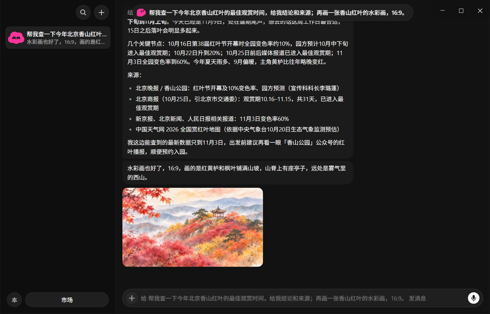
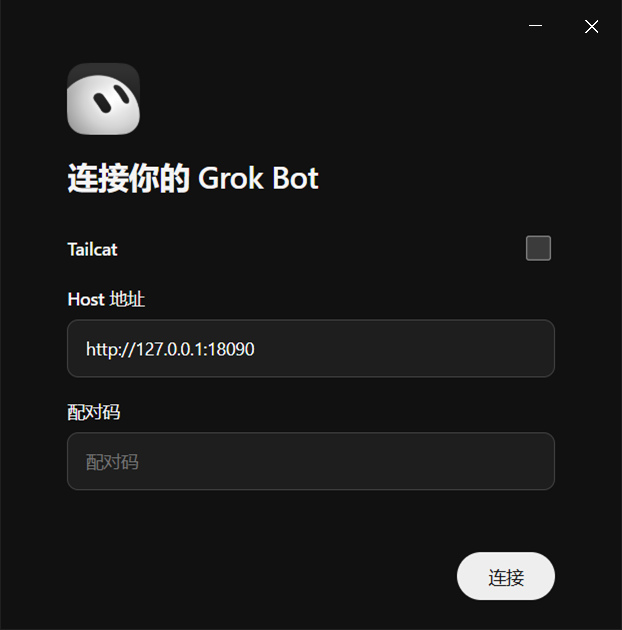
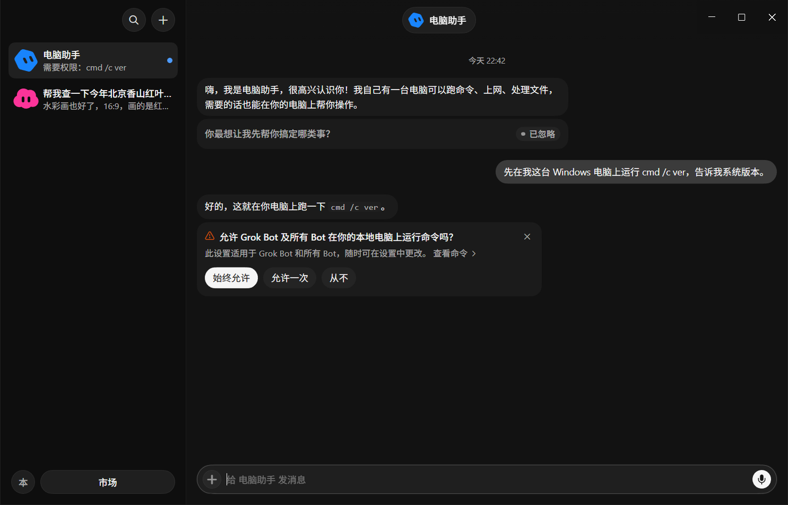
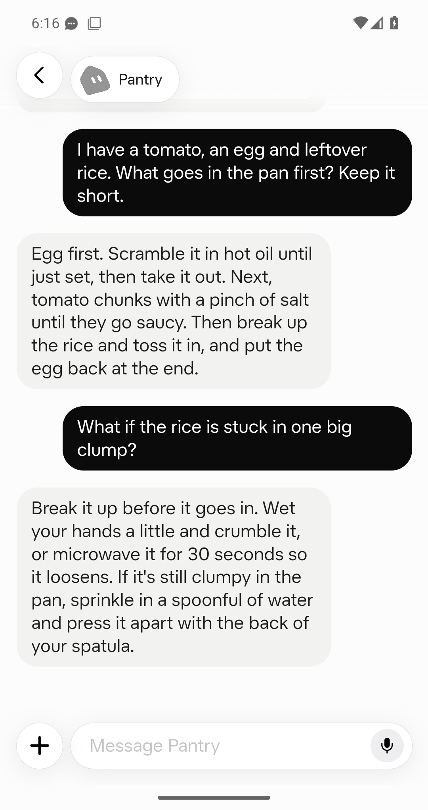
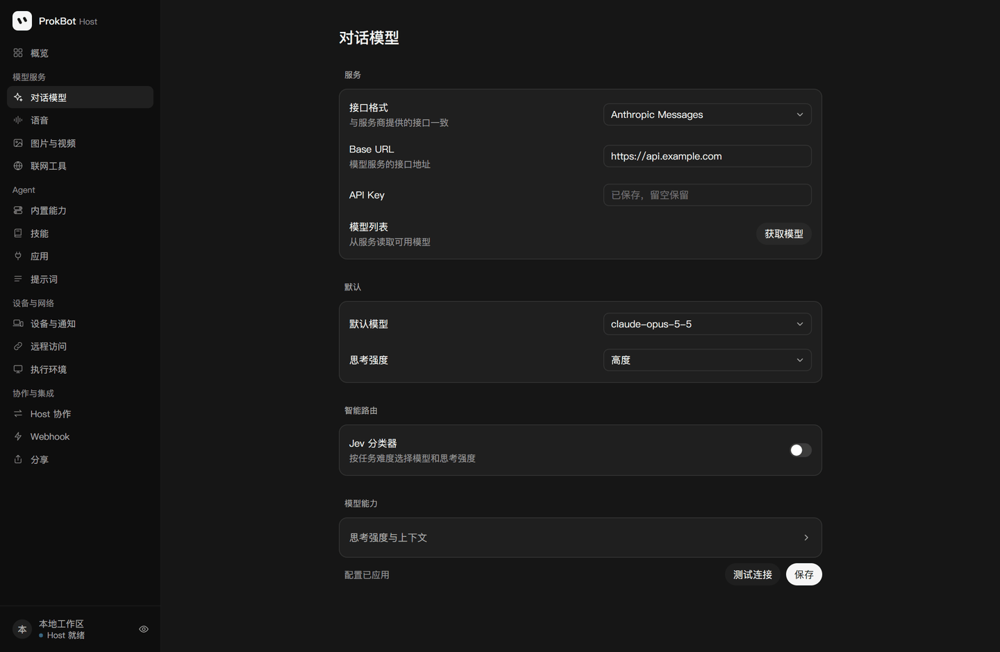
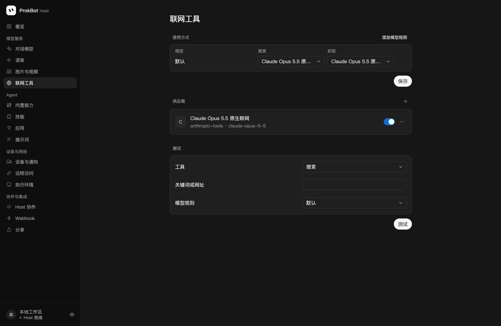
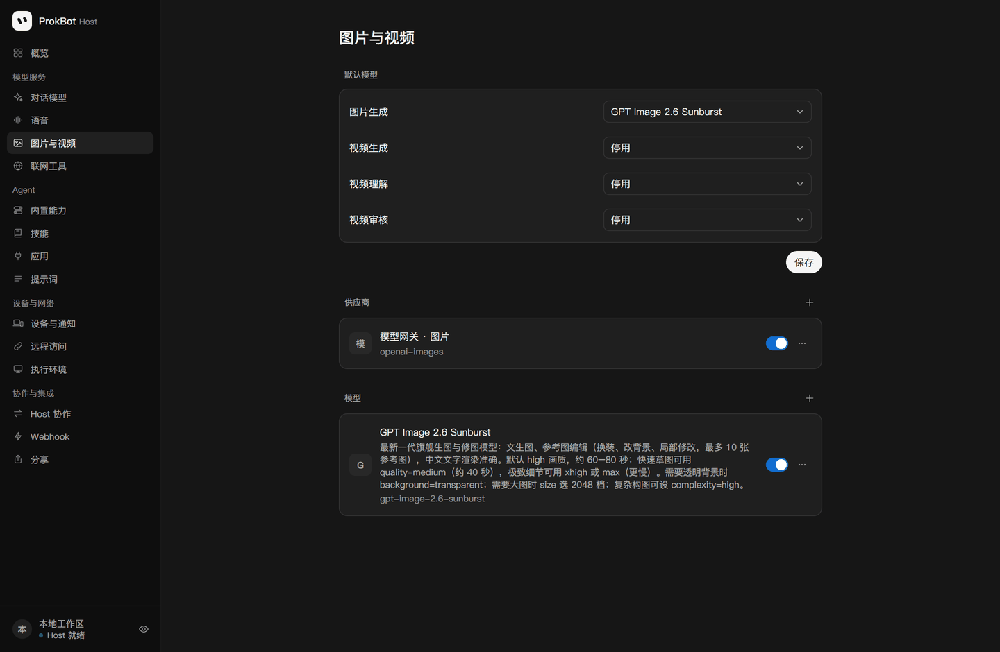

<div align="center">

# ProkBot Plus

**Move the Grok Bot server side onto your own server, and connect your own models.**

Windows, macOS and iOS patches | [Independently developed Android app (unofficial)](#android-client) | Linux server | OpenAI Chat / OpenAI Responses / Anthropic Messages

<p>
  
  
  
  
  
  
  <a href="https://linux.do"></a>
</p>

[简体中文](README.md) · **English**

</div>

<p align="center">
  
</p>
<p align="center"><sub>The Windows client. One message gets the Bot to look something up, cite its sources, and draw a picture on the side. The model, web access and image generation all go through your own APIs.</sub></p>
<p align="center"><sub>The screenshots show the Chinese UI; the apps also support English.</sub></p>

ProkBot Plus is a modified version of the open-source project [ProkBot](https://gitee.com/ahaduoduoduo/ProkBot). The idea behind ProkBot: the original Grok Bot apps and Agent work well, but they can only connect to the official cloud. ProkBot runs the server side (the Host and the Linux desktop used for execution) in Docker on your own machine, then patches the original apps so they connect to your server.

Plus adds on top of that: **Windows and Android clients**; **two more model APIs, Anthropic Messages and OpenAI Responses** (upstream supports only OpenAI Chat); and a set of fixes that make web search, image generation and local commands work smoothly in real use.

> This is an unofficial project. It has no connection to xAI or the official Grok Bot. Noncommercial use only. See [License and notices](#license-and-notices).

## What it does

- **Use the original Grok Bot.** The interface, Agent, tool calls, memory, scheduled tasks and action approvals are all the original ones. Only the server side is now in your hands.
- **Connect any model that supports tool calls.** Claude, GPT, DeepSeek, Grok, or any aggregator gateway. Pick any of the three API formats, and set thinking effort anywhere from `none` to `max`. You can also let the Jev classifier pick the model by task difficulty.
- **Let the Bot work on its own computer.** The server comes with a Linux desktop. The Bot runs commands, opens a browser and handles files on it.
- **Let the Bot operate your computer.** On Mac it can run commands and control the graphical interface. On Windows it can run local commands, and it asks you in a pop-up before each one.
- **Web access and image generation.** Search and read web pages with the model's built-in web tools. Generate images with an OpenAI-compatible image API, with support for set aspect ratios and editing from a reference image.
- **Your data stays on your machine.** Chats, files, memory and Bot data are all stored on your server. Telemetry and automatic updates are turned off.
- **Use it on your phone.** iOS and Android clients: get notified when a Bot replies, watch the Bot's computer live and take over.
- **Use it when you're out.** Direct LAN connection, built-in Tailcat networking (no public IP needed), or your own HTTPS domain.

## Supported systems

| Part | Supported | Notes |
| --- | --- | --- |
| Server | Linux x86_64 or ARM64 (Docker) | x86_64 tested on Ubuntu 24.04 + Docker 29. ARM64 builds a native Host; run the desktop on a separate amd64 node or emulate it locally (experimental). [Choose a deployment](docs/AI-INSTALL.en.md#choose-a-deployment) |
| Windows client | Windows 10 / 11, x64 | **New in this version.** Portable version and installer, no administrator rights needed |
| Mac client | Apple Silicon, Grok Bot 0.71.2 | From upstream |
| iOS client | Grok Bot 1.16.0 (23152) | From upstream. You need your own decrypted IPA and signing certificate |
| Android client | Android 9 or later | **New in this version.** An APK built from the official desktop interface and this project's shell, on a Windows, Mac or Linux computer |
| Linux desktop | Not supported | There is no official client for it |

## What's new in this version

### Windows client

<table>
  <tr>
    <td width="36%"></td>
    <td></td>
  </tr>
  <tr>
    <td><sub>On first launch, enter the Host address and the 6-character pairing code.</sub></td>
    <td><sub>When the Bot wants to run a command on your computer, it asks you first.</sub></td>
  </tr>
</table>

Upstream has only Mac and iOS. The Windows version is built by patching the official 0.71.2 Windows installer, and its interface matches the official Windows version:

- Stays in the system tray, system notifications, attachments, Tailcat;
- Local command execution (PowerShell, Chinese output is not garbled);
- Hands complex coding work to Codex on your computer;
- Builds both a portable version and an installer.

The patches are ported from the Mac version, and the structure of every segment is checked.

### Android client

**ProkBot Plus develops this Android app independently. It is neither the official xAI Android app nor a patch to the official Android APK.**

<p align="center">
  
</p>
<p align="center"><sub>Captured on an Android 15 emulator. Both questions were sent in the app; the model connected to the self-hosted Host generated both replies.</sub></p>

The official Android app carries tamper protection and cannot be modified. Plus takes another route: it puts the official **desktop** interface (the same one as the Windows and Mac clients, taken from your own download of the official Windows installer) into an Android shell written for this project, and builds an APK:

- Conversations, Bot management, skills, the library, routines and settings are the original interface, rearranged after the official phone app: the Bot list and a conversation are separate screens with the same round floating buttons, message bubbles, colors and typeface, details, settings and search open full screen, and menus and dialogs slide up from the bottom; with the back gesture and dark mode;
- Watch the Bot's computer live on the phone, and operate it with touch and the on-screen keyboard after "Take control";
- Upload files from the phone, and save files the Bot sends to the phone;
- Background notifications without Google's push service; tapping one opens that Bot;
- The device credential is encrypted with the Android Keystore and never reaches the web page.

The APK is signed with a key that belongs only to you. Tailcat is not supported; for access from outside, use a VPN, a tunnel or an HTTPS domain. See [Android client](android/README.en.md).

### Three model APIs

<p align="center"></p>

Upstream supports only OpenAI Chat Completions. Plus adds **Anthropic Messages** and **OpenAI Responses**. All three formats are fully supported: images, files, tool calls, thinking effort, and reasoning carried across turns.

- Switching models or formats in the middle of a conversation doesn't cause errors.
- When a provider doesn't support an optional parameter, it is removed and the request is retried automatically.
- Automatic safety review also works with all three formats.

### Web access and image generation

<table>
  <tr>
    <td></td>
    <td></td>
  </tr>
</table>

Upstream already connected the original web and image tools, but they had quite a few problems with newer models. Plus fixes these:

- Newer Claude models don't accept forced tool calls, so web access failed outright → it now switches to a regular tool call automatically;
- In a parallel search, if one search went over its usage limit, the whole search was marked as failed → now the result is used as long as one search succeeds;
- When the Bot asked to "draw a 16:9 image", the OpenAI image API returned an error → the ratio is now converted to the matching size automatically;
- Editing with a reference image returned an error → it now goes through the image edit endpoint.

### Other fixes

- **Message order.** The original Bot splits a reply into several short messages. In the upstream implementation, these messages could arrive out of order, with the short ones first. Now they are delivered strictly in the order the model wrote them.
- **Automatic review.** When the model sometimes answered in the wrong format, the action used to be rejected right away, with nothing in the log. Now it retries once, and failures are logged.
- **Linux deployment.** Docker 29 uses the containerd image store by default, which broke the upstream build script. This is now supported.
- **Command-line management.** New `host/tools/host-admin.mjs` lets you set up the Host, configure models and create pairing codes without opening the web page. This makes things easier for scripts and AI.
- **Docs.** A new [AI deployment guide](docs/AI-INSTALL.en.md) that even an average model can follow.

See the [CHANGELOG](CHANGELOG.md) and the [technical documentation](docs/ARCHITECTURE.en.md) for all changes.

## Compared with the official Grok Bot

**Benefits**

- Use the models and providers you choose. Costs are billed through your own API, and you can also use relays or aggregator gateways.
- Chats, files and memory are all on your own server, with no telemetry.
- Works where the official service isn't available. You can also use it only on your LAN.
- Some things the official version doesn't have:
  - Edit the system prompt, and restore the original at any time;
  - Set the context length per model;
  - Usage statistics;
  - Tasks triggered by webhooks;
  - Write your own apps (plugins);
  - Bot collaboration across several Hosts;
  - Full-machine backup and restore.

**Trade-offs**

- You need a Linux server (at least 8 GB of memory and 30 GB of disk), and you handle upgrades and backups yourself.
- Versions are pinned: client 0.71.2, iOS 1.16.0, Host `d0a4baa`. When the official apps update, you have to wait for the patches to catch up before upgrading, and there are no automatic updates.
- Results depend on the model you choose. The official service is tuned for its own models. With other models, the experience may not be as good.
- Some official features are turned off or replaced:
  - Turned off: virtual cards, external message drafts, product feedback, passkey forwarding;
  - Replaced: voice, push notifications, image and video generation and others, which need providers you set up yourself;
  - Real-time calls are experimental for now.
- The clients are not code-signed: Windows shows a SmartScreen warning on first launch; on iOS you sign and install the app yourself; on Android you allow installing apps from unknown sources.
- The Windows version can't yet let the Bot control the mouse and keyboard. The original component for this only exists for macOS.
- The Android version does not support Tailcat. Background notifications rely on a connection that stays open; some phones need the app allowed to run in the background in the system settings.
- Modifying the official client may break the official terms of use. Use at your own risk.

## What you need to deploy

| Required | Requirements |
| --- | --- |
| Server | 64-bit Linux, Docker Compose v2 and Python 3.10+. For a local desktop allow at least 8 GB RAM, 30 GB free disk and about 8 GB of initial downloads. A local ARM desktop also needs QEMU/binfmt |
| Model API | Any one of: Anthropic Messages, OpenAI Responses, OpenAI Chat Completions. It must support tool calls. For the Bot to operate a computer, it also needs image input |
| Computer to build the clients | Build the Windows client on Windows 10/11 x64 and the Mac client on an Apple Silicon Mac; the Android client builds on Windows, Mac or Linux. All need Node.js 22.12+. iOS needs a decrypted IPA and a signing certificate |

| Optional | Used for |
| --- | --- |
| A model with native web access | The Bot searches and reads web pages (for example Claude's `web_search`) |
| An OpenAI-compatible image API | The Bot generates and edits images |
| Bark or an Apple push certificate | Push notifications on iPhone (not needed for Android) |
| Speech recognition and synthesis services | Voice input, real-time calls |
| A domain and HTTPS | Access from outside without Tailcat |

## Install

The easiest way is to hand it to an AI that can run commands (Claude Code, Codex, Cursor and similar tools all work). Send it this:

```text
Please deploy ProkBot Plus for me: https://github.com/ferretgeek/prokbot-plus
First read docs/AI-INSTALL.en.md in the repository in full, then follow its steps exactly.
Ask about my machines, any existing instance, model and access method. Run doctor first. Never remove volumes, disclose keys or treat container startup as acceptance. Verify a two-turn client chat and a desktop action at the end.
```

The AI first lists what you need to prepare. Then it deploys the server, configures the model, builds the clients step by step, and checks the result at the end.

If you'd rather do it yourself, follow the [AI deployment guide](docs/AI-INSTALL.en.md). It is written for AI, but every step lists the commands and how to check them, so a person can follow it just as well.

[Releases](https://github.com/ferretgeek/prokbot-plus/releases) distributes platform-specific patch tools. `v1.0.0` predates the Android tools; build Android from this repository using the [Android guide](android/README.en.md). Releases do **not** distribute finished clients containing official program files.

## Documentation

| Document | Contents |
| --- | --- |
| [AI deployment guide](docs/AI-INSTALL.en.md) | Full steps for deploying from scratch. Every step says what you should see and what to do if it fails |
| [Technical documentation](docs/ARCHITECTURE.en.md) | How it works, how each feature is implemented, what Plus changed, the layout, tests, extension points and known limitations |
| [Windows client](windows/README.en.md) · [Mac client](mac/README.en.md) · [iOS client](ios/README.en.md) · [Android client](android/README.en.md) | How to use the patches for each platform |
| [Split deployment, backups and app development](host/README.en.md) | Advanced usage |

## Friends

- [LINUX DO](https://linux.do): a Chinese tech community where ProkBot Plus is discussed and released. Questions and ideas are welcome there.

## License and notices

- This project is derived from [ProkBot](https://gitee.com/ahaduoduoduo/ProkBot) (based on its 2026-11-05 version, commit `3e9fe8c`) and keeps its [ProkBot Noncommercial License 1.0](LICENSE).
  - You may use, study, modify and distribute it for personal and noncommercial purposes;
  - You may not use it for any commercial purpose, including paid deployments, paid services and internal use in a company.
  - See [NOTICE](NOTICE) for the source and the list of changes.
- The repository contains no official Grok Bot programs or finished client APKs or IPAs. `android/dist/` contains only the independently developed empty shell. The desktop interface comes from your own verified Windows installer.
- Grok, Grok Bot and related trademarks belong to their respective owners. This project is not affiliated with or endorsed by them.
- Most of the code in this project was written with AI assistance. It is provided as is, without any warranty.
- To report a security issue, see [SECURITY.md](SECURITY.md). To contribute, see [CONTRIBUTING.md](CONTRIBUTING.md).
