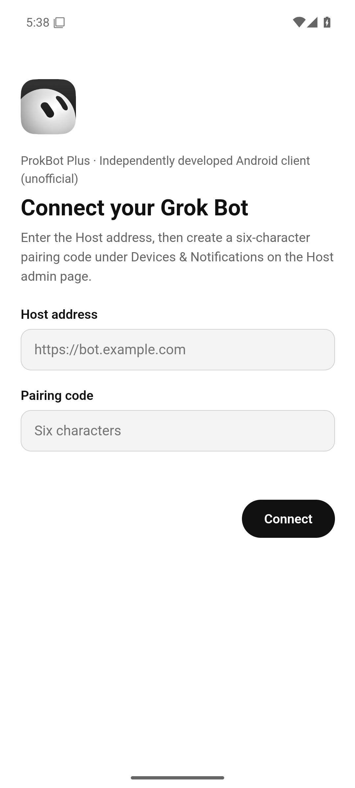

# ProkBot Plus Android Client

Builds, on your computer, an Android Grok Bot that connects to your own Host. The phone needs Android 9 or later (API 28+). The build machine can run Windows, macOS or Linux and needs Node.js 22.12+ and the full repository (code in `mac/` and `windows/` is shared).

See the [AI installation guide](../docs/AI-INSTALL.en.md#94-android-phone) for the full deployment and the [technical documentation](../docs/ARCHITECTURE.en.md#android-client) for how it works.

[简体中文](README.md)

## Why not patch the official Android app

The official Android app (`ai.x.grok.bot` 1.16.0) carries Google Play tamper protection and stops working once modified; circumventing that protection is out of scope for this project. The Android client is built differently instead:

- The interface is the official **desktop** interface, the same one as in the Windows and Mac clients, taken from your own download of the official Windows 0.71.2 installer.
- It runs inside an Android shell written for this project (`shell/`), which connects to the Host and handles credentials, notifications, files, the back gesture and other phone features.

Android installs the **project's shell**, `dev.grokbot.local`: `versionName` **1.1.0**, `versionCode` **10100**. The Windows renderer remains pinned to **0.71.2**. A shell release does not add support for a newer renderer or change the installed app's identity.

## Usage

From the repository root:

```sh
node android/patchers/patch.mjs
```

The tool downloads and verifies the official `Grok_Bot_0.71.2_Setup.exe` (the same file the Windows client uses) and writes to `android/output/`:

| Output | Purpose |
| --- | --- |
| `GrokBotLocal-1.1.0-android.apk` | Install it on the phone; the filename uses the shell version |
| `GrokBotLocal-1.1.0-android.patch.json` | Build record: shell and renderer versions, input digests, APK digest and signing certificate fingerprint |

The verification report, the patch record and `assets/web/client/build.json` inside the APK use `shell.versionName`, `shell.versionCode` and `rendererVersion` instead of the old ambiguous `version` field. Before writing the outputs, the patcher checks the signed APK's compiled manifest and embedded build record against the pins.

Copy the APK to the phone and install it (allow "Install unknown apps"), or use `adb install -r`. Open it and enter the Host address and the six-character pairing code. A paired phone retries only its original Host origin. If the hostname, scheme, or port changes, get a fresh code from the new Host. Do not uninstall the app to repair pairing.

<p align="center"></p>

| Option | Effect |
| --- | --- |
| `--source <file or folder>` | Use a downloaded official installer, `app-64.7z` or an installed original folder |
| `--shell <file>` | Use another copy of the reviewed shell; its SHA-256, package name and both version fields must match |
| `--output <folder>` | Output folder, `android/output/` by default |
| `--signing-key <file>` | Signing key file, `~/.grokbot-local/android-signing.json` by default |
| `--force` | Overwrite existing output |
| `--verify-only` | Check the inputs and shell, replay the Windows recipes, then validate the Android entry, bridge injection, CSP, preloads and pinned renderer edits in a temporary directory. No output APK, patch record or signing-key access |

### Signing key

The first build creates a signing key that belongs only to you (`~/.grokbot-local/android-signing.json`, mode 0600). **Back this file up.** Android only lets an APK signed with the same key replace an installed one; without the key you have to uninstall the old version first and pair again.

## Features

- The complete desktop interface: conversations, Bot management, skills, marketplace, library, routines and settings. Rearranged after the official Grok Bot phone app:
  - The home screen is the Bot list: the account at the top left, search and new Bot at the top right; each row shows the Bot's latest message and its time, and pinned Bots sit on top with large avatars. The marketplace is in the account menu.
  - A Bot opens as a full-screen conversation: a round back button and the Bot's name at the top left, messages in bubbles, and an add button and the message field at the bottom.
  - Colors, sizes and the typeface (XVF) follow the official phone app, in dark and light mode.
  - Conversation details, settings, the marketplace and search open full screen; menus, long-press menus, choices and dialogs slide up from the bottom.
  - Images and the large view of the Bot's computer are full screen on black.
  - The system back gesture steps back one level at a time: it closes a sheet first, then details or the large view, and finally returns to the Bot list.
  - In landscape and on tablets the wide layout shows the Bot list and the conversation side by side.
- **The Bot's computer**: conversation details show the live screen of the Bot's computer; "Open computer" shows it large, and after "Take control" you operate it with touch and the on-screen keyboard.
- Attachments: upload files from the phone (large files in chunks), save files the Bot sends to the phone (system save dialog), view images full screen.
- Notifications: a background service receives Host notifications, and tapping one opens that Bot; it resumes after a reboot. No Google push service is needed, and it can be turned off on the connection page.
- Dark mode follows the system, with matching status and navigation bar colors; Chinese and English interface.

## Notes and limitations

- Tailcat is not supported. For access from outside, use a VPN, a tunnel or an HTTPS domain.
- The layout follows the official phone app, but the pages are the desktop ones: settings are split into tabs such as General, Computer and Updates, and the marketplace has the desktop categories and content. The conversation has no computer button at the top right as in the official phone app; the Bot's computer opens from the conversation details.
- The Bot cannot run commands on the phone or operate it. "Teach a task" (recording a demonstration) is unavailable.
- Updated Hosts list Android separately and do not grant desktop execution privileges to newly paired phones. Older Hosts remain compatible but classify phones as desktop clients.
- Background notifications rely on a foreground service that keeps the connection, which shows a collapsible "keeping connected" notification. Some vendor systems restrict background apps; allow this app to run in the background or turn off battery optimization for it.
- The interface runs in the system's Android System WebView. WebView 125 or later works best. Older versions (some vendor systems update slowly) also work: the Bot computer view is positioned by fallback code, and a few decorative elements may sit slightly differently.
- The device credential is encrypted with the Android Keystore. The interface reaches the Host through a local gateway that listens only on `127.0.0.1` and uses fresh random credentials on every start, so the web page never sees the device token.

## Maintenance

- `client/`: bridge code that runs in the WebView in place of Electron's main process and preload. `patchers/renderer-patches.mjs`: the few changes to the official interface (each file verified by SHA-256, every anchor must be unique).
- `shell/`: Android shell source (Kotlin, no third-party libraries). For a new shell release, update `shell/app/build.gradle.kts` and `shell.versionName` / `shell.versionCode` in `patchers/supported.json` together. Increase the code from the previous installed version (the old renderer-numbered shell used 7102). Keep `desktopVersion` and renderer hashes unchanged unless the new Windows input and recipes have been verified.
- After changing the shell, run `node android/shell/release-shell.mjs`. It checks the compiled manifest before updating `dist/grokbot-android-shell.apk` and its digest. Building needs JDK 17+ and the Android SDK (`ANDROID_HOME`); use `--offline` with a cached Gradle distribution and dependencies. Gradle runs with one worker.
- Tests: `node --test "android/tests/*.test.mjs"`

## License and support

Noncommercial use only; see [LICENSE](../LICENSE). Most of this project's code was written with AI assistance.
