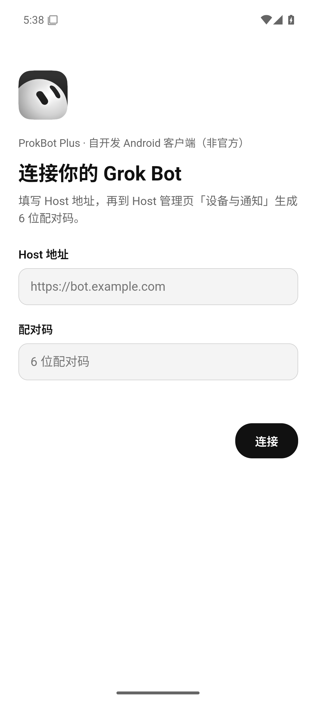

# ProkBot Plus Android 客户端

在电脑上生成一个连接自己 Host 的 Android 版 Grok Bot。手机需要 Android 9 及以上（API 28+）。生成用的电脑可以是 Windows、macOS 或 Linux，需要 Node.js 22.12+ 和完整的仓库（共用 `mac/`、`windows/` 中的代码）。

完整的部署步骤见 [AI 部署手册](../docs/AI-INSTALL.md#94-android-手机)，实现原理见[技术文档](../docs/ARCHITECTURE.md#android-客户端)。

[English](README.en.md)

## 为什么不是改官方 Android 版

官方 Android 版（`ai.x.grok.bot` 1.16.0）带有 Google Play 的防篡改保护，改动后无法运行，绕过这种保护不在本项目的范围内。所以 Android 客户端换了一种做法：

- 界面用官方**桌面版**的界面，和 Windows、Mac 客户端完全相同，取自你自己下载的官方 Windows 0.71.2 安装包；
- 外面套一个本项目编写的 Android 外壳（`shell/`），负责连接 Host、保存凭据、通知、文件和返回键等手机功能。

## 使用

在仓库根目录执行：

```sh
node android/patchers/patch.mjs
```

工具自动下载并校验官方 `Grok_Bot_0.71.2_Setup.exe`（和 Windows 客户端用的是同一个文件），在 `android/output/` 生成：

| 输出 | 用途 |
| --- | --- |
| `GrokBotLocal-0.71.2-android.apk` | 安装到手机 |
| `GrokBotLocal-0.71.2-android.patch.json` | 生成记录：输入文件摘要、APK 摘要、签名证书指纹 |

把 APK 传到手机上安装（需要允许「安装未知应用」），或者用 `adb install -r`。打开后填写 Host 地址和六位配对码。

<p align="center"></p>

| 选项 | 作用 |
| --- | --- |
| `--source <文件或目录>` | 使用已下载的官方安装包、`app-64.7z` 或已安装的原版目录 |
| `--output <目录>` | 输出目录，默认 `android/output/` |
| `--signing-key <文件>` | 签名密钥文件，默认 `~/.grokbot-local/android-signing.json` |
| `--force` | 覆盖已有的输出 |
| `--verify-only` | 只校验输入，不生成 |

### 签名密钥

第一次生成时会创建一个只属于你的签名密钥（`~/.grokbot-local/android-signing.json`，权限 0600），**请备份这个文件**。Android 只允许用同一个密钥签名的 APK 覆盖升级；密钥丢了，就只能先卸载旧版再装新版，配对需要重新做。

## 功能

- 官方桌面版的完整界面：对话、Bot 管理、技能、市场、资料库、例行任务、设置。照官方 Grok Bot 手机版的样子重新排版：
  - 首页是 Bot 列表：左上角是账户，右上角是搜索和新建 Bot；每行显示 Bot 最近的消息和时间，置顶的 Bot 以大头像排在最上面；市场在账户菜单里；
  - 点一个 Bot 进入全屏的对话页：左上角是圆形返回按钮和 Bot 名字，消息是气泡，底部是加号按钮和输入框；
  - 配色、尺寸和字体（XVF）都按官方手机版，深色和浅色都有；
  - 对话详情、设置、市场和搜索全屏打开，菜单、长按菜单、选项和对话框从底部弹出；
  - 看图和 Bot 电脑的大画面是黑底全屏；
  - 系统返回键逐级返回：先关弹出的面板，再退出详情或大画面，最后回到 Bot 列表；
  - 横屏和平板按宽屏排版，Bot 列表和对话并排显示。
- **Bot 的电脑**：对话详情里能看到 Bot 电脑的实时画面；点「打开电脑」进入大画面，「取得控制权」后可以用触摸和软键盘直接操作。
- 附件：从手机选择文件上传（大文件分块），把 Bot 发来的文件保存到手机（系统的保存对话框），全屏看图。
- 通知：后台服务接收 Host 的通知，点击直接打开对应的 Bot；开机后自动恢复。不需要 Google 推送服务，可以在连接页关闭。
- 深色模式跟随系统，状态栏和导航栏颜色随界面变化；中文和英文界面。

## 说明与限制

- 不支持 Tailcat。外网使用请用 VPN、内网穿透或 HTTPS 域名。
- 排版照官方手机版，但页面内容是桌面版的：设置分「通用 / 电脑 / 更新」几个标签页，市场的分类和内容与桌面版相同；对话页右上角没有官方手机版的电脑按钮，Bot 的电脑从对话详情打开。
- Bot 不能在手机上执行命令，也不能操作手机。「教 Bot 做任务」（录制演示）不可用。
- 新版 Host 在设备列表中显示 Android，并且新配对的手机不会获得桌面执行权限。旧版 Host 也能配对，但仍将手机识别为桌面设备。
- 后台通知依靠一个常驻的前台服务保持连接，通知栏会有一条可以折叠的「保持连接」通知。部分厂商系统会限制后台运行，请在系统设置里允许本应用后台运行，或者关闭电池优化。
- 界面运行在系统的 Android System WebView 里。WebView 125 及以上效果最好；更老的版本（部分国产系统更新较慢）也能用，Bot 电脑画面由兼容代码定位，个别装饰元素的位置可能略有不同。
- 设备凭据用 Android Keystore 加密保存。界面通过只监听 `127.0.0.1` 的本地网关访问 Host，每次启动都会生成新的随机凭据，网页里拿不到设备令牌。

## 维护

- `client/`：运行在 WebView 里的桥接代码，代替 Electron 的主进程和 preload；`patchers/renderer-patches.mjs`：对官方界面的少量修改（逐个文件校验 SHA-256，锚点必须唯一）。
- `shell/`：Android 外壳源码（Kotlin，不依赖第三方库）。修改后执行 `node android/shell/release-shell.mjs` 重新构建 `dist/grokbot-android-shell.apk`，它会同时更新 `patchers/supported.json` 里的摘要。构建需要 JDK 17+ 和 Android SDK（`ANDROID_HOME`）。
- 测试：`node --test "android/tests/*.test.mjs"`

## 许可与支持

仅限非商业使用，见 [LICENSE](../LICENSE)。本项目多数代码由 AI 辅助生成。
