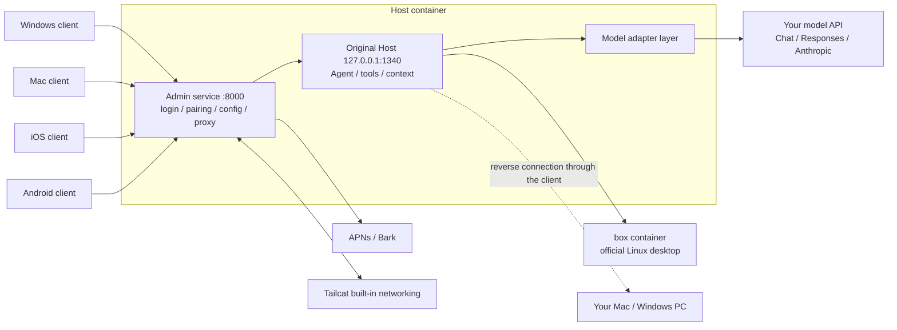

# Technical documentation

[简体中文](ARCHITECTURE.md)

This document explains how ProkBot Plus works, how each feature is implemented, and what this version changes on top of upstream ProkBot. It also covers the directory layout, tests, where to start for further development, and known limitations. For deployment steps, see the [AI deployment guide](AI-INSTALL.en.md).

## How it works

The original Grok Bot runs its server side in the official cloud, in two parts: the Host handles conversations, schedules Agents and keeps records; the cloud computer is a Linux desktop where the Agent does the actual work.

This project moves both parts to your own machines and uses the original programs directly wherever possible:

- **Host**: the original Node.js program. Only the parts tied to the official service are replaced, and an admin service layer sits in front.
- **Execution computer**: the official Linux desktop image, running unchanged in Docker. The Agent can also operate your own computer.
- **Clients**: the original interface is unchanged. The patches make them connect only to your Host.



The patches only work on pinned versions. Original files are checked by SHA-256, and a wrong version is rejected outright:

| Component | Version |
| --- | --- |
| Original Host | `sand-host-bundle-d0a4baa` |
| Linux desktop image | `9d2ac1b` (manifest digest `sha256:73c04dc8…`, config digest `sha256:1bdd316a…`) |
| Windows client | 0.71.2 x64 (`Grok_Bot_0.71.2_Setup.exe`) |
| Mac client | 0.71.2 Apple Silicon |
| iOS client | 1.16.0 (23152) arm64 decrypted IPA |
| Android client | Interface taken from the Windows 0.71.2 x64 installer; the shell is this project's code |

## Feature comparison

🟢 Original kept　🔁 Replaced with your own service　⛔ Turned off

| Feature | Original | Here | You need |
| --- | --- | --- | --- |
| 🔁 Sign-in | Official account | No account needed. The Host admin page creates a 6-character pairing code, and the client connects with the Host address and the pairing code | Nothing |
| 🔁 Host and execution computer | Official cloud | Runs where you deploy it, using the original Host | An x86_64 Linux machine that can run Docker |
| 🔁 Chat model | Official models, with automatic tier selection | Models you choose, through three API formats: OpenAI Chat Completions, OpenAI Responses and Anthropic Messages. The Jev classifier can choose the model and thinking effort automatically | A model API address and API key |
| 🟢 Computer and browser use | Original Agent | Kept as is | A model with vision |
| 🟢 Memory, context compaction, scheduled tasks | Original Agent, partly relying on official services | Kept, now running on your model and local timers; context compaction is configurable | Nothing |
| 🟢 Approvals, human takeover, interactive forms | Original | Kept as is | Nothing |
| 🔁 Automatic review | Official classification service | Your model decides whether an action may run, and you can write your own allow and block rules | Nothing |
| 🔁 Teach a task | Processed by an official service | Recording is kept as in the original; your model turns the recording into a skill | A model with vision |
| 🔁 Operating your computer | Through official services | Through your Host; the computer doesn't need any open ports. Mac supports commands and graphical control; Windows supports local commands | A signed Mac client, or the Windows client |
| 🔁 Bot library, user profile | Official cloud storage and account | Stored on the Host; every device sees the same data | Nothing |
| 🔁 Skills | Official skill catalog | The Host's own skill catalog, with versions, diffs and restore | Nothing |
| 🔁 Connected apps | Official app marketplace | The Host's own app catalog. You can import code apps, remote MCP servers or skill-only apps, with OAuth and API key authorization. Bots can also write apps themselves | Each app's own credentials |
| 🔁 Complex coding | Official cloud coding Agent | Handed to Codex on a connected Mac or Windows PC, using that computer's Codex sign-in and models | A computer with Codex CLI installed and signed in |
| 🔁 Sharing Bots and skills | Official publishing platform | Publish to your own Host, export as ZIP, and import on another Host | Nothing |
| 🔁 Bots working together | Official service | Hand a task to a Bot on another Host; the result comes back to your conversation | Another Host |
| 🔁 Voice input | Official transcription | Fish Audio, an OpenAI-compatible transcription service, or a local model on a Mac | A key for the transcription service, or a local model |
| 🔁 Live calls | Official realtime voice model | Recognition and synthesis each use a service you choose (experimental) | Recognition and synthesis services |
| 🔁 Image and video generation | Official service | OpenAI-compatible image APIs (with set aspect ratios and editing from reference images), WaveSpeed and others | Provider keys |
| 🔁 Web search | Official search | The built-in web access of Claude or OpenAI Responses models, or a separately configured DeepSeek or HTTP JSON search service | Optional |
| 🔁 Push notifications | Official push | iOS: APNs when the app is signed with the push entitlement, otherwise Bark. Android: the app keeps its own connection to the Host | For iOS, the Bark app, or an Apple Developer account and an APNs key (.p8) |
| 🔁 Access from outside your network | Connects directly to the official cloud | IP address, Tailscale, an HTTPS reverse proxy, or the built-in Tailcat | A domain, depending on the setup |
| ⛔ Telemetry and error reports | Sent to the vendor | Turned off | Nothing |
| ⛔ Automatic updates | Official updates | Turned off; patches are pinned to the supported versions | Nothing |

These original features are not available at the moment: virtual cards, external message drafts, product feedback and passkey forwarding.

Upstream ProkBot also added these features, which the original doesn't have:

| Feature | Description |
| --- | --- |
| **Apps** | One JSON file is one app. It can include code, a remote MCP server or skills. Code apps run on the execution computer. Bots can also write apps themselves with the built-in "Write an app" tool. See [App development](../host/README.en.md#app-development) |
| **Webhooks** | An external system sends a signed request, and a Bot starts working on a task |
| **Usage statistics** | How many tokens were used each day, shown in the admin page and in the iOS settings |
| **Prompt management** | Edit the system prompt and restore the original at any time, and see the prompts and tools each role actually receives |
| **Per-model context settings** | Set the capacity of each model and when summarization starts, separately for each model |
| **Admin web page** | All settings are made in the browser. Supports Chinese and English, light and dark themes, and phone screens |
| **Split deployment** | The Host and the execution computer can run on different machines; see [host/README.en.md](../host/README.en.md#separate-execution-computer) |
| **Backup and restore** | Back up all data and restore it as a new instance |

## How each part is implemented

### Patching

The patch tools copy bytes from the original files you provide (or that are downloaded automatically), add this project's changes, and produce new clients or images. Patches have only two kinds of operation, "copy" and "insert", and every segment checks the hash of the original file. Nothing is decompiled, and the original programs are not rewritten.

### Host and admin service

The original Host is a Node.js program. This project replaces only the four parts tied to the official service: authentication, Agent identity, model calls and MCP configuration. Scheduled tasks in the original are triggered by the official backend, so local timers are added here. In front of the original Host sits the admin service. It handles administrator login, device pairing, all settings and push notifications, and forwards client requests to the original Host.

- **`host` container**: the admin service listens on 8000, mapped to `${GROKBOT_LISTEN_ADDRESS:-127.0.0.1}:${GROKBOT_PUBLIC_PORT:-18080}` on the host machine. The original Host listens only on `127.0.0.1:1340` inside the container.
- **`box` container**: the official Linux desktop. Its VNC port is visible only inside the container network.

| Data | Contents |
| --- | --- |
| Volume `host-data` (`/data`) | Administrator (`auth.json`), devices, Bots, chat history, usage statistics, all settings. The model key is in `model.env`, web settings in `web-services.json`, image settings in `media.json` |
| `/data/setup-key` | Setup code. Deleted automatically after setup |
| Volumes `box-home`, `box-workspace` | Home directory and workspace of the execution computer |

| `.env` variable | Description |
| --- | --- |
| `GROKBOT_LISTEN_ADDRESS` | Address the port binds to. Default `127.0.0.1` |
| `GROKBOT_PUBLIC_PORT` | Port on the host machine. Default `18080` |
| `GROKBOT_PUBLIC_URL` | Public address. Clients check that the address matches when they pair, and the admin API checks Origin against it. It can only be a whole domain or IP, with no path |
| `TZ` | Time zone. Affects scheduled tasks and usage statistics |

Security measures for the admin API:

- The administrator password is stored as a scrypt hash (12–128 characters). After login, a cookie session is used;
- Non-GET requests must include `x-grokbot-csrf: 1`. If `Origin` is sent, it must match the public address;
- Login, setup and model tests are rate-limited per IP, 5 times per minute;
- Pairing codes have 6 characters, are valid for 5 minutes and can be used once. After pairing, each device gets its own token, which can be revoked in the admin page.

The command-line admin tool `host/tools/host-admin.mjs` (new in this version) wraps the common admin API calls: setup, listing models, configuring and testing a model, creating pairing codes, and checking status.

### Model adapter layer

The original sends model requests to an official classifier, which decides which model to use. This project takes over before the Host sends the request: it converts the messages of the original Harness into one of the three APIs, then converts the streamed reply back into the original format. Tool calls, sub-Agents and context management are still the original logic. Upstream supports only OpenAI Chat. **The Responses and Anthropic formats are new in this version.**

| File | Role |
| --- | --- |
| `host/runtime/model-session.mjs` | Entry point. Dispatches by `apiFormat` (`openai` / `openai-responses` / `anthropic`) |
| `host/runtime/openai-chat.mjs` | Chat Completions. Appends `/chat/completions` to the address |
| `host/runtime/openai-responses.mjs` | Responses. Appends `/responses` to the address. Stateless calls |
| `host/runtime/anthropic-messages.mjs` | Messages. The address can be the root address or end in `/v1` |
| `host/runtime/model-common.mjs` | SSE parsing, error normalization, image and file conversion, reasoning source tags, optional parameter fallback |
| `host/runtime/model-policy.mjs` | Thinking effort levels and the reference table of levels for each model |
| `host/runtime/model-router.mjs` | Manual mode, or Jev picks the model and effort by task difficulty |
| `host/server/models.mjs` | Saves the config, reads model lists, runs connection tests (on the same code path as real conversations) |

| Capability | OpenAI Chat | OpenAI Responses | Anthropic Messages |
| --- | --- | --- | --- |
| Thinking effort | `reasoning_effort`; DeepSeek also gets a `thinking` switch | `reasoning.effort`, with reasoning summaries and encrypted reasoning | From Claude 4.6, adaptive thinking plus `output_config.effort`; older models use a thinking budget; on models where thinking can't be turned off, `none` becomes `low` |
| Reasoning across turns | Sends back `reasoning_content` from the same model | `store: false`, sends back encrypted reasoning | Sends back signed thinking blocks |
| Images and files | Images, PDF, text files | Images directly in tool results, PDF | Images directly in tool results, PDF and text documents |
| Output limit | Chooses between `max_completion_tokens` and `max_tokens` automatically | `max_output_tokens` | Per-model limit |

- **Thinking effort**: the levels are `none`, `minimal`, `low`, `medium`, `high`, `xhigh`, `max`, and `default` (no effort parameter is sent). For the levels a model supports, the values returned by the API's `/models` come first. If there are none, the built-in reference table is used.
- **Reasoning source tags**: reasoning from one format or model can't be read by another. Each piece of reasoning records its format and model in `providerOptions.grokbot`. On replay, only the parts that the current format and model can read are sent back, so switching models in the middle of a conversation doesn't cause errors. Encrypted reasoning without a summary and empty thinking blocks are saved as `redacted-reasoning` and restored on replay.
- **Optional parameter fallback**: when a provider rejects an optional parameter with a 400 (for example `reasoning.summary`, `max_tokens`, `fallbacks`), the parameter is removed and the request is retried once. This is remembered for the rest of the session, and `[model] … retrying without …` is printed in the log. Replayed reasoning that is no longer valid is handled the same way.
- **Known gateway issue**: some aggregator gateways return `native_thinking_replay_mismatch` for any request with tools when they forward Claude in the Responses format. This is a gateway problem. Use the Anthropic format for Claude.

### Automatic review

When the Bot wants to do something risky on the execution computer or your computer, the original first asks the official classification service. Here the model you configured decides instead, using the original classification prompt and result format (`host/runtime/host-auto-review.mjs`). All three API formats are supported.

This version adds two things:

- The model sometimes doesn't answer as required (it doesn't call the classification tool, the JSON is incomplete, or a field is invalid). In that case the request is retried once automatically, and the action is rejected only if the retry also fails. Provider errors and cancellations are not retried.
- Every failure writes a line `Local auto-review failed: <reason>` to the Host log. In the original, failures were silent.

### Web access and image generation

The original `WebSearch`, `WebFetch` and `GenerateImage` tools are served by the Host. If no provider is configured, they don't appear.

| File | Role |
| --- | --- |
| `host/runtime/web-services.mjs` | Web adapters: `anthropic-tools` (the model's own `web_search` / `web_fetch`), `responses-search` (`web_search` in Responses, search only), `deepseek-tools`, `http-json` |
| `host/server/media-providers.mjs` | Image adapters: `openai-images`, `wavespeed`, `http-json`. `mediaInput` converts tool arguments into the request body |
| `host/runtime/media-services.mjs` | Records generation tasks, saves results to disk, prevents duplicate submissions |

Changes in this version:

- **Newer Claude models can use the web too**: Claude with thinking turned on doesn't accept forced tool calls. When `anthropic-tools` gets this kind of 400, it switches to automatic tool choice, asks for the tool call in the prompt, and remembers this choice for that model.
- **Tolerant parallel search**: Claude often sends two searches at once, and the one over the usage limit returns `max_uses_exceeded`. The old logic marked the whole search as failed because of this. Now the result is used as long as one search succeeds.
- **Aspect ratio converted to size**: the original tool passes `aspect_ratio`, but the OpenAI image API only accepts `size`. The Host picks the entry with the closest ratio from the `size` list in the model's parameter definition. Without a list, it uses `1024x1024`, `1536x1024`, `1024x1536`. When the Bot sets `parameters.size` explicitly, that size is used.
- **Editing from a reference image**: when `openai-images` gets a reference image, it sends a multipart request to `/images/edits` instead (field name `image[]`).

The parameter definition of an image model is an optional advanced setting, written in `models[].inputSchema` of `PUT /admin/api/media`. Without it, ratios are converted to the three standard sizes, and reference images are still accepted:

```json
{
  "id": "gpt-image-2", "providerId": "images", "model": "gpt-image-2", "kind": "image", "enabled": true,
  "name": "GPT Image 2", "description": "Text-to-image and editing from reference images. Use high quality when high detail is needed.",
  "parameters": { "size": "1024x1024", "quality": "high" },
  "inputSchema": { "type": "object", "additionalProperties": false, "properties": {
    "prompt": { "type": "string" },
    "images": { "type": "array", "items": { "type": "string" }, "maxItems": 10 },
    "size": { "type": "string", "enum": ["auto", "1024x1024", "1536x1024", "1024x1536", "1536x1152", "1152x1536", "1536x864", "864x1536"] },
    "quality": { "type": "string", "enum": ["auto", "low", "medium", "high"] }
  } }
}
```

- With a parameter definition, only models with an `images` property receive reference images. Don't add it for a model whose API doesn't support editing.
- The `size` list needs both landscape and portrait sizes, so the ratio conversion has something to choose from.
- Addresses for web and image providers always end in `/v1`, including `anthropic-tools`. This is different from the root address used for the Anthropic chat model.

### Delivery order of multiple messages

The original prompt asks the Bot to reply the way people text: first one sentence to acknowledge, then the conclusion and extra details split across 2–4 `SendToUser` messages. The original model output is streamed, and each tool call runs as soon as it has been written, so the messages naturally arrive in order.

The model layer in this project waits until the whole reply has finished, then hands all the tool calls to the Harness at once. This way a retry after a mid-stream error doesn't run tools twice. But the reliability layer `host/runtime/reliability/tool-journal.mjs` writes the execution intent to disk before it runs each tool, so when several messages start at the same time, whichever finishes writing first is sent first.

`host/runtime/reliability/tool-order.mjs` (new in this version) records the order in which `SendToUser` / `SendToAgent` were written in each reply, and makes each message wait until the previous one has run before it starts. Other tools still run in parallel. If the previous message never runs, it waits at most 15 seconds. On cancel, it stops waiting right away.

### Execution computer

In the original, every user gets an official cloud computer. Here the same official Linux desktop image runs in your Docker, and the Host operates it over an authenticated connection. The execution computer can be on the same machine as the Host or on another one. When you want the Agent to operate your own computer, the client connects out to the Host, so your computer doesn't need any open ports.

### Mac client

The original Mac client is an Electron app. Here the original interface is kept, and the main process that handles connections and system features is rewritten (`mac/clients/desktop/`, also used by the Windows version) so that it connects only to your Host. Complex coding tasks go to Codex on this Mac, using the Mac's own Codex sign-in and models.

- Ad-hoc signed by default. For the Agent to control the local graphical interface, sign it with your own certificate (`--identity auto`) and grant Accessibility and Screen Recording permissions.
- The output goes in a `.noindex` folder so Spotlight doesn't index it as a duplicate app.

### Windows client (new in this version)

The official Windows client of the same version uses the same Electron interface code as the Mac version. The only differences are the build number, resource file names, module order and a few line breaks.

**Patch flow** (`windows/patchers/desktop/patch.mjs`):

1. Download `Grok_Bot_0.71.2_Setup.exe` and verify its SHA-256. You can also use `--source` to point to an installer, `app-64.7z` or an installed folder.
2. Cut `app-64.7z` out of the NSIS installer and extract it with the `tar.exe` that comes with Windows 11 (7-Zip on Windows 10).
3. Unpack `resources/app.asar` and replace the main process with the shared `mac/clients/desktop` code.
4. Apply the byte patches in `recipes/`.
5. Repack the ASAR. Files that are not packed, such as `.node` files, are compared one by one with the original.
6. `Grok Bot.exe` embeds the SHA-256 of the ASAR header. The patch replaces this value in place and removes the official signature that this change invalidates.
7. Add `grokbot-tailcat.exe`, then output a portable folder, a portable zip, an installer and a `*.patch.json` manifest.

**Recipe porting** (`windows/tools/port-desktop-recipes.mjs`): the Windows recipes are generated automatically from the Mac recipes and the original files of both platforms. The original files of the two platforms are aligned segment by segment, all copied content is taken from the Windows original, exported identifiers are translated for each platform, and every segment gets a syntax structure check.

**Platform differences at runtime**:

- **Window**: keeps the original frameless window and uses `titleBarOverlay` to show the system title bar buttons (`platform.mjs`).
- **Tray and notifications**: after the window is closed, the app stays in the notification area. System notifications are delivered through a Start menu shortcut that carries an AppUserModelID.
- **Computer connection**: the machine ID is `win-<device ID>`, and the Host shows the platform as `win32`.
- **Local commands**:
  - Uses the original executor. When the client is started normally, the executor runs commands with Windows PowerShell.
  - The original doesn't turn on the UTF-8 output option for PowerShell, so output is garbled on Chinese Windows. The client turns this original option on when it loads the executor (`loadLocalExecDaemon` in `local-exec.mjs`).
  - When the client is started from Git Bash, the original switches to Git Bash, and arguments such as `cmd /c` get rewritten. So start the client from the Start menu.
- **Showing images from the Host**: the image addresses the Host records look like `file:///data/...`. The Windows version parses them with POSIX rules (`remoteAttachmentPath` in `attachments.mjs`). Otherwise the images would keep showing as loading.
- **Codex delegation**: finds the local `codex.exe` (including Codex installed with npm), and ends the whole process tree with `taskkill /T` when it finishes.
- **No local mouse and keyboard control**: the original computer-use component only exists for macOS.

**Installer** (`windows/installer/`, Go standard library):

- The installer is laid out as `stub.exe` + portable zip + a 32-byte trailer.
- Installs per user to `%LOCALAPPDATA%\Programs\Grok Bot Local`, registers an uninstall entry and creates a Start menu shortcut. Supports `/S` and `/D=directory`.
- To rebuild the stub, run this in `windows/installer/`: `go build -trimpath -ldflags="-H=windowsgui -s -w" -o ../dist/installer/grokbot-setup-stub.exe .`.
- To rebuild Tailcat for Windows, run this from the repository root: `python host/network/build-tailcat.py --target windows-amd64 --output windows/dist/network` (needs Go).

### Android client

The official Android app (`ai.x.grok.bot` 1.16.0) is a React Native app with Google Play tamper protection; once modified it stops working, and circumventing that protection is out of scope for this project. So the Android client does not modify the official Android app. It runs the official **desktop** interface on the phone (the same one as the Windows and Mac clients), with an Android shell written for this project in place of Electron.

**The shell** (`android/shell/`, Kotlin, no third-party libraries; `android/dist/grokbot-android-shell.apk` is its prebuilt release build) is a full-screen WebView plus:

- **A local gateway** (`LocalGateway.kt`) that listens only on `127.0.0.1`:
  - The interface port (from 39710) serves the interface files and the `/__native/*` native endpoints, and forwards `/api`, `/events`, `/local`, `/connect` and `/notifications` to the Host, adding the device token.
  - The computer view port (from 39720) forwards only the noVNC pages and WebSockets under `/vnc/desktop/` and `/vnc/fork/`.
  - Both ports check an HttpOnly, SameSite=Strict cookie generated at random on every start; the interface port also checks Host, Origin and Sec-Fetch-Site.
  - The device token stays in the native layer; the web page never sees it. When the Host fails, the gateway answers 502 instead of leaving the page an empty response.
- **The credential** (`Storage.kt`): the device token is encrypted with an AES-GCM key in the Android Keystore; settings and the interface's persisted data are kept in the app's private storage.
- **Notifications** (`Notifications.kt`): a foreground service follows the Host's `/notifications/events` (the same stream the iOS client reads), removes duplicates by creation time and stays quiet for the Bot being viewed. Tapping a notification opens that Bot through `grokbot-local://agent/<id>`. It resumes after a reboot or an update, and asks to pair again when the device is revoked. Notification texts follow the language chosen in the app.
- **System features**: file picking, the system save dialog, microphone permission, the back gesture, dark mode and system bar colors, screen insets.

**The bridge** (`android/client/`) replaces Electron's main process and preloads inside the WebView:

- `bridge.js` emulates `ipcRenderer`, `contextBridge` and `process` and runs the original `preload.cjs` unchanged.
- `services.js` and `gateway.js` port the local methods of the desktop client's main process (`mac/clients/desktop/`): chunked attachment uploads, saving files, profile, voice, settings, connected apps and more.
- `webview.js` replaces Electron's `<webview>` with an iframe:
  - The gateway forwards the computer view page from the Host and injects `vnc-bridge.js` and the original `preload-vnc.cjs` from the noVNC page's own folder (code that the original preload passes to `executeJavaScript` imports noVNC modules by page-relative paths).
  - `executeJavaScript`, `send`, `insertCSS` and `ipc-message` work over postMessage and accept only the app's own interface.
  - The iframe follows the `pointer-events` set by the interface, so the Bot's computer takes touch and on-screen keyboard input only after "Take control".
  - The desktop clients use a reduced VNC preload; the original one used here also gives the phone an input method field, the clipboard and adaptive quality.
- `layout.js` and `android.css` lay the interface out after the official phone app, with colors, sizes and the typeface taken from its design values:
  - Below a window width of 600 px, the Bot list and a conversation are two full-screen pages. `layout.js` picks the page from taps on a Bot, search, creating or deleting a Bot, new group chats and notifications, adds a back button to the conversation, and the back gesture in a conversation returns to the list. After "Create" it waits for the Host to make the Bot, then opens its conversation.
  - Back, the account, search, new Bot and add are round floating buttons, and the conversation shows the Bot's name in a pill at the top; bubbles, the message field, list rows and sheets have the official app's sizes and colors; the typeface is XVF, which the desktop interface ships.
  - The list has no marketplace button; `layout.js` adds a marketplace entry to the account menu. It also formats the last-active time on each row (the time today, then "Yesterday", the weekday and the date).
  - Conversation details, settings, the marketplace and search fill the screen; other dialogs, menus and choices slide up from the bottom; images and the large computer view are full screen on black.
  - From 600 px up the desktop layout stays; below 792 px conversation details are a full-screen layer that steps aside for the large computer view.
  - Settings that mean nothing on Android (hardware acceleration, local access, Tailcat) are hidden; wide images are scaled to the column.
- `anchor-fallback.js`: WebView builds before Chromium 125 lack CSS anchor positioning, and the computer view collapses to nothing. The fallback records anchor names and position expressions and turns them into pixels after layout.

**The builder** (`android/patchers/patch.mjs`):

1. Downloads and verifies the official `Grok_Bot_0.71.2_Setup.exe` (the same file as for the Windows client), extracts `app.asar` and applies the Windows recipes.
2. Verifies the SHA-256 of the interface entry, `preload.cjs` and `preload-vnc.cjs`, then applies the interface changes in `renderer-patches.mjs`; each file is verified by hash first and every anchor must be unique:
   - The window width check for conversation details is relaxed (a phone cannot widen its window).
   - The "Teach a task" and "Get the mobile app" entries are removed.
   - The computer view's anchor styles get custom properties that the fallback reads.
   - Each row of the Bot list shows when the Bot was last active.
3. Puts the interface, the bridge, the original preloads (wrapped as an ES module and a plain script) and the official icon into `assets/web/` of the shell APK.
4. Aligns the entries as zipalign does and signs the APK with signature scheme v2 (`apk.mjs`, plain Node.js). The signing key is created on the first build and kept in `~/.grokbot-local/android-signing.json`.

**Pairing**: Android sends `platform: desktop` with `clientKind: android`. Updated Hosts store new pairings as Android devices without desktop execution privileges; older Hosts ignore the extra field and remain compatible. Full-width characters typed by Chinese input methods are converted first.

**Differences from the desktop clients**: no Tailcat; the Bot cannot run commands on or operate the phone (`getLocalToolPermission` answers `never`); no "Teach a task".

### iOS client

The original iOS client is built with React Native. Here an injected dynamic library (Objective-C, source in `ios/clients/ios/`, compiled with `build.py`) sends the requests meant for the official service to your Host, and a few fixed changes are made to the Hermes bytecode. The three extensions (widgets, share and notifications) are kept, each with its own bundle ID. The patch outputs an unsigned IPA, and you sign the main app and all three extensions yourself (see [ios/README.en.md](../ios/README.en.md#signing)).

The iOS bytecode patches (`ios/recipes/ios/*.hbc.gbp.gz`) are data generated by the upstream author: the patch content is fully public, but the process used to modify the bytecode is not included in the upstream repository.

### Voice

Live calls in the original use an official realtime voice model. Here the original call screen, microphone and playback logic are kept, and the conversation is split into three steps: a recognition service turns your speech into text, the current Bot answers with its own model, context and tools, and a synthesis service reads the answer aloud.

### Push notifications and access from outside your network

The Host can send notifications directly through the Apple Push Notification service (APNs). This needs an Apple Developer account with push capability and a .p8 key. Without one, use Bark.

You can reach the Host only on the LAN, through a VPN, or through an HTTPS reverse proxy. The easiest option is the built-in Tailcat. Tailcat is based on Tailscale's open-source networking component and is built into the clients, the Host and the execution computer. Copy the connection link or scan the QR code to connect; no Tailscale sign-in is needed.

### Skills, apps, sharing and collaboration

In the original, the skill catalog, the app marketplace, Bot template publishing and multi-Agent collaboration all depend on the official platform. Here each one has its own version on the Host, keeping the original interface wherever possible: the app marketplace list, the skill publishing menu and the Bot publishing card are all original screens, with the data coming from your Host. Code apps and webhooks are new, and they are connected to the original tools and automated tasks.

## Directory layout and key files

| Path | Contents |
| --- | --- |
| `host/release/` | `build-docker.py` downloads and verifies the originals and builds `grokbot-host:local`; `patch-host.py` and `bytepatch.py` apply the Host patches; `compose*.yaml` for deployment; `backup.py` for backup and restore; `Dockerfile.*` |
| `host/server/` | Admin service: authentication, pairing, push, all settings, admin web page (`public/`) |
| `host/runtime/` | Runtime injected into the original Host: model adapter layer, web and images, automatic review, reliability layer (`reliability/`) |
| `host/deploy/` | Process management inside the container, standalone execution node |
| `host/tools/host-admin.mjs` | Command-line admin tool |
| `host/network/` | Go source and build script for Tailcat; `host/bin/` holds the prebuilt Linux version |
| `host/tests/` | Server unit tests |
| `mac/clients/desktop/` | Desktop client main process, shared by Mac and Windows: connection, pairing, notifications, attachments (`attachments.mjs`, `attachment-uploads.mjs`), external links and previews, local commands (`local-exec.mjs`), Codex delegation. Platform differences are kept in `platform.mjs`. The `*-settings-extension.js` files are the source of the code the recipes add to the original settings pages; changes to them take effect only after the recipes are made again. The Android client also copies `i18n.mjs`, `external-url.mjs` and `connectors.mjs` from here |
| `mac/patchers/desktop/` | Mac patcher, recipe applier and original-app downloader (`download-original.mjs`). The Windows patcher uses it too |
| `windows/patchers/desktop/` | Windows patcher: `patch.mjs`, `original.mjs` (extracting the official installer, also used by Android), `pe.mjs` (icon, ASAR integrity, signature table), `zip.mjs`, `recipes/` |
| `windows/tools/`, `windows/installer/`, `windows/dist/` | Recipe porting tool, installer source, prebuilt Tailcat and installer stub |
| `android/shell/` | Android shell (Kotlin): local gateway, credential, pairing, notifications, files and the back gesture; `release-shell.mjs` builds `android/dist/grokbot-android-shell.apk` |
| `android/client/` | Bridge in the WebView: replaces Electron's main process and preloads, computer view, layout adjustments, anchor fallback, connection page |
| `android/patchers/` | Android builder: `patch.mjs`, `apk.mjs` (ZIP and APK signing), `renderer-patches.mjs`, `supported.json` |
| `ios/release/` | iOS patch entry point `patch-ios.py`: verifies the user's IPA and outputs an unsigned file |
| `ios/clients/ios/` | Source of the injected library, native UI and feature adaptations (for example tunnel management in `GBNetwork.m` and voice transport in `GBVoiceSocket.m`); `audio-processing/` is the echo processing library |
| `*/recipes/` | Patch data that copies bytes from the original files and adds this project's changes |
| `*/THIRD_PARTY/` | Third-party licenses |

## Linux deployment notes

- The image is `linux/amd64`. From Docker 29 on, new installs use the containerd image store by default, and the ID that `docker image inspect` reports becomes the manifest digest. The upstream build script only accepted the config digest and failed with `Unsupported Box image identity`. This version accepts both, and offline archives are checked against the config digest inside the archive.
- Code checked out or uploaded on Windows loses its executable permission. So `Dockerfile.base` and `Dockerfile.execution` run `chmod 755` after copying the Tailcat program, and the Mac patcher also makes the Tailcat in its output executable.
- Ports published by Docker don't go through ufw. To restrict access, change `GROKBOT_LISTEN_ADDRESS`, or restrict it at the network boundary.
- Containers are paused during a backup, so the health check may fail briefly. This is normal.

## Tests

```sh
node --test "host/tests/*.test.mjs"      # server
node --test "windows/tests/*.test.mjs"   # Windows client
node --test "mac/tests/*.test.mjs"       # Mac / shared client
node --test "android/tests/*.test.mjs"   # Android client
```

The network layer of the iOS injected library has one more test, which runs on a Mac with the Xcode command line tools: `python3 ios/tests/ios-network.test.py`.

Coverage:

- **Server**: request building, stream parsing, reasoning replay, parameter fallback and error classification for all three formats, plus:
  - image ratio conversion and editing from reference images;
  - web tool fallback and parallel search tolerance;
  - automatic review retries;
  - message order.
- **Windows client**: window style, installer layout, finding Codex, Host image paths, command output encoding.
- **Mac client**: attachments, external links, previews, sidebar and more.
- **iOS network layer**: starting the Tailcat tunnel (concurrent requests start it once), restoring it, rebuilding it after connection errors, and shutting it down.
- **Android client**: APK alignment, signing and tamper detection, the signing key, the interface entry and interface patches, wrapping the original preloads, Host attachment paths, computer view addresses, event stream parsing, anchor position arithmetic, image scaling, switching between the list and conversation pages on phones, the format of the last-active time.

After changing code, it's a good idea to also check it for real:

- Use `host-admin.mjs model-set --test-only` to send real requests in each format;
- Have a multi-turn conversation with tool calls in a client;
- Ask the Bot to search for a news item, read a web page, draw a 16:9 image, and then change one thing in that image.

## Where to start for further development

| Task | Where |
| --- | --- |
| Add a new model API format | Create an adapter file in `host/runtime/` that implements a generator with the same shape as `openai-chat.mjs`, then register it in these places: `model-session.mjs`, `CLASSIFIERS` in `host-auto-review.mjs`, `host/server/models.mjs`, and the admin page `host/server/public/model.js` |
| Adjust the thinking levels of a model | `effortLevels` in `host/runtime/model-policy.mjs`. Claude model features are in `anthropic-messages.mjs` |
| Change the admin page | `host/server/public/`. English strings are in `locales-en.js` |
| Change the desktop client | `mac/clients/desktop/` (shared by Mac and Windows; Android uses three of its files) |
| Change the Android client | The bridge is in `android/client/`; the shell is in `android/shell/`. After changing the shell, run `node android/shell/release-shell.mjs` to update the prebuilt shell and its digest (needs JDK 17+ and the Android SDK) |
| Support a new official client version | Update the hashes in `supported.json`. Mac recipes have to be made again; Windows recipes are ported with `windows/tools/port-desktop-recipes.mjs`; for Android also update `android/patchers/supported.json` and `renderer-patches.mjs` |
| App (plugin) development | [host/README.en.md](../host/README.en.md#app-development) |

## Known limitations and to-do

- Only the pinned versions in the table above are supported. When the official apps update, the patches have to be updated too. There are no automatic updates.
- Windows client:
  - Can't yet let the Bot control the mouse and keyboard;
  - Not code-signed, so SmartScreen shows a warning on first launch;
  - x64 only;
  - Tailcat and live voice have not been tested against a real Host yet.
- Android client:
  - No Tailcat.
  - The layout follows the official phone app, but the pages are the desktop ones: settings are tabs such as General, Computer and Updates, the marketplace has the desktop categories and content, and the conversation has no computer button at the top right as in the official phone app (the Bot's computer opens from the conversation details).
  - Background notifications rely on a foreground service; some vendor systems require allowing the app to run in the background.
  - Voice input and live calls are verified only up to the request reaching the Host; they have not been tested against a real voice service.
  - Fully tested on an Android 15 emulator (WebView 124); pairing, the notification permission and the layout were verified on an Android 16 emulator (WebView 134). Not yet tested on a physical phone.
- The server supports only x86_64 Linux, and the original desktop image is amd64 only.
- iOS needs your own decrypted IPA and signing certificate. Headphones, Bluetooth and network switching have not been fully tested on real devices.
