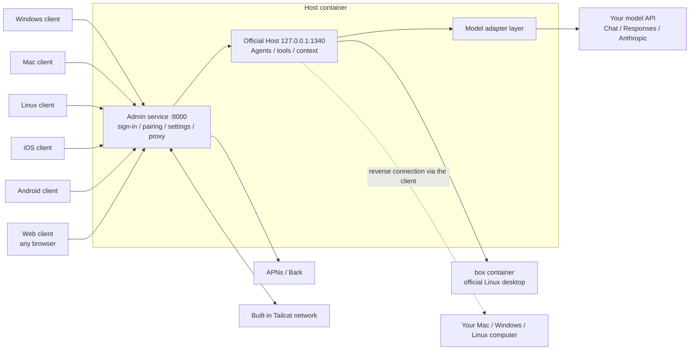

# Technical documentation

[简体中文](ARCHITECTURE.md) · [Deployment guide](AI-INSTALL.en.md)

How ProkBot Plus works, how each part is implemented, the layout, tests and maintenance, and known limitations.

## How it works

The official Grok Bot server side runs in the official cloud, in two parts: the Host handles chats, schedules Agents and stores records; the cloud computer is a Linux desktop where the Agent actually works. This project moves both onto your own machines and uses the official programs as directly as possible:

- **Host**: the official Node.js program, with only the parts tied to official services replaced, wrapped in an admin service;
- **Execution computer**: the official Linux desktop image, run unchanged in Docker. Agents can also operate your own computer;
- **Clients**: the official interface, unchanged; the patch makes them connect only to your Host.



The patch tools copy bytes from the official files you provide (or that they download), add this project's changes and produce new clients or images. A patch has only two kinds of operation, copy and add, and checks the hash of every source section. Nothing is decompiled or rewritten.

## Feature comparison

🟢 Official, kept　🔁 Replaced with your own service　⛔ Turned off

| Feature | How it works here | What you need |
| --- | --- | --- |
| 🔁 Sign-in | No account. The admin page creates a 6-character pairing code; a client enters the Host address and the code | — |
| 🔁 Host and execution computer | The Host is built for the server's architecture; the execution desktop stays official | amd64 / arm64 Linux; the amd64 desktop can run on its own machine |
| 🔁 Chat models | Several model services and profiles in three API formats; the default route or a per-Bot route sets the model, reasoning effort and fallback order | Model API address and key |
| 🟢 Computer and browser use, memory, context compaction, scheduled tasks, approvals, human takeover | Official behavior, using your model and local timers | A model with image input to operate computers |
| 🔁 Automatic review | Your model decides whether an action may run; you can write the rules | — |
| 🔁 Teach a task | Official recording; your model turns it into a skill | A model with image input |
| 🔁 Operate your computer | Through your Host; your computer opens no ports. Mac: commands and GUI control; Windows and Linux: local commands | Mac, Windows or Linux client |
| 🔁 Bot library, user profile, skills | Stored on the Host; skills have versions, diffs and restore | — |
| 🔁 Connected apps | The Host's own app catalog: code apps, remote MCP or skills only, with OAuth or API keys; Bots can write apps too | The app's own credentials |
| 🔁 Complex coding | Handed to Codex on a connected Mac, Windows or Linux computer, using that computer's Codex login and model | Codex CLI installed and signed in |
| 🔁 Sharing Bots and skills, multi-Bot collaboration | Publish to your own Host or export a ZIP; hand tasks to Bots on other Hosts | Another Host |
| 🔁 Voice input, live calls | Fish Audio, OpenAI-compatible transcription or a local model on Mac; calls use your recognition and speech services (experimental) | Voice services |
| 🔁 Image and video generation | OpenAI-compatible image APIs (aspect ratios, edits with reference images), WaveSpeed and more | Provider key |
| 🔁 Web search | Built-in web tools of Claude or OpenAI Responses models, or DeepSeek or an HTTP JSON search service | Optional |
| 🔁 Phone notifications | iOS: APNs or Bark; the Android app keeps its own connection; the web client uses browser notifications while open | For iOS, Bark or an Apple developer account with a .p8 key |
| 🔁 Access from outside | IP address, Tailscale, an HTTPS reverse proxy or the built-in Tailcat | A domain, depending on the method |
| ⛔ Telemetry, crash reports, automatic updates | Off; the patches are pinned to supported versions | — |

Official features not provided: virtual cards, external message drafts, product feedback, passkey forwarding, and adding Bots shared on the official website ("Add to Grok Bot" on x.ai/bot/… pages: those templates live in the official cloud and download only with an official account).

Added by upstream ProkBot: apps (one JSON file; see [app development](#app-development)), webhooks that start tasks, usage statistics, prompt management (with restore), per-model context settings, an admin web page (Chinese and English, light and dark, phone screens), a [split deployment](AI-INSTALL.en.md#split-host) and [volume backup and recovery](AI-INSTALL.en.md#volume-recovery).

## How each part is implemented

### Host and admin service

Only four parts of the official Host are replaced, the ones tied to official services: authentication, Agent identity, model calls and MCP configuration. Official scheduled tasks are triggered by the official backend, so local timers are added. The admin service in front handles administrator sign-in, device pairing, settings and push, and forwards client requests to the official Host.

- **`host` container**: the admin service listens on 8000, published on the host at `${GROKBOT_LISTEN_ADDRESS:-127.0.0.1}:${GROKBOT_PUBLIC_PORT:-18080}`; the official Host listens only on `127.0.0.1:1340` inside the container.
- **`box` container**: the official Linux desktop; its VNC port is visible only on the container network.

A single-machine Box shares only five protected data trees: `agents`, `user-memory`, `workflows`, `plugins` and `managed-skills`, mounted only below `/data/runtime/host-data/<tree>` so they stay inside the original `RemoteBox` protected root. `agent-transcripts`, `connector-secrets`, `model.env`, `auth.json`, `projects` and other internal data are never mounted into Box. Databases such as `store.db` inside `agents/<id>/` come along with `agents`: as in the official same-machine setup, the Bot's Shell can see them, while the original protected-path check refuses them to the Read tool. Each tree uses its own `volume subpath`, so a same-machine deployment requires Docker Engine 26.0+, API 1.45+ and Compose 2.26.0+, checked before writing or starting the configuration; `--host-only` mounts no subpaths and is not checked. Before starting services, the deployment tool runs `data_init.py` once in the Host image; it creates only missing directories and changes ownership and mode only on those new trees, never existing top-level directories. Deployment, backup and recovery validate the complete mount set. `compose.yaml` also sets `GROKBOT_HOST_MEMORY_MOUNTS=1`, so the prompt runtime adds its live-access reminder, which points the Bot at its own computer, only for the local Box topology; `--host-only` and remote execution nodes do not receive it.

| Data | Contents |
| --- | --- |
| Volume `host-data` (`/data`) | Administrator (`auth.json`), devices, Bots, chats, usage and settings. Model keys in `model.env`, web tools in `web-services.json`, images in `media.json` |
| `/data/setup-key` | Setup code, deleted after setup |
| Volumes `box-home`, `box-workspace` | The execution computer's home directory and workspace |

`GROKBOT_PUBLIC_URL` in `.env` is the public address. Pairing checks that the client uses the same address, and the admin API checks `Origin` against it. It must be a whole domain or IP, without a path. `TZ` affects scheduled tasks and usage statistics.

Admin API: the administrator password (12–128 characters) is stored with scrypt, and sign-in creates a cookie session. Non-GET requests need `x-grokbot-csrf: 1`, and an `Origin`, if present, must match the public address. Sign-in, setup and model tests are limited to 5 per minute per IP. Pairing codes have 6 digits, last 5 minutes and work once; each paired device gets its own token, which the admin page can revoke. `host/tools/host-admin.mjs` does setup, model configuration and tests, pairing codes and status from the command line.

### Model adapter layer

The official Host sends model requests to an official classifier. This project takes over before the request leaves the Host: it converts the official Harness messages into one of three APIs and converts the streamed reply back. Tool calls, sub-Agents and context management are still the official logic.

| File | Role |
| --- | --- |
| `host/runtime/model-session.mjs` | Entry point; dispatches on `apiFormat` (`openai` / `openai-responses` / `anthropic`) and handles fallback |
| `host/runtime/model-routing.mjs` | Validates services, profiles and routes; resolves the default or per-Bot route and its fallback chain |
| `host/runtime/openai-chat.mjs` | Chat Completions (`/chat/completions`). Either `[DONE]` or `finish_reason` ends the stream; tool calls that arrive with `stop` still run; empty arguments count as `{}` only for tools without required parameters |
| `host/runtime/openai-responses.mjs` | Responses (`/responses`), stateless |
| `host/runtime/anthropic-messages.mjs` | Messages; the address may be the root or `/v1` |
| `host/runtime/model-common.mjs` | SSE parsing, error normalization, image and file conversion, reasoning source tags, optional-parameter fallback |
| `host/runtime/model-policy.mjs` | Reasoning effort levels and the per-model reference table |
| `host/server/models.mjs` | Saves settings, lists models, tests connections (on the same code path as real chats) |

| Capability | OpenAI Chat | OpenAI Responses | Anthropic Messages |
| --- | --- | --- | --- |
| Reasoning effort | `reasoning_effort`; DeepSeek also gets a `thinking` switch | `reasoning.effort`, with reasoning summaries and encrypted reasoning | Adaptive thinking with `output_config.effort` from Claude 4.6; thinking budgets for older models |
| Multi-turn reasoning | Sends back `reasoning_content` from the same model | `store: false`, sends back encrypted reasoning | Sends back signed thinking blocks |
| Images and files | Images, PDF, text files | Images in tool results, PDF | Images in tool results, PDF and text documents |

- **Reasoning effort**: `none`, `minimal`, `low`, `medium`, `high`, `xhigh`, `max`, and `default` (not sent). Levels come from the API's `/models` response when available, otherwise from a built-in reference table.
- **Per-Bot routes**: a service holds the format, address and key; a profile binds a service, model ID, reasoning effort and context policy. A Bot can have a main profile and up to 8 fallbacks, without Jev; sub-Agents inherit their parent Bot's route. Keys are written only to the private `model.env`.
- **Fallback**: while the main model has produced no text or tool call yet, 402, 408, 429, 5xx, network errors and upstream I/O idle timeouts (300 seconds by default) move to the next fallback. The Harness has its own 150-second first-token timeout, which usually ends the turn first. 400s, authentication errors and caller cancellations do not trigger a fallback. Fallbacks that share a key are skipped only when the key's quota is clearly used up. Once text or a tool call has gone out, the model never changes, so nothing is shown or run twice.
- **Reasoning source tags**: reasoning from one format or provider cannot be read by another. Each reasoning part records its format and service ID in `providerOptions.grokbot` and is replayed only to a matching model.
- **Context size**: filled in automatically only when the provider's catalog reports it; unknown models get `0`, never a guess. A manual non-zero size and summary threshold turn on automatic summaries.
- **Optional-parameter fallback**: when a provider rejects an optional parameter with 400 (such as `reasoning.summary` or `max_tokens`), it is removed, the request is retried once and the choice is kept for the session; the log shows `[model] … retrying without …`.
- **Known gateway issue**: some aggregating gateways that forward Claude in Responses format return `native_thinking_replay_mismatch` whenever tools are present. Use the Anthropic format for Claude.

All three APIs release tool calls only after a complete end-of-stream marker. An early EOF, broken encoding or cancellation counts as a failure.

### Automatic review

Before a risky action, the official Host asks an official classifier. Here your configured model decides, with the official classifier prompt and result format (`host/runtime/host-auto-review.mjs`). If the model does not answer in the expected form, it retries once and only then refuses; every failure logs `Local auto-review failed: <reason>`.

### Web access and image generation

The official `WebSearch`, `WebFetch` and `GenerateImage` tools are served by the Host and appear only when a provider is configured.

| File | Role |
| --- | --- |
| `host/runtime/web-services.mjs` | Web adapters: `anthropic-tools` (the model's own `web_search` / `web_fetch`), `responses-search` (search only), `deepseek-tools`, `http-json` |
| `host/server/media-providers.mjs` | Image adapters: `openai-images`, `wavespeed`, `http-json` |
| `host/runtime/media-services.mjs` | Job records, saving results, preventing duplicate submissions |

Fixes in this project:

- Claude with thinking enabled refuses forced tool calls. After such a 400, `anthropic-tools` switches to automatic tool choice and remembers that for the model;
- when one of several parallel searches returns `max_uses_exceeded`, any successful search is used;
- the official tool passes `aspect_ratio`, but OpenAI image APIs accept only `size`: the Host picks the closest ratio from the model's `size` list, or from `1024x1024`, `1536x1024` and `1024x1536` when there is no list;
- with reference images, the request becomes a multipart call to `/images/edits`.

An image model can declare its parameters in `models[].inputSchema` of `PUT /admin/api/media`: only models with an `images` property accept reference images, and the `size` list should include both landscape and portrait sizes. Web and image provider addresses always end in `/v1`, including `anthropic-tools`.

### Delivery order of multiple messages

The official prompt asks Bots to split replies into 2–4 `SendToUser` messages. This project's model layer hands tool calls to the Harness only after the whole reply has arrived (so a retry never runs a tool twice), and the reliability layer writes each tool's intent to disk before running it, so messages started together went out in whichever order their writes finished. `host/runtime/reliability/tool-order.mjs` makes each `SendToUser` / `SendToAgent` wait for the previous one in written order, waiting at most 15 seconds; other tools still run in parallel. When concurrent replies reuse a call ID, that message is left unordered instead of failing the chat.

When the model asks, under a new call ID, to resend the exact text of a message that was just delivered successfully, the adapter ends the turn with a non-retryable error instead of sending it twice.

### Turn continuity and working indicator

`host/runtime/turn-continuity.mjs` (installed through `recovered-host-flow.mjs`, `recovered-engine.mjs`, `recovered-harness.mjs`, `recovered-host-execution.mjs` and `model-errors.mjs`) handles multi-step turn completion, retries and live activity state:

- **Silent tool-call closing nudges**: `detectSilentToolCallEnding` detects substantive tool work performed after the last successful `SendToUser` / `SendMessage` / `ReactToMessage` (including multiple progress messages, tool-first turns, parallel calls and plain-text/reasoning endings) while excluding bookkeeping tools such as `update_state` and `TodoWrite` / `todo_write`. `TurnRuntime.ensureUserReply` uses non-repeating nudge wording, allows at most 2 closing nudges per turn, and records `sand.closing_send_nudge` on every closing nudge.
- **Empty and missing-`SendToUser` retries**: `buildAgentForRun` enables `enableEmptyResponseRetry: true` only for normal user turns (keeping it disabled for subagents, `isSilenceAllowed` runs such as scheduled tasks, background wakes and broadcasts, and group-member turns so silence-capable runs are not pushed into speaking). Subsequent substantive tool results reopen in-loop retry eligibility after an earlier progress `SendToUser`, while capping empty/visibility retries at 2 per turn.
- **Automatic `length` truncation continuation**: `model-errors.mjs` maps `length` truncation to `OutputTokensLimitExceededError` so `AbstractUserMessageActionHandler.runWithMaxTokensRetry` can prompt the model to break up its output and continue once per step; a second truncation stops the step with a non-retriable error that keeps the original truncation message, instead of a generic `step-retries` failure, so the Runner does not retry the whole turn. It continues only once because each truncated reply stays in the history, so a second continuation would end with that partial assistant reply, which current Claude models reject as unsupported prefill.
- **Live working indicator**: `RunLifecycle.beginSessionRun` seeds `{ kind: 'thinking' }` at run start and `resolveNamedActivityHold` retains `thinking` across mid-turn `send-message` updates until `turn-ended` / `endSessionRun` clears it, preventing blank indicator gaps during multi-step turns.

### Execution computer

The official Linux desktop image is used directly; the Host operates it over an authenticated connection, on the same machine or another one. When Agents operate your computer, the client connects out to the Host, so your computer opens no ports.

<a id="mac-client"></a><a id="windows-client"></a><a id="linux-client"></a><a id="windows-client-new-in-this-version"></a>
### Desktop clients (Mac, Windows and Linux)

The official desktop client is an Electron app. The official interface is kept; the main process that handles connections and system features is rewritten (`mac/clients/desktop/`, shared by Mac, Windows and Linux) so the app connects only to your Host. Platform differences live in `platform.mjs`. Complex coding goes to Codex on the same computer.

- **Mac**: ad-hoc signed by default. For Agents to control the GUI, sign with your own certificate (`--identity auto`) and grant Accessibility and Screen Recording. Output goes to a `.noindex` folder so Spotlight does not index a duplicate app. The patcher picks the original for the Mac's chip: Apple Silicon pins are in `mac/patchers/desktop/`, Intel pins in `mac/patchers/desktop/x64/`; `--arch` overrides the choice. To fall back to `0.71.2`, use the v1.7.0 Mac release package. Rebuild Mac Tailcat with `python host/network/build-tailcat.py --target darwin-arm64 --output mac/dist/network` (Apple Silicon) and `python host/network/build-tailcat.py --target darwin-amd64 --output mac/dist/network/x64` (Intel).
- **Windows**: `windows/patchers/desktop/patch.mjs` uses the 1.2.3 installer by default; `--version 1.1.0` or `--version 0.71.2` uses a fallback; `--source` takes an installer, an `app-64.7z` or an installed folder (versions are recognized by size and SHA-256). It extracts `app-64.7z` from the NSIS installer, unpacks it with the Windows `tar.exe` (7-Zip on Windows 10), checks `app.asar` and replays the recipe; `--verify-only` stops there. A build swaps in the shared main process, repacks the ASAR and outputs a portable folder, a portable ZIP, an installer and `*.patch.json`. The modified `Grok Bot.exe` no longer carries the official signature.
- **Windows runtime**: closing the window leaves the app in the tray; notifications use a Start menu shortcut with an AppUserModelID; local commands run in PowerShell with UTF-8 output (starting from Git Bash changes `cmd /c` arguments, so start it from the Start menu); delegation uses the local `codex.exe` and ends with `taskkill /T`. Windows has no equivalent of the Mac mouse and keyboard component.
- **Linux**: `linux/patchers/desktop/patch.mjs` supports official 1.2.3 `.deb` packages for `x64` (`linux/patchers/desktop/`) and `arm64` (`linux/patchers/desktop/arm64/`). `deb.mjs` parses `ar` in pure Node, verifies both the `.deb` and `data.tar.xz` digests and extracts via `tar`; it checks `grok-bot` and `app.asar` and replays the recipes while leaving the ELF `grok-bot` binary untouched (Electron on Linux does not verify embedded ELF ASAR hashes). It bundles the matching Linux Tailcat from `host/bin/` and outputs a portable folder (`grokbot-local/`), `.tar.gz` (skip with `--no-archive`), `*.patch.json` and rootless `install.sh` / `uninstall.sh` / `setup-apparmor.sh`.
- **Linux runtime**: the workspace uses the official frameless window (`frame: false, titleBarStyle: 'default'`) with renderer-drawn window buttons and `--sand-wayland-client` on Wayland; the pairing dialog uses a standard OS frame; the tray uses `icon.png` (if unavailable, closing exits cleanly and `Ctrl+Q` always quits); notification sounds fall back across `pw-play`, `paplay` and `aplay`; credentials use the OS keyring when present and match the official Linux `basic_text` fallback otherwise; local machines report the `linux-` prefix with local command execution and Codex delegation, without mouse/keyboard GUI control.
- **Desktop 1.1.0 / 1.2.3 interfaces**: the preload declares methods on three edges, `desktop-mount`, `main` and `spotlight`, and `local-services.mjs` registers handlers per edge. Global search is forwarded by `gateway.mjs` to the Host's `searchAgents` / `searchMedia`. Dictation collects 16 kHz PCM into a WAV for the Host's `/local/audio/transcriptions`.
- **Recipes**: the 1.2.3 recipes for Windows x64, macOS ARM64, macOS Intel x64, Linux x64 and Linux ARM64 are generated by `windows/tools/desktop-recipes/build.mjs` (`--target windows|mac-arm64|mac-x64|linux-x64|linux-arm64`). Each change in `spec.mjs` is anchored on text that occurs once in the original file; this project's added code is in `extensions/`. `--check` regenerates the recipes from the official installer, compares their decompressed content (different zlib builds produce different gzip bytes), and checks each recipe file against the SHA-256 in the manifest. `1.1.0/` (generated from `spec.mjs` at commit `8c1fcd1`) and `0.71.2/` recipes remain pinned as Windows fallbacks and continue to back Android and the web client; `mac/patchers/desktop/native-helper.mjs` updates the Team ID for 1.2.3's universal `CUGrokBotService` binary. `mac/clients/desktop/*-settings-extension.js` is the source of the code the 0.71.2 recipe adds to the settings page.
- **Installer**: `windows/installer/` uses the Go standard library to join `stub.exe`, the portable ZIP and a 32-byte trailer into a per-user installer. It installs to `%LOCALAPPDATA%\Programs\Grok Bot Local` by default and supports `/S` and `/D=folder`. Rebuild the stub in `windows/installer/` with `go build -trimpath -ldflags="-H=windowsgui -s -w" -o ../dist/installer/grokbot-setup-stub.exe .`, and Tailcat with `python host/network/build-tailcat.py --target windows-amd64 --output windows/dist/network`.

<a id="desktop-protocol"></a>
**Shared protocol**:

- `gateway.mjs` answers a single v3 `ready` per port and closes the port on a version mismatch; request IDs are unique per port, and a cancellation affects only its own request.
- `connection.mjs` stores device credentials encrypted and retries only the original Host address or Tailcat tunnel; a new address needs new pairing. Requests do not follow redirects.
- `streams.mjs` reports online only after `/events` returns 200 with `text/event-stream`, and reconnects with `Last-Event-ID`. When a normal request gets 401, it checks `/connect/status` first and asks for new pairing only if that returns 401 too; older Hosts without that endpoint get the original pairing prompt.
- `client-persistence.mjs` keeps the old settings when a write fails; a damaged file is renamed to `local-client-persistence.json.damaged-<time>` and the app continues with empty data.

<a id="android-client"></a>
### Android client

The official Android app is a React Native app with Google Play tamper protection, so a modified copy does not run, and bypassing that protection is outside this project's scope. The Android client therefore runs the official **desktop** interface on the phone, with this project's shell in place of Electron.

**The shell** (`android/shell/`, Kotlin, no third-party libraries; prebuilt as `android/dist/grokbot-android-shell.apk`) is a full-screen WebView plus:

- **A local gateway** (`LocalGateway.kt`), listening only on `127.0.0.1`. The interface port serves the interface files and the `/__native/*` native API, and forwards `/api`, `/events`, `/local`, `/connect` and `/notifications` to the Host with the device token added; the computer-view port forwards only noVNC. Both ports check a cookie generated at each start, and the interface port also checks Host, Origin and Sec-Fetch-Site. The device token stays in the native layer.
- **Credentials** (`Storage.kt`): the device token is encrypted with an AES-GCM key in the Android Keystore.
- **Notifications** (`Notifications.kt`): a foreground service follows the Host's `/notifications/events` and skips the Bot you are viewing; tapping a notification opens that Bot through `grokbot-local://agent/<id>`; it resumes after reboots and updates.
- **System features**: file picking and saving, microphone permission, the back button, dark mode, system bars and safe areas.

**The bridge** (`android/client/`) replaces Electron's main process and preload inside the WebView:

- `bridge.js` emulates `ipcRenderer`, `contextBridge` and `process` and runs the official `preload.cjs` unchanged; `services.js` and `gateway.js` port the desktop main process's local methods (attachments, files, profile, voice, settings, connected apps).
- `webview.js` uses an iframe in place of `<webview>`. The gateway injects `vnc-bridge.js` and the official `preload-vnc.cjs` into the noVNC page; the iframe follows the interface's `pointer-events`, so touch control works only after "Take control". Computer-view tickets expire after 10 minutes, so each load first re-reads `getForeverBoxStatus` for a fresh ticket.
- `layout.js` and `android.css` follow the official phone layout. Below 600 px wide, the Bot list and the chat are two full-screen pages, and the back button returns from the chat to the list; chat details, settings, the marketplace and search are full screen, and other dialogs open from the bottom. From 600 px up the desktop layout is kept, with chat details as a full-screen layer below 792 px. Selectors match both 1.1.0 (`data-component`, `sand-` classes) and 0.71.2 (`.ui-dialog` and similar).
- `anchor-fallback.js`: before Chromium 125, WebView has no CSS anchor positioning and the computer view collapses to 0; the fallback converts anchors to pixels after layout.
- `compat.js` (ES5): adds functions the official interface calls but older WebViews lack (such as `URL.canParse`, `toSorted`, `Object.hasOwn`, `showPopover`, `moveBefore`), only where missing. When the page cannot start at all (below Chromium 89), it shows the WebView version and what to update instead of a blank screen.

**The build tool** (`android/patchers/patch.mjs`) downloads and verifies the official Windows installer and runs that version's Windows recipe. It checks the SHA-256 of the interface entry and preloads and applies that version's interface changes from `renderer-patches.mjs`: a looser width check for chat details, no "Teach a task" or "Get the mobile app" entries, anchor compatibility, and last-activity times in the list. It then puts everything in the shell APK's `assets/web/`, aligns it by the zipalign rules and signs it with scheme v2 (`apk.mjs`). The signing key is created on first use at `~/.grokbot-local/android-signing.json`. In `supported.json`, the top level is the recommended version and `fallback` lists the others.

**Pairing**: Android sends `platform: desktop` and `clientKind: android`; newer Hosts store it as an Android device without desktop execution rights. No Tailcat, no commands on the phone, no "Teach a task".

<a id="web-client"></a>
### Web client

The web client runs the same interface and bridge as Android in a browser. What the Android shell does (serving the interface, keeping the device token, injecting the computer-view bridge) is done by the Host, and browser features replace the shell's native API. See [`web/README.en.md`](../web/README.en.md) for usage.

**The bundle** (`web/patchers/patch.mjs`) builds the interface the same way as Android. Before the official scripts in the interface entry it inserts `boot-data.js`, `compat.js`, `bridge.js`, `web-shell.js`, styles and a web app manifest, and adds `'self'` to the CSP `frame-src` and `wss:` to `connect-src`. The first entry of the output ZIP, `web-bundle.json` (`grokbot-web-bundle/v1`), lists the size and SHA-256 of every other file. The bundle contains the official interface: it goes only to the user's own Host, never into the repository or a release. `--upload` uses `upload.mjs` to sign in to the admin API, upload, enable and sign out.

**Host side** (`host/server/web-client.mjs`):

- **Install**: checks paths, sizes and digests against the manifest, limits file count and size, unpacks next to the current bundle and swaps it in whole; any failure leaves the old bundle untouched.
- **Sign-in**: `/web/login` is the Host's own page (`public/web-login.*`). `/web/api/pair` creates a `platform: web` device from a pairing code and puts its token in the `grokbot_web` cookie (HttpOnly, SameSite=Strict, Secure over https). Interface files are served only to signed-in browsers.
- **Device API**: requests with the cookie must also carry `x-grokbot-web: 1` and a same-origin Origin. Other sites need a CORS preflight to send that header, which the Host never allows: a second line of defense besides SameSite. `web` devices have no desktop execution rights; revoking one also revokes its computer-view tickets, push registrations and open connections.
- **Computer view**: the iframe loads the Host's `/vnc/desktop/` and `/vnc/fork/` directly, and the Host inserts the bridge scripts from the bundle into the noVNC page.

**Browser layer** (`web/client/`):

- `boot-data.js` prepares the language, theme, settings and `?agent=` deep link (removed from the address bar once read). iPhone and iPad disable zoom so tapping a field does not zoom the page; Android uses `interactive-widget=resizes-content`.
- `native.js` implements the shell's native API in the browser: settings in localStorage, downloads through Blob links, external links in new tabs, and a 401 returns to the sign-in page. It connects only to the Host that served the page.
- `web-shell.js` gives the browser's back button and back gesture to the bridge first, one level at a time; uses `visualViewport` so the keyboard does not cover the input; and while the page is open, subscribes to notification events and shows browser notifications for Bots you are not viewing, deduplicated by ID.
- `web.css`: no page scrolling, and safe areas when opened from the home screen.

Changes to code shared with Android: when Safari lacks `device-pixel-content-box`, `compat.js` falls back to `content-box` so chats do not go blank; `bridge.js` focuses a deep-linked or notified Bot only after the interface lists it. A LAN http address is not a secure context, so the microphone, voice input and notifications work only over https or on `localhost`.

### iOS client

The official iOS client is a React Native app. An injected dynamic library (Objective-C, source in `ios/clients/ios/`, built with `build.py`) redirects requests meant for official servers to your Host, and a few fixed changes are made to the Hermes bytecode. The widget, share and notification extensions are kept with their own bundle IDs; `extensions.py` and `patch-app.py` also isolate `GrokAppProtection` groups in both the main app and extension `Info.plist` files. The patch outputs an unsigned IPA; you sign the app and all three extensions yourself (see [`ios/README.en.md`](../ios/README.en.md)).

- **Bytecode patch tooling (HBC 98)**: `ios/tools/build_ios_127_recipe.py` and `ios/tools/hbc98/` deterministically rebuild the three 1.27.0 (29519) recipes solely from a user-supplied stock 1.27.0 HBC and the archived 1.26.0 recipe (semantically porting all 59 edited and 6 added functions — updating `stampSender` env slot `60`, `gatewayPorts` `CreateClosureLongIndex`, dynamic `Promise.resolve(true)` telemetry stubs, SkillDetail env slots `12`/`18` and React module `__r(50)`, preserving `ChatAvatar` live default, hiding `useNativePluginEntries`, expanding `BackendClient.call`/`callPublic` to 24 local bypasses, and pinning `cloud_canvas_skill` and `grok_bot_canvas_skill` to `true` in `buildPinnedGate` (`fn#19464`)), round-tripping all three recipes and auditing simulated URL/token injection. `ios/tools/build_ios_126_recipe.py` requires uncommitted intermediate analysis files (`bodies_full.json`, `bodies_plan.json`, etc., excluded from Git because they contain stock bytecode snippets) and is retained for reference. `ios/recipes/ios/1.26.0/` and `ios/recipes/ios/1.16.0/` preserve the pinned 1.26.0 (29388) and 1.16.0 (23152) fallbacks; the repository stores only deterministic patches, never a stock or modified HBC.
- **Host compat and injected library**: `ios/clients/ios/GBConnectors.m` swizzles `NSURLSession` factory methods to prepend local `NSURLProtocol` classes on a copy of each configuration (preserving any custom `NSURLSessionConfiguration` provider installed by the app while leaving background session configurations untouched), intercepts Auto-review team-preference RPCs locally with `{}`, and forwards Connected Apps, 8 Canvas/Pages RPCs and 2 MCP tool-permission RPCs to `/local/mobile-rpc/`; on Hosts without full self-hosted Pages, the standalone module `host/server/mobile-rpc-compat.mjs` responds with empty `ListUserCanvases`, Connect-formatted `not_found`/`unimplemented` errors, `{ servers: [] }` for `GetGrokBotMcpToolPermissions`, and 501 `unimplemented` for `SetGrokBotMcpToolPermissions`. `GBBootstrap.m` scopes Settings Sign-out interception using Settings-specific markers (`dev-gateway@localhost`, local profile/usage overlay tags, etc.) to clear all Keychain access groups, `NSUserDefaults`, and `Caches/GrokBotPaired`, and exposes a native Connect to Host entry on the unpaired login screen.

<a id="voice"></a>
### Voice, push and access from outside

- **Live calls**: the official call interface is kept, and each exchange becomes three steps: recognition turns speech into text, the current Bot answers with its own model, and speech synthesis reads it out.
- **Push**: the Host can send to APNs directly (with an Apple developer account that has push rights and a .p8 key); otherwise it uses Bark.
- **Access from outside**: LAN, VPN, an HTTPS reverse proxy or the built-in Tailcat. Tailcat is based on Tailscale's open-source networking component and is built into the clients, the Host and the execution computer; copy a link or scan a code to connect, without a Tailscale account.

<a id="app-development"></a>
### Skills, apps, sharing and collaboration

The official skill catalog, app marketplace, Bot publishing and multi-Agent collaboration depend on official platforms. Each has a counterpart on the Host that keeps the official interface, with data from your Host. Code apps and webhooks plug into the official tools and automations.

Bots and skills are published to your own Host, or exported and imported as ZIP files on the admin page's Sharing view to move them between Hosts. The desktop clients register only `grokbot-local://` links and leave the official `grokbot://` scheme alone (including the website's template links, `grokbot://app/v1/bot-template`), so they do not clash with an official client on the same computer.

An app is one `grokbot-app` JSON file that declares code, a remote MCP server or skills; import and authorize it on the admin page. Code apps run on the execution computer with that user's file and network access. The full format and OAuth examples are in `host/server/application-guide.md`, the same guide Bots read when they write apps.

## Directory layout and key files

| Path | Contents |
| --- | --- |
| `host/deploy.py` | Deployment entry point: checks, setup, start, update, backup and recovery. Not the same as `host/deploy/` inside the container |
| `host/release/` | `build-docker.py` downloads and verifies the originals and builds `grokbot-host:local`; `patch-host.py` and `bytepatch.py` apply the Host patch; `compose*.yaml`; `backup.py`; `platforms.py` detects architectures |
| `host/recipes/host/` | Input manifest (`manifest.json`) for the official Host, desktop and patches |
| `host/server/` | Admin service: authentication, pairing, push, settings, web client hosting, admin web page (`public/`) |
| `host/runtime/` | Runtime injected into the official Host: model adapters, web and image tools, automatic review, reliability layer (`reliability/`) |
| `host/deploy/` | Process management inside the container and the standalone execution node |
| `host/tools/host-admin.mjs` | Command-line administration |
| `host/network/`, `host/bin/` | Tailcat source and build script; prebuilt Linux binaries |
| `host/bench/` | Whole-machine capacity measurement (see `host/README.en.md`) |
| `mac/clients/desktop/` | Desktop main process shared by Mac, Windows and Linux; Android also copies `i18n.mjs`, `external-url.mjs` and `connectors.mjs` |
| `mac/patchers/desktop/` | Mac patcher, recipe applier and original downloader (also used by Windows and Linux); `x64/` holds the Intel pins and recipes |
| `linux/patchers/desktop/` | Linux patcher: `patch.mjs`, `deb.mjs` (pure-Node `.deb` parser and verifier), `launcher.mjs` (portable wrapper and per-user install scripts), `tar.mjs`, `recipes/`; `arm64/` holds the ARM64 pins and recipes |
| `windows/patchers/desktop/` | Windows patcher: `patch.mjs`, `original.mjs` (unpacks the official installer; also used by Android and the web client), `inputs.mjs` (inputs per version), `pe.mjs`, `recipes/`; `1.1.0/` and `0.71.2/` are the fallbacks |
| `windows/tools/` | The 1.2.3 desktop recipe generator `desktop-recipes/` (Windows / macOS ARM64 / macOS Intel / Linux x64 / Linux ARM64) and preload inspection |
| `windows/installer/`, `windows/dist/` | Installer source; prebuilt Tailcat and installer stub |
| `android/shell/`, `android/dist/` | Android shell source (rebuilt with `release-shell.mjs`) and the prebuilt shell |
| `android/client/` | Bridge, layout and compatibility code in the WebView, shared with the web client |
| `android/patchers/` | APK build: `patch.mjs`, `apk.mjs`, `renderer-patches.mjs`, `supported.json` |
| `web/client/`, `web/patchers/` | Web client browser layer; bundle build and upload |
| `ios/` | `release/patch-ios.py` patch entry point; `clients/ios/` injected library source |
| `ci/` | Input checks, the homepage version table, official channel snapshots, release packaging and workflow templates |
| `*/recipes/`, `*/THIRD_PARTY/` | Patch data; third-party licenses |

## Linux deployment notes

- Both architectures use the same Host patch. An amd64 Host keeps the official image base; ARM64 uses Node 22, pinned ARM native modules (`host/release/arm-runtime/`) and Tailcat built for the architecture. The official desktop is always `linux/amd64`.
- On a single ARM machine a small amd64 probe container runs first, and the large desktop is not downloaded if it fails; with a separate desktop, the ARM Host does not download it at all. The official images are accepted only by pinned digests.
- Code checked out on Windows loses executable bits, so the Dockerfiles run `chmod 755` after copying Tailcat.
- Ports published by Docker bypass ufw. To restrict access, change `GROKBOT_LISTEN_ADDRESS` or restrict at the network edge.
- Backups pause containers, so health checks may fail briefly.

<a id="capacity-evidence"></a>
**Capacity basis**: the homepage minimum (2 cores / 4 GB) and recommendation (4 cores / 8 GB) come from functional tests on fresh 2C4G and 4C8G virtual machines (pairing, attachments, two-turn real chats, cancellation, reading back after a restart) and about a week of real use on the author's production instance (memory peaks of 0.9 GB for the Host and 1.7 GB for the execution desktop, about 13 GB of images). Two timed runs on 2C2G failed. This shows enough for one person or a household; sustained load from several clients is untested. To measure more, compare runs with `host/bench/` on dedicated non-production virtual machines, as described in [`host/README.en.md`](../host/README.en.md#capacity-benchmark).

<a id="testing"></a>
## Tests and maintenance

You need Node.js 22.12+ and Python 3.10+. All six suites must pass before a commit; run each command separately:

```sh
node ci/check-inputs.mjs                 # pinned versions, patch manifests and prebuilt shell digests
node ci/homepage-versions.mjs            # the homepage version table matches the manifests
node --test "host/tests/*.test.mjs"      # server
node --test "windows/tests/*.test.mjs"   # Windows client
node --test "mac/tests/*.test.mjs"       # Mac / shared client
node --test "linux/tests/*.test.mjs"     # Linux client
node --test "android/tests/*.test.mjs"   # Android client
node --test "web/tests/*.test.mjs"       # web client
```

- The Host's web client route test needs `npm ci --prefix host/server --omit=dev --ignore-scripts` first; otherwise it is skipped.
- When running the Host tests in Git Bash, `/usr/bin/tar` on the PATH makes two deployment tests fail; put `C:\Windows\System32` first so the Windows `tar.exe` is used.
- Tests that need official originals are skipped by default. Put the originals in the git-ignored `inputs/` and set `PROKBOT_ANDROID_TEST_SOURCE`, `PROKBOT_WEB_TEST_SOURCE` (the 1.1.0 installer), `PROKBOT_WEB_TEST_FALLBACK_SOURCE` (the 0.71.2 installer) and `PROKBOT_TEST_HOST_ARCHIVE` (the Host original; defaults to `inputs/host/sand-host-bundle-d0a4baa.tgz`).
- Web client browser test: `python web/tests/browser-flows.py <bundle>`, which needs Playwright (`pip install playwright`, `playwright install chromium firefox webkit`) and covers sign-in, chat, images, notifications, back and sign-out at 8 device sizes. After changing `android/client/` or `web/`, run it once with a 1.1.0 bundle and once with a 0.71.2 bundle.
- iOS tests:
  - `python3 -B -m unittest discover -s ios/tools/hbc98/tests` (run from repository root for HBC 98 parser and recipe builder tests);
  - `python3 ios/tests/ios-release.test.py`, `ios-signing.test.py`, `ios-pairing-credentials.test.py`, `ios-app-intents-source.test.py`, `ios-pages-rpc.test.py` (offline, cross-platform);
  - `python3 ios/tests/ios-network.test.py` and `python3 ios/tests/ios-auto-review-preferences.test.py` (on a Mac with Xcode command line tools).
- Android shell pairing-origin check: `python android/tests/native_pairing_origin.py`, after building the shell.

Beyond the automated tests, after a change: send real requests in each format with `host-admin.mjs model-set --test-only`, hold a multi-turn chat with tool calls in a client, and have the Bot look up a news item, draw a 16:9 picture and then edit it. Host runtime changes take effect only after the image is rebuilt; verify them only on isolated non-production instances.

<a id="desktop-compatibility"></a><a id="desktop-validation"></a>
### Supporting a new official version

Versions are set by the manifests the build tools read: desktop `*/patchers/desktop/supported.json` and `recipes/manifest.json`, Android and web client `android/patchers/supported.json`, iOS `ios/recipes/ios/manifest.json` (plus versioned fallbacks in `ios/recipes/ios/<version>/manifest.json` and per-release extension hashes/counts `EXTENSIONS_BY_RELEASE` and `WIDGETS_SCHEME_COUNTS_BY_RELEASE` in `ios/patchers/ios/extensions.py`), Host `host/recipes/host/manifest.json`. Never loosen hash checks.

```sh
node ci/official-channels.mjs --online --phase planning     # current versions on the official channels
node ci/desktop-source-audit.mjs <windows|mac|linux> <app.asar> <version> <asar-sha256>
node windows/tools/desktop-recipes/build.mjs --target <windows|mac-arm64|mac-x64|linux-x64|linux-arm64> --source <installer-app-or-deb> --check
node --expose-internals windows/tools/inspect-desktop-preload.mjs <preload.cjs> <preload-sha256>
```

1. Desktop (Windows, Mac and Linux): move the current Windows version's inputs and recipe to `windows/patchers/desktop/<version>/` as a fallback; update each platform's `supported.json`, adjust the anchors in `spec.mjs` for the new originals, and run `build.mjs --target windows`, `--target mac-arm64`, `--target mac-x64`, `--target linux-x64` and `--target linux-arm64` (also checking `native-helper.mjs` offsets on Mac). For Android and the web client, verify the WebView bridge and `renderer-patches.mjs`, then update `android/patchers/supported.json` (moving the old version into `fallback`).
2. Check preload interface changes, the Bot catalog and library, tables, dialogs and input methods, and confirm that wrong inputs are rejected.
3. On a real client, verify pairing, revocation, the Bot list and history, a two-turn chat, cancellation, uploading and reading back an attachment, reconnecting without duplicates, and history after a restart.
4. Official channel observations are kept in `ci/official-snapshot.json`. After updating it, run `node ci/homepage-versions.mjs --write` to refresh the version table on both homepages; this does not change the versions the patches accept.

The release process (packaging, checksums, `--verify-only` for each package, creating the release) is in `AGENTS.md` at the repository root.

## Where to start for further development

| Need | Where |
| --- | --- |
| Deployment, updates, backups | `host/deploy.py` → `host/release/`; startup inside the container in `host/deploy/supervisor.mjs`. Test fresh installs and updates over old volumes separately |
| A new model API format | Add an adapter in `host/runtime/` shaped like `openai-chat.mjs`, then register it in `model-session.mjs`, `CLASSIFIERS` in `host-auto-review.mjs`, `host/server/models.mjs` and the admin page's `public/model.js` |
| Reasoning effort levels | `host/runtime/model-policy.mjs`; Claude model traits in `anthropic-messages.mjs` |
| The admin page | `host/server/public/`; English strings in `locales-en.js` |
| Desktop clients | `mac/clients/desktop/`, shared by Mac, Windows and Linux; Android copies a few modules too |
| The Android client | Bridge in `android/client/`; shell in `android/shell/`. After changing the shell, run `node android/shell/release-shell.mjs` to update the prebuilt shell and its digest (needs JDK 17+ and the Android SDK) |
| The web client | Browser layer in `web/client/`, Host side in `host/server/web-client.mjs`; the bridge is shared with Android |
| Apps (plugins) | See first whether it can be an app or a skill: [app development](#app-development) |

## Known limitations

- Only the pinned versions in the manifests are supported; a new official release needs a new patch. There are no automatic updates.
- Windows: Bots cannot control the mouse and keyboard yet; no code signing; x64 only; Tailcat and live voice have not been tested against a real Host.
- Linux: no local mouse/keyboard GUI control; on Ubuntu 24.04+ with AppArmor userns restrictions, run `sudo …/setup-apparmor.sh` once to keep Chromium sandboxing; tested on Ubuntu 22.04 x64 under WSL2 (WSLg) for building, pairing, chat, local commands with approval, restoring after a restart and the install and uninstall scripts; native GNOME / KDE, Wayland, Tailcat, the tray, ARM64 and the AppArmor script on Ubuntu 24.04 are untested. Local commands and Codex need a 1.10.0 or later Host; older Hosts reject the `linux` platform.
- Android: no Tailcat. The layout follows the official phone app, but the pages are the desktop ones (settings use tabs such as General / Computer / Updates, and the Bot's computer opens from chat details). Background notifications rely on a foreground service, which some vendor systems must allow to run in the background. Voice has been verified only up to the request reaching the Host. Tested on emulators only.
- Web client: works with the Bot's computer on the Host only; no Tailcat; over http the microphone, voice input and notifications are unavailable, and there are no notifications once the page is closed; not tested in browsers on real devices.
- The official desktop is amd64 only. A full deployment and its performance with both the Host and an emulated desktop on a single ARM machine are unverified.
- Mac: Intel 1.2.3 has been confirmed working on a real Intel Mac for building, pairing and chatting (local graphical control and Tailcat remain untried on Intel Mac); Apple Silicon 1.2.3 passed certificate-signed build verification but has not yet been live-tested on Apple Silicon hardware.
- iOS requires your own decrypted IPA and signing certificate. The contributor tested 1.27.0 (29519) on an iPad Pro for upgrading, pairing, messages with image attachments, Auto-review settings and the notification stream; the injection library rebuilt afterwards (`78d334e4…`) has run only the native tests on a Mac, not on a device. iPhone has not been fully tested, and the 1.26.0 and 1.16.0 fallbacks with the new library have not been tested on a device.
