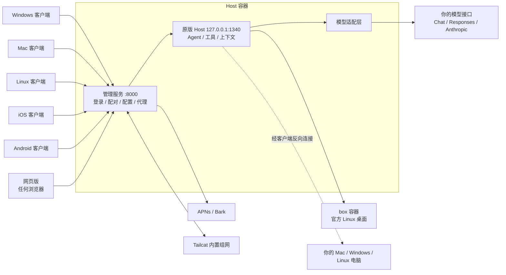

# 技术文档

[English](ARCHITECTURE.en.md) · [部署手册](AI-INSTALL.md)

ProkBot Plus 的原理、各部分的实现、目录、测试与维护，以及已知限制。

## 原理

原版 Grok Bot 的服务端在官方云端，分两部分：Host 负责对话、调度 Agent 和保存记录；云电脑是一台 Linux 桌面，Agent 在上面实际操作。本项目把两部分都搬到你自己的机器上，尽量直接使用原版程序：

- **Host**：原版 Node.js 程序，只替换和官方服务绑定的部分，外面再加一层管理服务；
- **执行电脑**：官方 Linux 桌面镜像，原样运行在 Docker 里。也可以让 Agent 操作你自己的电脑；
- **客户端**：原版界面不变，补丁让它只连接你的 Host。



补丁工具从你提供（或自动下载）的原版文件里复制字节，加入本项目的修改，生成新的客户端或镜像。补丁只有「复制」和「新增」两种操作，每一段都校验原文件哈希，不反编译、不重写原版程序。

## 功能对照

🟢 保留原版　🔁 换成你自己的服务　⛔ 已关闭

| 功能 | 这里怎么做 | 你需要准备 |
| --- | --- | --- |
| 🔁 登录 | 不需要账号。管理页生成 6 位配对码，客户端输入 Host 地址和配对码 | — |
| 🔁 Host 和执行电脑 | Host 按服务器架构构建，执行桌面保持原版 | amd64 / arm64 Linux，amd64 桌面可独立部署 |
| 🔁 对话模型 | 多个模型服务和档案，三种接口格式；默认路由或单个 Bot 路由指定模型、思考强度和备用顺序 | 模型接口地址和 API Key |
| 🟢 电脑和浏览器操作、记忆、上下文压缩、定时任务、操作审批、人工接管 | 保留原版，改用你的模型和本地计时 | 操作电脑需要能看图的模型 |
| 🔁 自动审查 | 用你的模型判断操作能不能执行，规则可以自己写 | — |
| 🔁 演示任务（Teach a task） | 录制保留原版，整理成技能用你的模型 | 能看图的模型 |
| 🔁 操作你的电脑 | 经你的 Host，电脑不需要开放端口。Mac 支持命令与图形控制；Windows 和 Linux 支持本机命令 | Mac、Windows 或 Linux 客户端 |
| 🔁 Bot 资料库、用户资料、技能 | 保存在 Host 上；技能可以查看版本、对比和恢复 | — |
| 🔁 连接应用 | Host 自己的应用目录：代码应用、远程 MCP 或纯技能，支持 OAuth、API Key；Bot 也能自己写应用 | 应用自己的凭据 |
| 🔁 复杂编程 | 交给已连接的 Mac、Windows 或 Linux 上的 Codex，用这台电脑的 Codex 登录和模型 | 装好并登录 Codex CLI |
| 🔁 Bot 和技能分享、多 Bot 协作 | 发布到自己的 Host、导出 ZIP；把任务交给其他 Host 上的 Bot | 另一个 Host |
| 🔁 语音输入、实时通话 | Fish Audio、OpenAI 兼容的转写，或 Mac 本地模型；通话的识别和合成分别接你的服务（实验） | 语音服务 |
| 🔁 图片和视频生成 | OpenAI 兼容图片接口（按比例出图、参考图修图）、WaveSpeed 等 | 供应商的 Key |
| 🔁 联网搜索 | Claude 或 OpenAI Responses 自带的联网，或 DeepSeek、HTTP JSON 搜索服务 | 可选 |
| 🔁 手机推送 | iOS 用 APNs 或 Bark；Android App 自己保持连接；网页版在页面打开时用浏览器通知 | iOS 需要 Bark，或 Apple 开发者账号和 .p8 |
| 🔁 外网访问 | IP 地址、Tailscale、HTTPS 反向代理，或内置的 Tailcat | 视情况准备域名 |
| ⛔ 遥测、错误上报、自动更新 | 已关闭，补丁固定在支持的版本 | — |

未提供的原版功能：虚拟卡、外部消息草稿、产品反馈、通行密钥转发，以及添加官方网站上分享的 Bot（x.ai/bot/… 页面的「Add to Grok Bot」：模板存在官方云端，要用官方账号下载）。

上游 ProkBot 新增的功能：应用（一个 JSON 文件，见[应用开发](#app-development)）、Webhook 触发任务、用量统计、提示词管理（可恢复原版）、按模型设置上下文、管理网页（中英文、深浅色、手机屏幕）、[分机部署](AI-INSTALL.md#split-host)和[卷备份恢复](AI-INSTALL.md#volume-recovery)。

## 各部分的实现

### Host 与管理服务

原版 Host 只替换了和官方服务绑定的四部分：身份验证、Agent 身份、模型调用和 MCP 配置；原版定时任务由官方后端触发，这里补上了本地计时。外面的管理服务负责管理员登录、设备配对、配置和推送，并把客户端请求转给原版 Host。

- **`host` 容器**：管理服务监听 8000，映射到宿主机 `${GROKBOT_LISTEN_ADDRESS:-127.0.0.1}:${GROKBOT_PUBLIC_PORT:-18080}`；原版 Host 只监听容器内的 `127.0.0.1:1340`。
- **`box` 容器**：官方 Linux 桌面，VNC 端口只在容器网络内可见。

同机 Box 只共享五棵受保护数据目录：`agents`、`user-memory`、`workflows`、`plugins`、`managed-skills`，并且只挂到 `/data/runtime/host-data/<目录>`，仍在原版 `RemoteBox` 的受保护根内；`agent-transcripts`、`connector-secrets`、`model.env`、`auth.json`、`projects` 和其他内部数据不会挂入 Box。`agents/<id>/` 里的 `store.db` 等数据库随 `agents` 一起挂入：和官方同机运行时一样，Bot 的 Shell 看得到它们，Read 工具会被原版的受保护路径检查拒绝。每个目录使用独立的 `volume subpath`，所以同机部署要求 Docker Engine 26.0+、API 1.45+ 和 Compose 2.26.0+，部署工具在写入或启动前检查；`--host-only` 不挂子路径，不检查。部署工具启动服务前用 Host 镜像运行一次 `data_init.py`，只创建缺失目录，并且只设置这些新建目录的属主和权限，不改已有顶层目录；部署、备份和恢复都会核对完整的挂载集合。`compose.yaml` 还会设置 `GROKBOT_HOST_MEMORY_MOUNTS=1`，提示运行时只在同机 Box 拓扑追加现场检查提示，让 Bot 在自己的电脑上读记忆；`--host-only` 和远程执行端不会收到该提示。

| 数据 | 内容 |
| --- | --- |
| 卷 `host-data`（`/data`） | 管理员（`auth.json`）、设备、Bot、对话、用量和配置。模型 Key 在 `model.env`，联网在 `web-services.json`，图片在 `media.json`，上游 `/models` 能力缓存与同步开关在 `model-context-cache.json`（由管理服务写入），运行时溢出观测上限在 `model-context-observed.json`（由 Host 运行时写入） |
| `/data/setup-key` | 初始化码，初始化完成后自动删除 |
| 卷 `box-home`、`box-workspace` | 执行电脑的家目录和工作区 |

`.env` 里的 `GROKBOT_PUBLIC_URL` 是对外地址：客户端配对时校验地址是否一致，管理接口的 Origin 也以它为准，只能是整个域名或 IP，不能带路径。`TZ` 影响定时任务和用量统计。

管理接口：管理员密码用 scrypt 保存（12–128 位），登录后用 Cookie 会话；非 GET 请求必须带 `x-grokbot-csrf: 1`，带 `Origin` 时必须和对外地址一致；登录、初始化、模型测试按 IP 每分钟限 5 次，`/admin/api/model/catalog` 与 `/admin/api/model/resolve` 每分钟限 30 次，`/admin/api/model/sync-contexts` 每分钟限 12 次（另设 `PUT /admin/api/model/sync-settings` 保存同步开关、`POST /admin/api/model/observed/clear` 清除观测上限）；配对码 6 位、5 分钟有效、只能用一次，配对后设备拿到独立令牌，可在管理页吊销。`host/tools/host-admin.mjs` 在命令行完成初始化、配置并测试模型、生成配对码和查看状态。

### 模型适配层

原版的模型请求发给官方分类器。本项目在 Host 发出请求前接手：把原版 Harness 的消息转换成三种接口之一，再把流式回复转换回原版格式。工具调用、子 Agent、上下文管理仍是原版逻辑。

| 文件 | 职责 |
| --- | --- |
| `host/runtime/model-session.mjs` | 入口，按 `apiFormat`（`openai` / `openai-responses` / `anthropic`）分派，负责主/备切换 |
| `host/runtime/model-routing.mjs` | 校验服务、档案和路由配置，解析默认或 Bot 路由及备用链 |
| `host/runtime/openai-chat.mjs` | Chat Completions（`/chat/completions`）。`[DONE]` 和 `finish_reason` 有一个就算结束；`stop` 但带了工具调用时照常执行；空参数只对没有必填参数的工具当 `{}` |
| `host/runtime/openai-responses.mjs` | Responses（`/responses`），无状态调用 |
| `host/runtime/anthropic-messages.mjs` | Messages，地址写根地址或 `/v1` 都可以 |
| `host/runtime/model-common.mjs` | SSE 解析、错误归一、图片和文件转换、推理来源标记、可选参数回退 |
| `host/runtime/model-policy.mjs` | 思考强度档位、参考档位表、含输出预留的 75% 摘要阈值计算及运行时档位降级 |
| `host/runtime/model-specs.mjs` | 模型 ID 规范化、内置参考上下文规格及多格式 `/models` 字段解析（最低 1024） |
| `host/runtime/model-context-cache.mjs` | `model-context-cache.json` 与 `model-context-observed.json` 分进程缓存读写，解析 `auto` / `manual` 上下文与档位 |
| `host/server/models.mjs` | 保存配置、读取与同步上游模型列表、能力解析、连接测试（和正式对话走同一条代码路径） |

| 能力 | OpenAI Chat | OpenAI Responses | Anthropic Messages |
| --- | --- | --- | --- |
| 思考强度 | `reasoning_effort`；DeepSeek 另加 `thinking` 开关 | `reasoning.effort`，附推理摘要和加密推理 | Claude 4.6 起用自适应思考加 `output_config.effort`，更早的型号用思考预算 |
| 多轮推理接续 | 回传同一模型的 `reasoning_content` | `store: false`，回传加密推理 | 回传带签名的思考块 |
| 图片和文件 | 图片、PDF、文本文件 | 工具结果中带图，PDF | 工具结果中带图，PDF 和文本文档 |

- **思考强度**：`none`、`minimal`、`low`、`medium`、`high`、`xhigh`、`max`，以及 `default`（不发送）。档案支持 `effortsMode`（`auto` / `manual`）；旧档案（含未迁移的单服务配置）默认保留 `manual`，命令行 `host-admin model-set` 仅在指定 `--efforts` 时设为 `manual`（否则沿用原模式）。`auto` 模式下优先跟随上游 `/models` 返回的档位，其次匹配内置参考表（`effortLevels` 已通过 `normalizeModelId` 支持带服务商或区域前缀的模型 ID）；若上游列表变化导致已选档位不再受支持，运行时自动降级到最接近的支持档位，非 `none` 档位绝不会降到 `none`（无可用档位时退回 `default` 不发送推理参数）。
- **Bot 路由**：服务保存格式、地址和 Key；档案绑定服务、模型 ID、思考强度和上下文策略。单个 Bot 可定义主档案和最多 8 个备用档案，不调用 Jev；子代理继承父 Bot 的路由。Key 只写入私有 `model.env`。
- **主/备切换**：主模型尚未发出文字或工具调用时，402、408、429、5xx、网络错误或上游 I/O 空闲超时（默认 300 秒）转到下一个备用；Harness 自己还有 150 秒首字停滞超时，多数首字停滞会先由它结束本轮。400、认证错误和调用方取消不触发备用。只有明确的额度耗尽才跳过共用同一 Key 的备用。已经发出文字或工具调用后绝不切换，避免重复输出和工具副作用。
- **推理来源标记**：不同格式、不同服务商的推理互相读不了。每段推理在 `providerOptions.grokbot` 记下格式和服务 ID，回放时只交给同源的模型。
- **上下文容量与自愈**：档案支持 `contextMode`（`auto` / `manual`）。旧档案（含未迁移的旧版单服务 `model.env`，即使上下文填 `0`）以及未提供 `contextMode` 的配置在管理页与运行时均保留 `manual`；命令行 `host-admin model-set` 仅在指定 `--context` 时切换为 `manual`，未指定时沿用原档案模式并只采纳上游返回的容量。`auto` 只跟随上游 `/models` 返回的容量（≥ 1024）和运行时溢出观测上限，**不套用内置表猜测**（内置规格表仅在管理页显示为建议值，用户确认采用后按 `manual` 保存）。`auto` 模式下摘要阈值按扣除输出预留后的 75% 计算（Anthropic 自动扣除默认 `max_tokens` 64000，例如 200K 模型为 102K，回落配置快照时同样适用）；`manual` 档案以及管理页按总上下文计算的推荐阈值仍按 75%。`auto` 模式下遇到输入超限溢出报错时，会在内存立即下调并仅在出现比较式报错（如 `a + b > c`）或连续两次一致观测后写入 `model-context-observed.json`（保留 30 天，不随定时后台同步覆盖）；`manual` 模式不受观测值压低。可通过管理页清除按钮、手动「同步上游能力」或保存配置清除观测上限：保存时对接口格式、地址、密钥或模型与上下文设置发生变动的档案清除对应观测上限，若这些字段均未变动（如原样重新保存、仅改名或调整路由/思考档位）则清除当前全部档案的观测上限（早于清除时间的挂起观测不会复活）。
- **后台同步与开关**：开启管理页的「自动同步上游模型能力」（默认开启）时，管理服务会在启动、保存模型配置和每 6 小时携带服务 API Key 请求上游 `/models` 刷新缓存（缓存仅存 SHA-256 键、容量和档位，不存明文 Key 或地址）；**仅当存在 `auto` 档案（`contextMode` 或 `effortsMode` 为 `auto`）时才在后台请求对应服务，全部档案为 `manual` 时自动跳过**（管理页手动「同步上游能力」和查询建议值不受影响），关闭开关后停止一切后台请求。「附带 Codex 客户端版本参数探测清单」（`?client_version=0.160.0`）默认关闭，仅在管理页明确开启后才会发送。
- **可选参数回退**：服务商用 400 拒绝某个可选参数（例如 `reasoning.summary`、`max_tokens`）时，去掉它重试一次并在本次会话内记住，日志打印 `[model] … retrying without …`。
- **已知网关问题**：有的聚合网关用 Responses 格式转发 Claude 时，带工具就返回 `native_thinking_replay_mismatch`。Claude 请用 Anthropic 格式。

三种接口都只在收到完整终止标记后发布工具调用；中途 EOF、损坏编码和取消都按失败处理。

### 自动审查

Bot 做有风险的操作前，原版会问官方分类服务。这里改用你配置的模型判断，沿用原版的分类提示词和结果格式（`host/runtime/host-auto-review.mjs`）。模型不按格式回答时重试一次，仍失败才拒绝；每次失败都在日志里写 `Local auto-review failed: <原因>`。

### 联网与生成图片

原版的 `WebSearch`、`WebFetch`、`GenerateImage` 由 Host 提供，没有配置服务商时不会出现。

| 文件 | 作用 |
| --- | --- |
| `host/runtime/web-services.mjs` | 联网适配器：`anthropic-tools`（模型自带的 `web_search` / `web_fetch`）、`responses-search`（只能搜索）、`deepseek-tools`、`http-json` |
| `host/server/media-providers.mjs` | 图片适配器：`openai-images`、`wavespeed`、`http-json` |
| `host/runtime/media-services.mjs` | 生成任务记录、结果落盘、防止重复提交 |

本项目的修复：

- 开启思考的 Claude 不接受强制工具调用。`anthropic-tools` 收到这类 400 后改用自动调用，并对这个模型记住；
- 并行搜索里有一路返回 `max_uses_exceeded` 时，只要有一路成功就采用；
- 原版工具传 `aspect_ratio`，OpenAI 图片接口只认 `size`：Host 从模型参数定义的 `size` 列表选比例最接近的一项，没有列表时用 `1024x1024`、`1536x1024`、`1024x1536`；
- 带参考图时改为 multipart 请求 `/images/edits`。

图片模型可以在 `PUT /admin/api/media` 的 `models[].inputSchema` 里写参数定义：只有含 `images` 属性的模型才接收参考图；`size` 列表要同时有横版和竖版。联网和图片供应商的地址一律以 `/v1` 结尾，包括 `anthropic-tools`。

### 多条消息的送达顺序

原版要求 Bot 把回复拆成 2–4 条 `SendToUser`。本项目的模型层等整段回复结束才把工具调用交给 Harness（避免重试时重复执行），而可靠性层执行工具前要先写盘，几条消息同时启动时谁先写完谁先发。`host/runtime/reliability/tool-order.mjs` 按书写顺序让每条 `SendToUser` / `SendToAgent` 等上一条执行完，其他工具照常并行；前一条最多等 15 秒。并发回复用到同一个调用 ID 时，这条消息不参与排序，而不是让对话出错。

模型换了调用 ID 却要求重发上一条已成功送达的同样文本时，适配层以不可重试错误结束这一轮，不会重复发送。

### 回合连续性与状态提示

`host/runtime/turn-continuity.mjs`（经 `recovered-host-flow.mjs`、`recovered-engine.mjs`、`recovered-harness.mjs`、`recovered-host-execution.mjs` 与 `model-errors.mjs` 注入）负责多步工具回合的收尾、重试与状态提示：

- **静默工具收尾提醒**：`detectSilentToolCallEnding` 识别在最后一次成功 `SendToUser` / `SendMessage` / `ReactToMessage` 之后又执行了实质性工具调用（支持多条进度 `SendToUser`、先调工具再发进度、并行调用以及纯文本/仅思考收尾），而 `update_state`、`TodoWrite` / `todo_write` 等记账工具不计入未送达工作；`TurnRuntime.ensureUserReply` 配合不重发旧内容的收尾提示，每轮最多触发 2 次收尾提醒（含原版首轮与追加循环），并在每次收尾提醒上写入 `sand.closing_send_nudge` 追踪属性。
- **空响应与漏发 `SendToUser` 重试**：`buildAgentForRun` 仅对普通用户回合开启 `enableEmptyResponseRetry: true`（子代理、`isSilenceAllowed` 的定时任务/后台唤醒/广播，以及群聊成员回合保持关闭，避免在允许保持静默的回合强推模型发消息）。引擎步内重试在后续实质性工具结果后不再被早前的进度 `SendToUser` 屏蔽，同时将每轮空响应/漏发 `SendToUser` 的可见性重试共同限制在最多 2 次。
- **`length` 输出截断自动续写**：`model-errors.mjs` 将模型 `length` 截断映射为 `OutputTokensLimitExceededError`，由 `AbstractUserMessageActionHandler.runWithMaxTokensRetry` 注入提示词拆小并续写，每步只续写一次；再次截断则以不可重试的错误中止，保留原始截断错误信息，而不是覆写成笼统的 `step-retries`，Runner 也不会重试整轮。只续写一次，是因为每次截断的部分回复都会留在历史里，第二次续写的请求会以这段 assistant 回复结尾，新版 Claude 会以「不支持 prefill」拒绝。
- **工作中状态提示**：`RunLifecycle.beginSessionRun` 在进入运行态时立即写入 `{ kind: 'thinking' }`，且 `resolveNamedActivityHold` 在中段 `send-message` 更新时保持 `thinking`（直到 `turn-ended` 与 `endSessionRun` 清空），避免回合启动或中段进度消息后状态短暂空白。

### 执行电脑

直接使用官方 Linux 桌面镜像，Host 通过带认证的连接操作它，可以和 Host 同机，也可以放到另一台。让 Agent 操作你的电脑时，客户端主动连到 Host，你的电脑不需要开放端口。

<a id="mac-client"></a><a id="windows-client"></a><a id="linux-client"></a><a id="mac-客户端"></a><a id="windows-客户端本版本新增"></a>
### 桌面客户端（Mac、Windows 与 Linux）

原版桌面客户端是 Electron 应用。这里保留原版界面，重写负责连接和系统功能的主进程（`mac/clients/desktop/`，Mac、Windows 与 Linux 共用），让它只连接你的 Host。平台差异集中在 `platform.mjs`。复杂编程交给本机的 Codex。

- **Mac**：默认 ad-hoc 签名；要让 Agent 控制图形界面，需要用自己的证书签名（`--identity auto`），并授予辅助功能和屏幕录制权限。输出放在 `.noindex` 目录，避免 Spotlight 收录重复的 App。补丁按本机芯片选原版：Apple 芯片的固定输入在 `mac/patchers/desktop/`，Intel 的在 `mac/patchers/desktop/x64/`，`--arch` 可以指定。如需上一版 1.2.3，请使用 v1.14.0 的 Mac 发布包；回退 `0.71.2` 请使用 v1.7.0 的 Mac 发布包。重建 Mac Tailcat：`python host/network/build-tailcat.py --target darwin-arm64 --output mac/dist/network`（Apple 芯片）和 `python host/network/build-tailcat.py --target darwin-amd64 --output mac/dist/network/x64`（Intel）。
- **Windows**：`windows/patchers/desktop/patch.mjs` 默认用 1.3.0 安装包，`--version 1.2.3`、`--version 1.1.0` 或 `--version 0.71.2` 改用回退版本，`--source` 可指定安装包、`app-64.7z` 或已安装目录（按大小和 SHA-256 识别版本）。从 NSIS 安装包取出 `app-64.7z`，用 Windows 自带的 `tar.exe`（Windows 10 用 7-Zip）解包，核对 `app.asar` 并回放 recipe；`--verify-only` 到此为止。生成时换入共用主进程，重打 ASAR，输出便携目录、便携 ZIP、安装包和 `*.patch.json`。改过的 `Grok Bot.exe` 不再带官方签名。
- **Windows 运行时**：关窗后留在托盘；通知用带 AppUserModelID 的开始菜单快捷方式；本机命令用 PowerShell 并打开 UTF-8 输出（从 Git Bash 启动会改变 `cmd /c` 参数，请从开始菜单启动）；委派用本机 `codex.exe`，结束时 `taskkill /T`。Windows 没有 Mac 的鼠标键盘组件。
- **Linux**：`linux/patchers/desktop/patch.mjs` 支持官方 1.3.0 `x64`（`linux/patchers/desktop/`）和 `arm64`（`linux/patchers/desktop/arm64/`）的 `.deb` 原包（`deb.mjs` 用纯 Node 解析 `ar` 归档并校验整包及 `data.tar.xz` 摘要，再调用 `tar` 解包），核对 `grok-bot` 与 `app.asar` 并回放 recipe；Linux Electron 不校验 ELF 内嵌 ASAR 摘要，保持原版 `grok-bot` 二进制不变。复用 `host/bin/` 下对应架构的 Linux Tailcat，输出便携目录（`grokbot-local/`）、`.tar.gz`（`--no-archive` 可跳过）、`*.patch.json` 及免 root 的 `install.sh` / `uninstall.sh` / `setup-apparmor.sh`。如需上一版 1.2.3，请使用 v1.14.0 的 Linux 发布包。
- **Linux 运行时**：主窗口沿用官方无边框样式（`frame: false, titleBarStyle: 'default'`），由原版界面渲染最小化/最大化/关闭按钮并在 Wayland 下传递 `--sand-wayland-client`；配对窗口使用原生边框；托盘使用 `icon.png`（不可用时关窗直接退出，菜单保留 `Ctrl+Q`）；提示音依次回退 `pw-play` / `paplay` / `aplay`；凭据优先用系统密钥环，无守护进程时沿用官方行为启用 `basic_text`；本机机器 ID 使用 `linux-` 前缀，支持本机命令行与 Codex，不支持鼠标键盘图形控制。
- **桌面 1.1.0 / 1.2.3 / 1.3.0 接口**：preload 按 `desktop-mount`、`main`、`spotlight` 三条边声明方法，`local-services.mjs` 按边注册处理器；全局搜索由 `gateway.mjs` 转为 Host 的 `searchAgents` / `searchMedia`；听写把 16 kHz PCM 攒成 WAV 交给 Host 的 `/local/audio/transcriptions`。1.3.0 的 preload 结构和协调器协议（v3）与 1.2.3 相同；`main` 边新增的方法里，`downloadAttachments` 把一条消息的多个附件存进用户选的文件夹（不覆盖已有文件，重名时用「名称 (2).扩展名」），`getBotPage`、`getGrokBotAgentBotSkills`、`getGrokBotAgentPreview`、`browseGrokBotTeamAgents`、`getPluginMcpServerLinks` 和 `getMcpMarketplaceLinkNeeds` 返回官方在云端没有数据时的空值；其余依赖云端账户的新操作仍未实现，由原版界面显示失败。
- **recipe**：1.3.0 的五平台 recipe（Windows x64、macOS ARM64、macOS Intel x64、Linux x64、Linux ARM64）由 `windows/tools/desktop-recipes/build.mjs`（`--target windows|mac-arm64|mac-x64|linux-x64|linux-arm64`）统一生成。`spec.mjs` 的每处修改以原文件里只出现一次的文本为锚点，追加的本项目代码在 `extensions/`；`--check` 从官方安装包重新生成，比较解压后的内容（不同 zlib 压缩出的 gzip 字节不同），并核对每个 recipe 文件与清单里的 SHA-256 一致。`1.2.3/`（由提交 `41c836b` 的 `spec.mjs` 生成）、`1.1.0/`（由提交 `8c1fcd1` 的 `spec.mjs` 生成）和 `0.71.2/` 的 recipe 保留为 Windows 回退版本，其中 1.1.0 和 0.71.2 也供 Android / 网页版使用；`mac/patchers/desktop/native-helper.mjs` 针对 1.3.0 的 `CUGrokBotService` 通用二进制更新 Team ID。`mac/clients/desktop/*-settings-extension.js` 是 0.71.2 recipe 加进设置页的代码的源码。
- **安装器**：`windows/installer/` 用 Go 标准库把 `stub.exe`、便携 ZIP 和 32 字节尾部拼成按用户安装包，默认装到 `%LOCALAPPDATA%\Programs\Grok Bot Local`，支持 `/S`、`/D=目录`。重建 stub：在 `windows/installer/` 运行 `go build -trimpath -ldflags="-H=windowsgui -s -w" -o ../dist/installer/grokbot-setup-stub.exe .`；重建 Tailcat：`python host/network/build-tailcat.py --target windows-amd64 --output windows/dist/network`。

<a id="desktop-protocol"></a>
**共享协议**：

- `gateway.mjs` 每个端口只回应一次 v3 `ready`，版本不符就关端口；请求 ID 在端口内去重，取消只作用于该请求。
- `connection.mjs` 加密保存设备凭据，只在原 Host 地址或原 Tailcat 隧道重试，换地址须重新配对；请求不跟随重定向。
- `streams.mjs` 只有 `/events` 返回 200 和 `text/event-stream` 后才报告在线，重连带 `Last-Event-ID`。普通请求返回 401 时，先用 `/connect/status` 核对，只有它也返回 401 才要求重新配对；没有这个接口的旧 Host 照原来的方式弹出配对窗口。
- `client-persistence.mjs` 写入失败时保留原设置；文件损坏时改名为 `local-client-persistence.json.damaged-<时间>` 后按空数据继续。

<a id="android-客户端"></a><a id="android-client"></a>
### Android 客户端

官方 Android 版是 React Native 应用，带 Google Play 的防篡改保护，改动后无法运行；绕过保护不在本项目范围内。所以 Android 客户端在手机上运行官方**桌面版**的界面，由本项目的外壳代替 Electron。

**外壳**（`android/shell/`，Kotlin，无第三方库；预编译版是 `android/dist/grokbot-android-shell.apk`）是一个全屏 WebView 加上：

- **本地网关**（`LocalGateway.kt`），只监听 `127.0.0.1`：界面端口提供界面文件和 `/__native/*` 原生接口，并把 `/api`、`/events`、`/local`、`/connect`、`/notifications` 转发给 Host 并加上设备令牌；电脑画面端口只转发 noVNC。两个端口都校验每次启动随机生成的 Cookie，界面端口还校验 Host、Origin 和 Sec-Fetch-Site。设备令牌只在原生层。
- **凭据**（`Storage.kt`）：设备令牌用 Android Keystore 的 AES-GCM 密钥加密。
- **通知**（`Notifications.kt`）：前台服务跟随 Host 的 `/notifications/events`，正在看的 Bot 不提醒；点通知用 `grokbot-local://agent/<id>` 打开对应的 Bot；开机和升级后自动恢复。
- **系统功能**：文件选择和保存、麦克风权限、返回键、深色模式、系统栏和安全区域。

**桥接**（`android/client/`）在 WebView 里代替 Electron 的主进程和 preload：

- `bridge.js` 模拟 `ipcRenderer`、`contextBridge` 和 `process`，原样运行官方 `preload.cjs`；`services.js`、`gateway.js` 移植桌面主进程的本地方法（附件、文件、资料、语音、设置、连接应用）。
- `webview.js` 用 iframe 代替 `<webview>`：网关在 noVNC 页面注入 `vnc-bridge.js` 和官方 `preload-vnc.cjs`；iframe 跟随界面的 `pointer-events`，只有「取得控制权」后才能触摸操作。电脑画面的票据 10 分钟失效，每次加载前重新读取 `getForeverBoxStatus` 换入新票据。
- `layout.js`、`android.css` 照官方手机版排版：宽度小于 600 px 时 Bot 列表和对话是两个全屏页面，返回键从对话回到列表；对话详情、设置、市场和搜索全屏显示，其他对话框从底部弹出；600 px 以上沿用桌面排版，对话详情在 792 px 以下是全屏层。选择器同时匹配 1.1.0（`data-component`、`sand-` 类名）和 0.71.2（`.ui-dialog` 等）。
- `anchor-fallback.js`：Chromium 125 以前不支持 CSS 锚点定位，电脑画面会缩成 0，兼容代码在布局后换算成像素。
- `compat.js`（ES5）：补齐官方界面直接调用、但旧 WebView 没有的函数（例如 `URL.canParse`、`toSorted`、`Object.hasOwn`、`showPopover`、`moveBefore`），只补缺少的；页面起不来时（低于 Chromium 89）显示 WebView 版本和需要更新的组件，而不是白屏。

**生成工具**（`android/patchers/patch.mjs`）：下载并校验官方 Windows 安装包，执行该版本的 Windows recipe；校验界面入口和 preload 的 SHA-256，执行 `renderer-patches.mjs` 中该版本的界面修改（放宽对话详情的宽度判断、去掉「教 Bot 做任务」和「获取手机版」入口、锚点兼容、列表显示最后活动时间）；放进外壳 APK 的 `assets/web/`，按 zipalign 规则对齐，用 v2 方案签名（`apk.mjs`）。签名密钥第一次生成时创建在 `~/.grokbot-local/android-signing.json`。`supported.json` 顶层是推荐版本，`fallback` 列出其他版本。

**配对**：Android 发送 `platform: desktop` 和 `clientKind: android`，新版 Host 把它存为 Android 设备，不授予桌面执行权限。不支持 Tailcat，不能在手机上执行命令，没有「教 Bot 做任务」。

<a id="web-client"></a>
### 网页版

网页版在浏览器里运行和 Android 同一套界面与桥接。Android 外壳做的事（提供界面文件、保管设备令牌、注入电脑画面桥接）由 Host 完成，外壳的原生接口由浏览器功能代替。使用说明见 [`web/README.md`](../web/README.md)。

**界面包**（`web/patchers/patch.mjs`）：和 Android 走同一条路生成界面；在界面入口的官方脚本前插入 `boot-data.js`、`compat.js`、`bridge.js`、`web-shell.js`、样式和 Web App 清单，CSP 的 `frame-src` 加 `'self'`、`connect-src` 加 `wss:`。输出 ZIP 的第一项 `web-bundle.json`（`grokbot-web-bundle/v1`）列出其余文件的大小和 SHA-256。界面包含有官方界面，只装在用户自己的 Host 上，不进仓库、不进 Release。`--upload` 用 `upload.mjs` 登录管理 API、上传、启用后退出登录。

**Host 端**（`host/server/web-client.mjs`）：

- **安装**：按清单核对路径、大小和摘要，限制文件数和大小，解到旁边的目录后整体换入，任何一步失败都不动原包。
- **登录**：`/web/login` 是 Host 自己的页面（`public/web-login.*`）。`/web/api/pair` 用配对码创建 `platform: web` 的设备，令牌放进 `grokbot_web` Cookie（HttpOnly、SameSite=Strict，https 下加 Secure）。界面文件只提供给已登录的浏览器。
- **设备接口**：带 Cookie 的请求还必须带 `x-grokbot-web: 1` 且 Origin 同源。其他网站发这个头要经 CORS 预检，Host 从不放行，这是 SameSite 之外的第二道防线。`web` 设备没有桌面执行权限；撤销设备时一并吊销电脑画面票据、推送登记和已打开的连接。
- **电脑画面**：iframe 直接加载 Host 的 `/vnc/desktop/`、`/vnc/fork/`；Host 在 noVNC 页面插入取自界面包的桥接脚本。

**浏览器层**（`web/client/`）：

- `boot-data.js`：准备语言、主题、设置和 `?agent=` 深链接（读取后从地址栏去掉）；iPhone 和 iPad 禁止缩放，避免点输入框时放大；Android 用 `interactive-widget=resizes-content`。
- `native.js`：外壳原生接口的浏览器实现。设置存 localStorage，下载用 Blob 链接，外部链接开新标签页，收到 401 回到登录页；只连接提供页面的 Host。
- `web-shell.js`：浏览器的返回键和返回手势先交给桥接逐级返回；用 `visualViewport` 让键盘不挡输入框；页面打开时订阅通知事件，用浏览器通知提醒没在看的 Bot，按 ID 去重。
- `web.css`：整页不滚动，从主屏幕打开时留出安全区域。

与 Android 共用代码的修改：`compat.js` 在 Safari 缺少 `device-pixel-content-box` 时改用 `content-box`，避免对话变白；`bridge.js` 打开深链接或通知指向的 Bot 时，等界面列出 Bot 后再聚焦。http 的局域网地址不是安全上下文，麦克风、语音输入和通知只在 https 或 `localhost` 下可用。

### iOS 客户端

原版 iOS 客户端用 React Native 开发。这里写了一个注入的动态库（Objective-C，源码在 `ios/clients/ios/`，`build.py` 编译），把发往官方的请求转到你的 Host，再对 Hermes 字节码做少量固定修改。小组件、分享和通知三个扩展保留，使用独立的 Bundle ID；`extensions.py` 与 `patch-app.py` 同时隔离主应用与扩展 `Info.plist` 中的 `GrokAppProtection` 组配置。补丁输出未签名的 IPA，主应用和三个扩展都要自己签名（见 [`ios/README.md`](../ios/README.md)）。

- **字节码补丁工具（HBC 98）**：1.27.0（29519）的三份补丁由 `ios/tools/build_ios_127_recipe.py` 与 `ios/tools/hbc98/` 仅凭用户原版 1.27.0 HBC 与仓库内归档 1.26.0 补丁即可确定性重建（按 1.27.0 字符串表语义移植全部 59 处编辑与 6 个新增函数，包含 `stampSender` 父环境槽位 `60`、`gatewayPorts` `CreateClosureLongIndex`、动态 `Promise.resolve(true)` 遥测桩、SkillDetail 环境槽位 `12`/`18` 与 React 模块 `__r(50)`、保持 `ChatAvatar` 默认 `live`、隐藏 `useNativePluginEntries`、扩展 `BackendClient.call`/`callPublic` 至 24 项本地旁路、以及在 `buildPinnedGate` (`fn#19464`) 固定 `cloud_canvas_skill` 与 `grok_bot_canvas_skill` 为 `true`），回放三份 recipe 并模拟 URL/token 注入后重新审计。`ios/tools/build_ios_126_recipe.py` 需要未提交的本地中间分析文件（`bodies_full.json`、`bodies_plan.json` 等，因含原版字节码片段不进仓库）才能重跑，仅供留档参考。`ios/recipes/ios/1.26.0/` 与 `ios/recipes/ios/1.16.0/` 保留 1.26.0（29388）和 1.16.0（23152）的固定回退补丁；仓库只保存确定性补丁，不保存原版或修改后的 HBC。
- **Host 兼容与注入库**：`ios/clients/ios/GBConnectors.m` 通过 swizzle `NSURLSession` 工厂方法在保留应用自定义 `NSURLSessionConfiguration` 的同时前置本地 `NSURLProtocol`（后台会话配置原样放行），拦截自动审查团队偏好 RPC 返回 `{}`，并将连接应用、8 个 Canvas/Pages RPC 与 2 个 MCP 工具权限 RPC 转发至 Host `/local/mobile-rpc/`；Host 端由独立模块 `host/server/mobile-rpc-compat.mjs` 对未启用自建 Pages 的实例返回 `ListUserCanvases` 空列表、Connect 格式 `not_found`/`unimplemented` 错误，并对 `GetGrokBotMcpToolPermissions` 返回 `{ servers: [] }`、`SetGrokBotMcpToolPermissions` 返回 501 `unimplemented`。`GBBootstrap.m` 依据设置页特有标记（`dev-gateway@localhost`、本地配置覆盖 tag 等）在设置页接管「退出登录 / Sign out」清理全部钥匙串访问组、`NSUserDefaults` 与 `Caches/GrokBotPaired`，并在未配对登录页提供原生「连接 Host」入口。

<a id="voice"></a>
### 语音、推送和外网访问

- **实时通话**：保留原版通话界面，对话改成三步：识别服务转文字，当前 Bot 用自己的模型回答，合成服务读出来。
- **推送**：Host 可直接给 APNs 发通知（需要有推送权限的 Apple 开发者账号和 .p8 密钥），没有就用 Bark。
- **外网访问**：局域网、VPN、HTTPS 反向代理，或内置的 Tailcat。Tailcat 基于 Tailscale 的开源组网组件，内置在客户端、Host 和执行电脑里，复制连接链接或扫码即可连接，不需要 Tailscale 账号。

<a id="app-development"></a>
### 技能、应用、分享和协作

原版的技能目录、应用市场、Bot 发布和多 Agent 协作都依赖官方平台。这里在 Host 上各做了一份，沿用原版界面，数据来自你的 Host。代码应用和 Webhook 接入了原版的工具和自动任务。

Bot 和技能发布到自己的 Host，或在管理页「分享」导出、导入 ZIP，在 Host 之间传递。桌面客户端只注册 `grokbot-local://` 链接，不接管官方的 `grokbot://`（包括官方网站的模板链接 `grokbot://app/v1/bot-template`），以免和同一台电脑上的官方客户端冲突。

开发时用一个 `grokbot-app` JSON 声明代码、远程 MCP 或技能，在管理页导入和授权。代码应用在执行电脑上运行，沿用该用户的文件和网络权限。完整格式与 OAuth 示例在 `host/server/application-guide.md`，这也是 Bot 写应用时读取的指南。

## 目录与关键文件

| 路径 | 内容 |
| --- | --- |
| `host/deploy.py` | 对外部署入口：预检、初始化、启动、升级、备份、恢复。与容器内的 `host/deploy/` 不同 |
| `host/release/` | `build-docker.py` 下载校验原版并构建 `grokbot-host:local`；`patch-host.py`、`bytepatch.py` 应用 Host 补丁；`compose*.yaml`；`backup.py`；`platforms.py` 识别架构 |
| `host/recipes/host/` | 原版 Host、桌面和补丁的输入清单（`manifest.json`） |
| `host/server/` | 管理服务：认证、配对、推送、配置、网页版托管、管理网页（`public/`） |
| `host/runtime/` | 注入原版 Host 的运行时：模型适配层、联网与图片、自动审查、可靠性层（`reliability/`） |
| `host/deploy/` | 容器内的进程管理和独立执行节点 |
| `host/tools/host-admin.mjs` | 命令行管理 |
| `host/network/`、`host/bin/` | Tailcat 源码与构建脚本、预编译的 Linux 版 |
| `host/bench/` | 整机容量测量工具（见 `host/README.md`） |
| `mac/clients/desktop/` | 桌面主进程，Mac、Windows 与 Linux 共用；Android 也复制其中的 `i18n.mjs`、`external-url.mjs`、`connectors.mjs` |
| `mac/patchers/desktop/` | Mac 补丁、recipe 应用器、原版下载器（Windows、Linux 也用）；`x64/` 是 Intel 版的固定输入和 recipe |
| `linux/patchers/desktop/` | Linux 补丁：`patch.mjs`、`deb.mjs`（纯 Node 解析与校验 `.deb`）、`launcher.mjs`（便携启动器与用户级安装脚本）、`tar.mjs`、`recipes/`；`arm64/` 是 ARM64 版的固定输入和 recipe |
| `windows/patchers/desktop/` | Windows 补丁：`patch.mjs`、`original.mjs`（解压官方安装包，Android 和网页版也用）、`inputs.mjs`（各版本输入）、`pe.mjs`、`recipes/`；`1.1.0/` 与 `0.71.2/` 是回退版本 |
| `windows/tools/` | 1.3.0 桌面 recipe 生成工具 `desktop-recipes/`（支持 Windows / macOS ARM64 / macOS Intel / Linux x64 / Linux ARM64）、preload 检查 |
| `windows/installer/`、`windows/dist/` | 安装器源码，预编译的 Tailcat 和安装器 stub |
| `android/shell/`、`android/dist/` | Android 外壳源码（`release-shell.mjs` 重建）和预编译外壳 |
| `android/client/` | WebView 里的桥接、排版和兼容代码，网页版共用 |
| `android/patchers/` | APK 生成：`patch.mjs`、`apk.mjs`、`renderer-patches.mjs`、`supported.json` |
| `web/client/`、`web/patchers/` | 网页版的浏览器层；界面包生成和上传 |
| `ios/` | `release/patch-ios.py` 补丁入口；`clients/ios/` 注入库源码 |
| `ci/` | 输入检查、首页版本表、官方通道快照、发布打包和工作流模板 |
| `*/recipes/`、`*/THIRD_PARTY/` | 补丁数据；第三方许可证 |

## Linux 部署要点

- 两种架构走同一套 Host 补丁。amd64 Host 保留原版镜像基底；ARM64 用 Node 22、锁定的 ARM 原生模块（`host/release/arm-runtime/`）和按架构编译的 Tailcat。官方桌面始终是 `linux/amd64`。
- ARM 同机先运行一个小型 amd64 容器做探针，失败时不下载大桌面；独立桌面模式下 ARM Host 不下载桌面。原版镜像只接受固定的摘要。
- 在 Windows 上检出的代码会丢掉可执行权限，所以 Dockerfile 复制 Tailcat 后会再 `chmod 755`。
- Docker 发布的端口不经过 ufw。需要限制访问时改 `GROKBOT_LISTEN_ADDRESS`，或在网络边界上限制。
- 备份期间会暂停容器，健康检查可能短暂失败。

<a id="capacity-evidence"></a>
**容量依据**：首页的最低（2 核 4 GB）和推荐（4 核 8 GB）配置来自 2C4G、4C8G 两台虚拟机从零部署后的功能测试（配对、附件、两轮真实对话、取消、重启后读回），以及作者生产实例约一周的实际占用（内存峰值 Host 0.9 GB、执行桌面 1.7 GB，镜像约 13 GB）。2C2G 两次限时测试都没通过。这些只说明个人或家庭使用够用；多客户端的持续负载没有测过。要测更高负载，用 `host/bench/` 在专用的非生产虚拟机上比较，方法见 [`host/README.md`](../host/README.md#capacity-benchmark)。

<a id="testing"></a>
## 测试与维护

需要 Node.js 22.12+、Python 3.10+。提交前六套测试必须全部通过，每条单独运行：

```sh
node ci/check-inputs.mjs                 # 固定版本、补丁清单和预编译外壳摘要
node ci/homepage-versions.mjs            # 首页版本表是否与清单一致
node --test "host/tests/*.test.mjs"      # 服务端
node --test "windows/tests/*.test.mjs"   # Windows 客户端
node --test "mac/tests/*.test.mjs"       # Mac / 共用客户端
node --test "linux/tests/*.test.mjs"     # Linux 客户端
node --test "android/tests/*.test.mjs"   # Android 客户端
node --test "web/tests/*.test.mjs"       # 网页版
```

- Host 的网页版路由测试需要先执行 `npm ci --prefix host/server --omit=dev --ignore-scripts`，否则这一项跳过。
- 在 Git Bash 里运行 Host 测试时，PATH 里的 `/usr/bin/tar` 会让两项部署用例失败，要把 `C:\Windows\System32` 放在前面，使用 Windows 自带的 `tar.exe`。
- 依赖官方原包的用例默认跳过。把原包放在 Git 忽略的 `inputs/` 并设置环境变量后才会运行：`PROKBOT_ANDROID_TEST_SOURCE`、`PROKBOT_WEB_TEST_SOURCE`（1.1.0 安装包）、`PROKBOT_WEB_TEST_FALLBACK_SOURCE`（0.71.2 安装包）、`PROKBOT_TEST_HOST_ARCHIVE`（Host 原包，未设置时找 `inputs/host/sand-host-bundle-d0a4baa.tgz`）。
- 网页版浏览器测试：`python web/tests/browser-flows.py <界面包>`，需要 Playwright（`pip install playwright`、`playwright install chromium firefox webkit`），在 8 种设备尺寸上跑登录、对话、看图、通知、返回和退出。改了 `android/client/` 或 `web/` 要用 1.1.0 和 0.71.2 两种界面包各跑一次。
- iOS 测试：
  - `python3 -B -m unittest discover -s ios/tools/hbc98/tests`（在仓库根目录运行，HBC 98 解析与补丁生成单测）；
  - `python3 ios/tests/ios-release.test.py`、`ios-signing.test.py`、`ios-pairing-credentials.test.py`、`ios-app-intents-source.test.py`、`ios-pages-rpc.test.py`（跨平台离线运行）；
  - `python3 ios/tests/ios-network.test.py` 与 `python3 ios/tests/ios-auto-review-preferences.test.py`（需要装了 Xcode 命令行工具的 Mac）。
- Android 外壳配对来源检查：`python android/tests/native_pairing_origin.py`，需要先构建外壳。

自动测试之外，改动后建议用 `host-admin.mjs model-set --test-only` 对各格式发真实请求，在客户端完成一次带工具调用的多轮对话，并让 Bot 搜一条新闻、画一张 16:9 的图再改一处。改了 Host 运行时代码要重建镜像才生效，只在隔离的非生产实例上验证。

<a id="desktop-compatibility"></a><a id="desktop-validation"></a>
### 支持新的官方版本

版本由构建工具读取的清单决定：桌面 `*/patchers/desktop/supported.json` 和 `recipes/manifest.json`，Android 和网页版 `android/patchers/supported.json`，iOS `ios/recipes/ios/manifest.json`（及回退目录 `ios/recipes/ios/<版本>/manifest.json`、`ios/patchers/ios/extensions.py` 中的 `EXTENSIONS_BY_RELEASE` 与 `WIDGETS_SCHEME_COUNTS_BY_RELEASE`），Host `host/recipes/host/manifest.json`。不要放宽哈希校验。

```sh
node ci/official-channels.mjs --online --phase planning     # 查询官方通道的当前版本
node ci/desktop-source-audit.mjs <windows|mac|linux> <app.asar> <版本> <asar-sha256>
node windows/tools/desktop-recipes/build.mjs --target <windows|mac-arm64|mac-x64|linux-x64|linux-arm64> --source <安装包、.app 或 .deb> --check
node --expose-internals windows/tools/inspect-desktop-preload.mjs <preload.cjs> <preload-sha256>
```

1. 桌面（Windows、Mac 与 Linux）：Windows 先把当前版本的输入和 recipe 移到 `windows/patchers/desktop/<版本>/` 作为回退（并把它的三个文件加进 `ci/release-packages.py` 的必需文件）；Mac 与 Linux 每种架构只固定一个版本，旧版本由上一个发布包提供；更新各平台 `supported.json`，按新原文件调整 `spec.mjs` 的锚点后分别运行 `build.mjs --target windows`、`--target mac-arm64`、`--target mac-x64`、`--target linux-x64`、`--target linux-arm64`（并在 Mac 上核对 `native-helper.mjs` 偏移）。Android 和网页版另外验证 WebView 桥接和 `renderer-patches.mjs`，再更新 `android/patchers/supported.json`（旧版本移进 `fallback`）。
2. 检查 preload 的接口变化、Bot 目录和资料库、表格、弹窗与输入法，并确认错版输入会被拒绝。
3. 在真实客户端上验证配对、吊销、Bot 列表与历史、两轮对话、取消、附件上传并读回、重连不重复、重启后历史仍在。
4. 官方通道的观测记录在 `ci/official-snapshot.json`。更新它之后运行 `node ci/homepage-versions.mjs --write` 刷新双语首页的版本表；这不改变补丁接受的版本。

发布流程（打包、校验、各包的 `--verify-only`、创建 Release）见仓库根目录的 `AGENTS.md`。

## 二次开发入口

| 需求 | 位置 |
| --- | --- |
| 部署、升级、备份 | `host/deploy.py` → `host/release/`；容器内启动在 `host/deploy/supervisor.mjs`。新装和带旧卷升级要分别测试 |
| 新增模型接口格式 | 在 `host/runtime/` 新建适配文件，照 `openai-chat.mjs` 的形态实现，再在 `model-session.mjs`、`host-auto-review.mjs` 的 `CLASSIFIERS`、`host/server/models.mjs`、管理页 `public/model.js` 注册 |
| 调整思考档位 | `host/runtime/model-policy.mjs`；Claude 型号特性在 `anthropic-messages.mjs` |
| 修改管理页 | `host/server/public/`，英文文案在 `locales-en.js` |
| 修改桌面客户端 | `mac/clients/desktop/`，Mac、Windows 与 Linux 共用；Android 也复制其中几个模块 |
| 修改 Android 客户端 | 桥接在 `android/client/`；外壳在 `android/shell/`，改完运行 `node android/shell/release-shell.mjs` 更新预编译外壳和摘要（需要 JDK 17+ 和 Android SDK） |
| 修改网页版 | 浏览器层在 `web/client/`，Host 端在 `host/server/web-client.mjs`；桥接与 Android 共用 |
| 应用（插件） | 先看能否做成应用或技能：[应用开发](#app-development) |

## 已知限制

- 只支持清单里的固定版本，官方更新后要重新制作补丁；没有自动更新。
- Windows：Bot 还不能控制鼠标键盘；没有代码签名；只支持 x64；Tailcat 和实时语音没有和真实 Host 联调过；1.3.0 只通过了离线的补丁回放和生成校验，还没有在 Windows 上实际运行。
- Linux：不支持本机鼠标键盘图形控制；Ubuntu 24.04+ 启用 AppArmor userns 限制时需运行一次 `sudo …/setup-apparmor.sh` 以保留沙箱；上一版 1.2.3 在 WSL2 的 Ubuntu 22.04 x64（WSLg）上实测了生成、配对、对话、需审批的本机命令、重启恢复和安装卸载脚本，1.3.0 只通过了离线的补丁回放；原生 GNOME / KDE、Wayland、Tailcat、托盘、ARM64 和 Ubuntu 24.04 的 AppArmor 脚本还没实测。本机命令和 Codex 需要 1.10.0 及以后的 Host，旧 Host 不接受 `linux` 平台。
- Android：不支持 Tailcat；排版照官方手机版，但页面内容是桌面版的（设置是「通用 / 电脑 / 更新」等标签页，Bot 的电脑从对话详情打开）；后台通知靠前台服务，部分厂商系统需要允许后台运行；语音只验证到请求送达 Host；只在模拟器上测过。
- 网页版：只能使用 Host 上的 Bot 电脑；不支持 Tailcat；http 地址下麦克风、语音输入和通知不可用，页面关闭后没有通知；没有在真机浏览器上测试。
- 原版桌面只有 amd64。单台 ARM 机器同时运行 Host 和模拟桌面的完整部署和性能没有验证。
- Mac：1.3.0 尚未在 Mac 上生成或运行（Mac 的 `--verify-only` 只能在 macOS 上执行），只在 Windows 上从官方 DMG 内容做了 recipe 重现和 `CUGrokBotService` Team ID 偏移检查。上一版 Intel 1.2.3 已在 Intel Mac 上实测生成、配对和对话可用（本机图形控制和 Tailcat 尚未在 Intel Mac 上实测）；Apple 芯片 1.2.3 已通过证书签名构建校验，但尚未在 Apple 芯片真机上实测运行。
- iOS 需要自备已解密的 IPA 和签名证书。1.27.0（29519）由贡献者在 iPad Pro 上实测了升级、配对、消息与图片附件、自动审查设置和通知流；之后重编的注入库（`053542bc…`）只在 Mac 上跑过离线与原生测试，尚未重新上真机验证。iPhone 还没有完整实测；1.26.0 和 1.16.0 回退版本搭配新注入库也没有真机测试。
