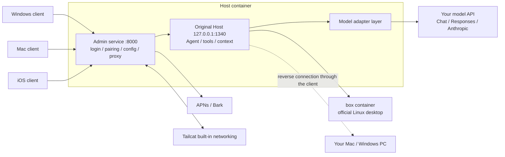

# Technical notes

[简体中文](TECHNICAL.md)

This document describes how ProkBot Plus is built, what it changes on top of upstream ProkBot, and why. For deployment steps, see the [AI deployment guide](AI-INSTALL.en.md). For how the parts inherited from upstream work, see [Features and architecture](ARCHITECTURE.en.md).

## Overall structure

The original Grok Bot runs its server side in the official cloud, in two parts: the Host handles conversations, schedules Agents and keeps records; the cloud computer is a Linux desktop where the Agent does the actual work. This project moves both parts to your own server and uses the original programs directly wherever possible:

- **Host**: the original Node.js program. Only the parts tied to the official service are replaced: authentication, Agent identity, model calls and MCP configuration. Local scheduled triggers are added, and an admin service layer sits in front.
- **Execution computer**: the official Linux desktop image, running unchanged in Docker.
- **Clients**: the original interface is unchanged. The patches make them connect only to your Host.



The patches only work on pinned versions. Original files are checked by SHA-256, and a wrong version is rejected outright:

| Component | Version |
| --- | --- |
| Original Host | `sand-host-bundle-d0a4baa` |
| Linux desktop image | `9d2ac1b` (manifest digest `sha256:73c04dc8…`, config digest `sha256:1bdd316a…`) |
| Windows client | 0.71.2 x64 (`Grok_Bot_0.71.2_Setup.exe`) |
| Mac client | 0.71.2 Apple Silicon |
| iOS client | 1.16.0 (23152) arm64 decrypted IPA |

## Directory layout

| Path | Contents |
| --- | --- |
| `host/release/build-docker.py` | Downloads and verifies the original Host and desktop image, and builds `grokbot-host:local` |
| `host/release/patch-host.py`, `bytepatch.py` | Generates the patched Host from `host/recipes/host/manifest.json`. Only copies and inserts fixed bytes, with no decompiling |
| `host/release/compose.yaml` | Standard deployment: two services, `host` and `box`, and three volumes |
| `host/release/compose.host.yaml`, `compose.execution.yaml` | Run the Host and the execution computer on separate machines. See [host/docs/DEPLOYMENT.en.md](../host/docs/DEPLOYMENT.en.md) |
| `host/release/backup.py` | Backs up and restores volumes |
| `host/server/` | Admin service: authentication, pairing, push, all settings, admin web page (`public/`) |
| `host/runtime/` | Runtime injected into the original Host: model adapter layer, web and images, automatic review, reliability layer and more |
| `host/tools/host-admin.mjs` | Command-line admin tool (new in this version) |
| `host/network/` | Go source and build script for the built-in Tailcat networking |
| `host/tests/` | Server unit tests |
| `mac/clients/desktop/` | Desktop client main process, **shared by Mac and Windows**: connection, pairing, notifications, local commands, Codex delegation |
| `mac/patchers/desktop/` | Mac patcher, recipe applier and original-app downloader. The Windows patcher uses it too |
| `windows/patchers/desktop/` | Windows patcher (new in this version): main flow in `patch.mjs`, `pe.mjs`, `zip.mjs`, `recipes/` |
| `windows/tools/` | Tool that ports Mac recipes to Windows recipes |
| `windows/installer/` | Installer source (Go, standard library only) |
| `windows/dist/` | Prebuilt `grokbot-tailcat.exe` and installer stub |
| `ios/` | dylib for iOS injection, bytecode patches, signing notes |

## Server runtime layout

- `host` container: the admin service listens on 8000, mapped to `${GROKBOT_LISTEN_ADDRESS:-127.0.0.1}:${GROKBOT_PUBLIC_PORT:-18080}` on the host machine. The original Host listens only on `127.0.0.1:1340` inside the container and is reached through the admin service's proxy.
- `box` container: the official Linux desktop. Its VNC port is visible only inside the container network.

| Data | Contents |
| --- | --- |
| Volume `host-data` (mounted at `/data`) | Administrator, devices, Bots, chat history, usage statistics, all settings. The model key is in `/data/model.env`, web settings in `/data/web-services.json`, image settings in `/data/media.json` |
| `/data/setup-key` | Setup code. Deleted automatically after setup |
| Volumes `box-home`, `box-workspace` | Home directory and workspace of the execution computer |

Variables in `.env`:

| Variable | Description |
| --- | --- |
| `GROKBOT_LISTEN_ADDRESS` | Address the port binds to. Default `127.0.0.1` |
| `GROKBOT_PUBLIC_PORT` | Port on the host machine. Default `18080` |
| `GROKBOT_PUBLIC_URL` | Public address. Clients check that the address matches when they pair, and the admin API checks Origin against it |
| `TZ` | Time zone. Affects scheduled tasks and usage statistics |

Security measures for the admin API:

- The administrator password is stored as a scrypt hash (12–128 characters). After login, a cookie session is used;
- Non-GET requests must include `x-grokbot-csrf: 1`. If `Origin` is sent, it must match the public address;
- Login and setup are rate-limited per IP, 5 times per minute;
- Pairing codes have 6 characters, are valid for 5 minutes and can be used once. After pairing, each device gets its own token, which can be revoked in the admin page.

## Model adapter layer

The original sends model requests to the official service. This project takes over before the Host sends the request: it converts the messages of the original Harness into one of the three APIs, then converts the streamed reply back into the original format. Tool calls, sub-Agents and context management are still the original logic. Upstream supports only OpenAI Chat. **The Responses and Anthropic formats are new in this version.**

| File | Role |
| --- | --- |
| `host/runtime/model-session.mjs` | Entry point. Dispatches by `apiFormat` (`openai` / `openai-responses` / `anthropic`) |
| `host/runtime/openai-chat.mjs` | Chat Completions. Appends `/chat/completions` to the address |
| `host/runtime/openai-responses.mjs` | Responses. Appends `/responses` to the address. Stateless calls |
| `host/runtime/anthropic-messages.mjs` | Messages. The address can be the root address or end in `/v1` |
| `host/runtime/model-common.mjs` | SSE parsing, error normalization, image and file conversion, reasoning source tags, optional parameter fallback |
| `host/runtime/model-policy.mjs` | Thinking effort levels and the reference table of levels for each model |
| `host/runtime/host-auto-review.mjs` | Automatic review: uses the current model to decide whether an action may run. Supports all three formats |
| `host/server/models.mjs` | Saves the config, reads model lists, runs connection tests (on the same code path as real conversations) |

| Capability | OpenAI Chat | OpenAI Responses | Anthropic Messages |
| --- | --- | --- | --- |
| Thinking effort | `reasoning_effort`; DeepSeek also gets a `thinking` switch | `reasoning.effort`, with reasoning summaries and encrypted reasoning | From Claude 4.6, adaptive thinking plus `output_config.effort`; older models use a thinking budget; on models where thinking can't be turned off, `none` becomes `low` |
| Reasoning across turns | Sends back `reasoning_content` from the same model | `store: false`, sends back encrypted reasoning | Sends back signed thinking blocks |
| Images and files | Images, PDF, text files | Images directly in tool results, PDF | Images directly in tool results, PDF and text documents |
| Output limit | Chooses between `max_completion_tokens` and `max_tokens` automatically | `max_output_tokens` | Per-model limit |

Thinking effort levels: `none`, `minimal`, `low`, `medium`, `high`, `xhigh`, `max`, and `default` (no effort parameter is sent). For the levels a model supports, the values returned by the API's `/models` come first. If there are none, the built-in reference table is used.

**Reasoning source tags.** Reasoning from one format or model can't be read by another. Each piece of reasoning records its format and model in `providerOptions.grokbot`. On replay, only the parts that the current format and model can read are sent back, so switching models in the middle of a conversation doesn't cause errors. The original Harness drops reasoning parts with empty text, so encrypted reasoning without a summary and empty thinking blocks are both saved as `redacted-reasoning` and restored on replay.

**Optional parameter fallback.** When a provider rejects an optional parameter with a 400 (for example `reasoning.summary`, `max_tokens`, `fallbacks`), the Host removes that parameter and retries once, remembers this for the rest of the session, and prints `[model] … retrying without …` in the log. Replayed reasoning that is no longer valid (for example when the history was rewritten by a summary) is handled the same way.

**Known gateway issue.** Some aggregator gateways return `native_thinking_replay_mismatch` for any request with tools when they forward Claude in the Responses format. This is a gateway problem. Use the Anthropic format for Claude.

## Automatic review

When the Bot wants to do something risky on the execution computer or your computer, the original first asks the official classification service. This project uses the model you configured to decide instead, with the original classification prompt and result format.

This version adds two things:

- The model sometimes doesn't answer as required (it doesn't call the classification tool, the JSON is incomplete, or a field is invalid). In that case the request is retried once automatically, and the action is rejected only if the retry also fails. Provider errors and cancellations are not retried.
- Every failure writes a line `Local auto-review failed: <reason>` to the Host log. In the original, failures were silent. The Bot would only say "the automatic safety check ran into an error", which made it hard to debug.

## Web access and image generation

The original `WebSearch`, `WebFetch` and `GenerateImage` tools are served by the Host. If no provider is configured, these three tools don't appear.

| File | Role |
| --- | --- |
| `host/runtime/web-services.mjs` | Web adapters: `anthropic-tools` (the model's own `web_search` / `web_fetch`), `responses-search` (`web_search` in Responses, search only), `deepseek-tools`, `http-json` |
| `host/server/media-providers.mjs` | Image adapters: `openai-images`, `wavespeed`, `http-json`. `mediaInput` converts tool arguments into the request body |
| `host/runtime/media-services.mjs` | Records generation tasks, saves results to disk, prevents duplicate submissions |

Changes in this version:

- **Newer Claude models can use the web too.** Claude with thinking turned on doesn't accept forced tool calls (`tool_choice: {type: 'tool'}`). When `anthropic-tools` gets this kind of 400 error, it switches to automatic tool choice, tells the model in the prompt to call the tool, and remembers this choice for that model.
- **Tolerant parallel search.** Claude often sends two searches at once (for example one in Chinese and one in English), and the one over the usage limit returns `max_uses_exceeded`. The old logic marked the whole search as failed because of this. Now the result is used as long as one search succeeds.
- **Aspect ratio converted to size.** The original tool passes `aspect_ratio` (1:1, 4:3, 3:4, 16:9, 9:16), but the OpenAI image API only accepts `size`. The Host picks the entry with the closest ratio from the `size` list in the model's parameter definition. Without a list, it uses `1024x1024`, `1536x1024`, `1024x1536`. When the Bot sets a size explicitly in `parameters.size`, that size is used.
- **Editing from a reference image.** When `openai-images` gets a reference image, it sends a multipart request to `/images/edits` instead, with the image field named `image[]`.

Example parameter definition for an image model, written in `models[].inputSchema` of `PUT /admin/api/media`:

```json
{
  "id": "gpt-image-2", "providerId": "images", "model": "gpt-image-2", "kind": "image", "enabled": true,
  "name": "GPT Image 2", "description": "Text-to-image and editing from reference images. Use high quality when high detail is needed.",
  "parameters": { "size": "1024x1024", "quality": "high" },
  "inputSchema": { "type": "object", "additionalProperties": false, "properties": {
    "prompt": { "type": "string" },
    "images": { "type": "array", "items": { "type": "string" }, "maxItems": 10 },
    "size": { "type": "string", "enum": ["auto", "1024x1024", "1536x1024", "1024x1536", "1536x1152", "1152x1536", "1536x864", "864x1536"] },
    "quality": { "type": "string", "enum": ["auto", "low", "medium", "high"] }
  } }
}
```

Rules for writing parameter definitions:

- Only models with an `images` property receive reference images. Don't add it for a model whose API doesn't support editing.
- The `size` list needs both landscape and portrait sizes, so the ratio conversion has something to choose from. For a model that only supports the standard sizes, list only those three standard sizes.
- Addresses for web and image providers always end in `/v1`, including `anthropic-tools`. This is different from the root address used for the Anthropic chat model.

## Delivery order of multiple messages

The original prompt asks the Bot to reply the way people text: first one sentence to acknowledge, then the conclusion and extra details split across 2–4 `SendToUser` messages. The original model output is streamed, and each tool call runs as soon as it has been written, so the messages naturally arrive in order.

The model layer in this project waits until the whole reply has finished, then hands all the tool calls to the Harness at once. This way a retry after a mid-stream error doesn't run tools twice. But the reliability layer `host/runtime/reliability/tool-journal.mjs` writes the execution intent to disk before it runs each tool. When several messages start at the same time, whichever finishes writing first is sent first, and short messages often get ahead of long ones.

`host/runtime/reliability/tool-order.mjs` fixes this:

- When the model layer hands over the tool calls, it records the order in which `SendToUser` / `SendToAgent` were written in this reply;
- The execution layer makes each message wait until the previous one has run before it starts. Other tools still run in parallel;
- If the previous message never runs, it waits at most 15 seconds. On cancel, it stops waiting right away.

## Windows client (new in this version)

The official Windows client of the same version uses the same Electron interface code as the Mac version. The only differences are the build number, resource file names, module order and a few line breaks.

**Patch flow** (`windows/patchers/desktop/patch.mjs`):

1. Download `Grok_Bot_0.71.2_Setup.exe` and verify its SHA-256. You can also use `--source` to point to an installer, `app-64.7z` or an installed folder.
2. Cut `app-64.7z` out of the NSIS installer and extract it with the `tar.exe` that comes with Windows 11. Windows 10 uses 7-Zip.
3. Unpack `resources/app.asar`, replace the main process with `local-client/main.mjs`, and copy in the shared `mac/clients/desktop` code.
4. Apply the byte patches in `recipes/`. There are only two kinds of operation, copy and insert, and every segment checks the hash of the original file.
5. Repack the ASAR. Files that are not packed, such as `.node` files, are compared one by one with the original and must match.
6. `Grok Bot.exe` embeds the SHA-256 of the ASAR header, and the patch replaces this value in place. This breaks the official signature, so the signature is removed instead of leaving an invalid one behind.
7. Add `grokbot-tailcat.exe` and its license, then output a portable folder, a portable zip, an installer and a `*.patch.json` manifest.

**Recipe porting** (`windows/tools/port-desktop-recipes.mjs`): the Windows recipes are generated automatically from the Mac recipes and the original files of both platforms:

- The original files of the two platforms are aligned segment by segment, and all copied content is taken from the Windows original;
- Exported identifiers in the bundle are translated for each platform;
- Every segment gets a syntax structure check.

**Platform differences at runtime**:

- **Window**: keeps the original frameless window and uses `titleBarOverlay` to show the system title bar buttons.
- **Tray and notifications**: after the window is closed, the app stays in the notification area. System notifications are delivered through a Start menu shortcut that carries an AppUserModelID.
- **Computer connection**: the machine ID is `win-<device ID>`, and the Host shows the platform as `win32`.
- **Local commands**: uses the original executor. When the client is started normally, the executor runs commands with Windows PowerShell.
  - The original doesn't turn on the UTF-8 output option for PowerShell, so command output is garbled on Chinese Windows. The client turns this original option on when it loads the executor (`loadLocalExecDaemon` in `mac/clients/desktop/local-exec.mjs`).
  - When the client is started from Git Bash, the original switches to Git Bash, and arguments such as `cmd /c` get rewritten by Git Bash. So start the client from the Start menu.
- **Showing images from the Host**: the image addresses the Host records look like `file:///data/...`. The Windows version parses them with POSIX rules (`remoteAttachmentPath` in `attachments.mjs`). Otherwise images and screenshots made by the Bot would keep showing as loading.
- **Codex delegation**: finds the local `codex.exe` (including Codex installed with npm), and ends the whole process tree with `taskkill /T` when it finishes.
- **No local mouse and keyboard control**: the original computer-use component only exists for macOS.

**Installer** (`windows/installer/`):

- Written with the Go standard library. The installer is laid out as `stub.exe` + portable zip + a 32-byte trailer (stub length, zip length, `GROKBOT-SETUP-V1`).
- Installs per user to `%LOCALAPPDATA%\Programs\Grok Bot Local`, registers an uninstall entry and creates a Start menu shortcut. Supports `/S` and `/D=directory`.
- To rebuild the installer stub, run this in `windows/installer/`: `go build -trimpath -ldflags="-H=windowsgui -s -w" -o ../dist/installer/grokbot-setup-stub.exe .`.
- To rebuild Tailcat for Windows, run this from the repository root: `python host/network/build-tailcat.py --target windows-amd64 --output windows/dist/network` (needs Go).

## Mac and iOS

- **Mac**:
  - Keeps the original Electron interface and replaces the main process.
  - Ad-hoc signed by default. For the Agent to control the local graphical interface, sign with your own certificate (`--identity auto`) and grant Accessibility and Screen Recording permissions.
  - The output goes in a `.noindex` folder so Spotlight doesn't index it as a duplicate app.
- **iOS**:
  - Injects a dynamic library that sends requests meant for the official service to your Host, and makes a few fixed changes to the bytecode.
  - The three extensions (widgets, share, notifications) are kept.
  - Outputs an unsigned IPA. The user signs it.

## Linux deployment notes

- The image is `linux/amd64`. From Docker 29 on, new installs use the containerd image store by default, and the ID that `docker image inspect` reports becomes the manifest digest. The upstream build script only accepted the config digest and failed with `Unsupported Box image identity`. This version accepts both digests, and offline archives are checked against the config digest inside the archive.
- Code checked out or uploaded from Windows loses the executable bit. `Dockerfile.base` and `Dockerfile.execution` therefore run `chmod 755` on the Tailcat binary after copying it; otherwise enabling Tailcat on the server fails with `EACCES`.
- Ports published by Docker don't go through ufw. To restrict access, change `GROKBOT_LISTEN_ADDRESS`, or restrict it at the network boundary.
- Containers are paused during a backup, so the health check may fail briefly. This is normal.

## Tests

```sh
node --test "host/tests/*.test.mjs"      # server, 35 tests
node --test "windows/tests/*.test.mjs"   # Windows client, 8 tests
node --test mac/tests/*.test.mjs         # Mac / shared client, 15 tests
```

Coverage:

- **Server**: request building, stream parsing, reasoning replay, parameter fallback and error classification for all three formats, plus:
  - image ratio conversion and editing from reference images;
  - web tool fallback and parallel search tolerance;
  - automatic review retries;
  - message order.
- **Windows client**: window style, installer layout, finding Codex, Host image paths, command output encoding and more.

After changing code, it's a good idea to also check it for real:

- Use `host-admin.mjs model-set --test-only` to send real requests in each format;
- Have a multi-turn conversation with tool calls in a client;
- Ask the Bot to search for a news item, read a web page, draw a 16:9 image, and then change one thing in that image.

## Where to start for further development

| Task | Where |
| --- | --- |
| Add a new model API format | Create an adapter file in `host/runtime/` that implements a generator with the same shape as `openai-chat.mjs`, then register it in these places: `model-session.mjs`, `CLASSIFIERS` in `host-auto-review.mjs`, `host/server/models.mjs`, and the admin page `host/server/public/model.js` |
| Adjust the thinking levels of a model | `effortLevels` in `host/runtime/model-policy.mjs`. Claude model features are in `anthropic-messages.mjs` |
| Change the admin page | `host/server/public/`. English strings are in `locales-en.js` |
| Change the desktop client | `mac/clients/desktop/` (shared by Mac and Windows; platform differences are kept in `platform.mjs`) |
| Support a new official client version | Update the hashes in `supported.json`. Mac recipes have to be made again; Windows recipes are ported with `windows/tools/port-desktop-recipes.mjs` |
| App (plugin) development | [host/PLUGINS.en.md](../host/PLUGINS.en.md) |
