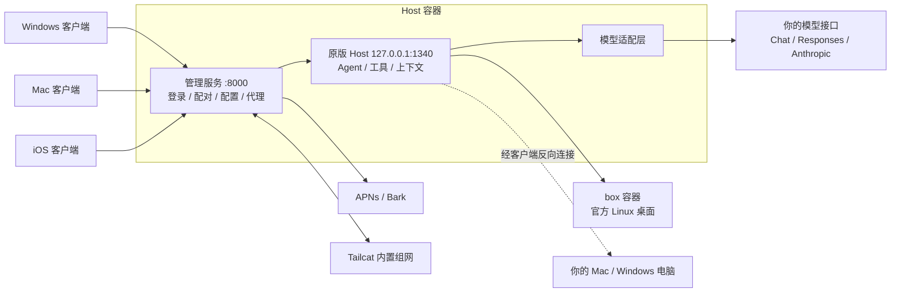

# 技术说明

[English](TECHNICAL.en.md)

这份文档说明 ProkBot Plus 的结构，以及它在上游 ProkBot 之上改了什么、为什么这样改。部署步骤见 [AI 部署手册](AI-INSTALL.md)。上游原有部分的完整原理见 [功能与原理](ARCHITECTURE.md)。

## 整体结构

原版 Grok Bot 的服务端在官方云端，分两部分：Host 负责对话、调度 Agent、保存记录；云电脑是一台 Linux 桌面，Agent 在上面实际操作。这个项目把两部分都搬到你自己的服务器上，并尽量直接使用原版程序：

- **Host**：原版 Node.js 程序，只替换和官方服务绑定的部分：身份验证、Agent 身份、模型调用、MCP 配置。补上本地定时触发，外面再加一层管理服务。
- **执行电脑**：官方 Linux 桌面镜像，原样运行在 Docker 里。
- **客户端**：原版界面不变，补丁让它只连接你的 Host。



补丁只对固定版本生效。原文件按 SHA-256 校验，版本不对会直接拒绝：

| 组件 | 版本 |
| --- | --- |
| 原版 Host | `sand-host-bundle-d0a4baa` |
| Linux 桌面镜像 | `9d2ac1b`（清单摘要 `sha256:73c04dc8…`，配置摘要 `sha256:1bdd316a…`） |
| Windows 客户端 | 0.71.2 x64（`Grok_Bot_0.71.2_Setup.exe`） |
| Mac 客户端 | 0.71.2 Apple Silicon |
| iOS 客户端 | 1.16.0（23152）arm64 砸壳 IPA |

## 目录

| 路径 | 内容 |
| --- | --- |
| `host/release/build-docker.py` | 下载并校验原版 Host 与桌面镜像，构建 `grokbot-host:local` |
| `host/release/patch-host.py`、`bytepatch.py` | 按 `host/recipes/host/manifest.json` 生成补丁后的 Host。只做固定字节的复制和新增，不反编译 |
| `host/release/compose.yaml` | 标准部署：`host` 和 `box` 两个服务，三个数据卷 |
| `host/release/compose.host.yaml`、`compose.execution.yaml` | Host 与执行电脑分开部署，见 [host/docs/DEPLOYMENT.md](../host/docs/DEPLOYMENT.md) |
| `host/release/backup.py` | 备份和恢复数据卷 |
| `host/server/` | 管理服务：认证、配对、推送、各类配置、管理网页（`public/`） |
| `host/runtime/` | 注入原版 Host 的运行时：模型适配层、联网与图片、自动审查、可靠性层等 |
| `host/tools/host-admin.mjs` | 命令行管理工具（本版本新增） |
| `host/network/` | Tailcat 内置组网的 Go 源码与构建脚本 |
| `host/tests/` | 服务端单元测试 |
| `mac/clients/desktop/` | 桌面客户端主进程，**Mac 与 Windows 共用**：连接、配对、通知、本机命令、Codex 委派 |
| `mac/patchers/desktop/` | Mac 补丁、recipe 应用器、原版下载器；Windows 补丁也用它 |
| `windows/patchers/desktop/` | Windows 补丁（本版本新增）：`patch.mjs` 主流程、`pe.mjs`、`zip.mjs`、`recipes/` |
| `windows/tools/` | 由 Mac recipe 移植出 Windows recipe 的工具 |
| `windows/installer/` | 安装器源码（Go，只用标准库） |
| `windows/dist/` | 预编译的 `grokbot-tailcat.exe` 和安装器 stub |
| `ios/` | iOS 注入用的 dylib、字节码补丁、签名说明 |

## 服务端运行结构

- `host` 容器：管理服务监听 8000，映射到宿主机 `${GROKBOT_LISTEN_ADDRESS:-127.0.0.1}:${GROKBOT_PUBLIC_PORT:-18080}`。原版 Host 只监听容器内的 `127.0.0.1:1340`，由管理服务代理访问。
- `box` 容器：官方 Linux 桌面，VNC 端口只在容器网络内可见。

| 数据 | 内容 |
| --- | --- |
| 卷 `host-data`（挂载为 `/data`） | 管理员、设备、Bot、对话记录、用量统计、各类配置。模型 Key 在 `/data/model.env`，联网配置在 `/data/web-services.json`，图片配置在 `/data/media.json` |
| `/data/setup-key` | 初始化码，初始化完成后自动删除 |
| 卷 `box-home`、`box-workspace` | 执行电脑的家目录和工作区 |

`.env` 里的变量：

| 变量 | 说明 |
| --- | --- |
| `GROKBOT_LISTEN_ADDRESS` | 端口绑定地址，默认 `127.0.0.1` |
| `GROKBOT_PUBLIC_PORT` | 宿主机端口，默认 `18080` |
| `GROKBOT_PUBLIC_URL` | 对外地址。客户端配对时会校验地址是否一致，管理接口的 Origin 也以它为准 |
| `TZ` | 时区，影响定时任务和用量统计 |

管理接口的安全措施：

- 管理员密码用 scrypt 哈希保存（12–128 位），登录后用 Cookie 会话；
- 非 GET 请求必须带 `x-grokbot-csrf: 1`；如果带 `Origin`，必须和对外地址一致；
- 登录和初始化按 IP 限流，每分钟 5 次；
- 配对码 6 位，5 分钟内有效，只能用一次。配对后设备拿到独立令牌，可以在管理页吊销。

## 模型适配层

原版的模型请求发往官方服务。本项目在 Host 发出请求前接手：把原版 Harness 的消息转换成三种接口之一，再把流式回复转换回原版格式。工具调用、子 Agent、上下文管理仍然是原版逻辑。上游只支持 OpenAI Chat，**Responses 和 Anthropic 两种格式是本版本新增的**。

| 文件 | 职责 |
| --- | --- |
| `host/runtime/model-session.mjs` | 入口，按 `apiFormat`（`openai` / `openai-responses` / `anthropic`）分派 |
| `host/runtime/openai-chat.mjs` | Chat Completions，地址后接 `/chat/completions` |
| `host/runtime/openai-responses.mjs` | Responses，地址后接 `/responses`，无状态调用 |
| `host/runtime/anthropic-messages.mjs` | Messages，地址写根地址或 `/v1` 都可以 |
| `host/runtime/model-common.mjs` | SSE 解析、错误归一、图片和文件转换、推理来源标记、可选参数回退 |
| `host/runtime/model-policy.mjs` | 思考强度档位和各模型的参考档位表 |
| `host/runtime/host-auto-review.mjs` | 自动审查：用当前模型判断一个操作能不能执行，三种格式都支持 |
| `host/server/models.mjs` | 保存配置、读取模型列表、连接测试（和正式对话走同一条代码路径） |

| 能力 | OpenAI Chat | OpenAI Responses | Anthropic Messages |
| --- | --- | --- | --- |
| 思考强度 | `reasoning_effort`；DeepSeek 另加 `thinking` 开关 | `reasoning.effort`，附推理摘要和加密推理 | Claude 4.6 起用自适应思考加 `output_config.effort`，更早的型号用思考预算；不能关闭思考的型号把 `none` 换成 `low` |
| 多轮推理接续 | 回传同一模型的 `reasoning_content` | `store: false`，回传加密推理 | 回传带签名的思考块 |
| 图片和文件 | 图片、PDF、文本文件 | 工具结果中直接带图，PDF | 工具结果中直接带图，PDF 和文本文档 |
| 输出上限 | 自动在 `max_completion_tokens` 和 `max_tokens` 之间选择 | `max_output_tokens` | 按型号上限 |

思考强度档位：`none`、`minimal`、`low`、`medium`、`high`、`xhigh`、`max`，以及 `default`（不发送强度参数）。某个模型支持哪些档位，优先用接口 `/models` 返回的值，没有时用内置参考表。

**推理来源标记。** 不同格式、不同模型的推理内容互相读不了。每段推理在 `providerOptions.grokbot` 里记下格式和模型，回放时只回放当前格式、当前模型能读的部分，所以对话中途切换模型不会出错。原版 Harness 会丢掉文字为空的推理片段，所以没有摘要的加密推理和空的思考块都保存成 `redacted-reasoning`，回放时再还原。

**可选参数回退。** 服务商用 400 拒绝某个可选参数（例如 `reasoning.summary`、`max_tokens`、`fallbacks`）时，Host 去掉这个参数重试一次，在本次会话内记住，并在日志里打印 `[model] … retrying without …`。回放的推理失效时（例如历史被摘要改写）同样处理。

**已知网关问题。** 有的聚合网关用 Responses 格式转发 Claude 时，只要请求带工具就返回 `native_thinking_replay_mismatch`。这是网关的问题。Claude 请用 Anthropic 格式。

## 自动审查

Bot 要在执行电脑或你的电脑上做有风险的操作时，原版会先问官方的分类服务。本项目改为用你配置的模型来判断，用的是原版的分类提示词和结果格式。

本版本补了两点：

- 模型偶尔不按要求回答（没有调用分类工具、JSON 不完整、字段不合法）。这种情况会自动重试一次，重试仍失败才拒绝这个操作。服务商报错和取消操作不重试。
- 每次失败都在 Host 日志里写一行 `Local auto-review failed: <原因>`。原版的失败是静默的，Bot 只会说「自动安全检查出错了」，很难排查。

## 联网与生成图片

原版的 `WebSearch`、`WebFetch`、`GenerateImage` 三个工具由 Host 提供服务，没有配置服务商时这三个工具不会出现。

| 文件 | 作用 |
| --- | --- |
| `host/runtime/web-services.mjs` | 联网适配器：`anthropic-tools`（模型自带的 `web_search` / `web_fetch`）、`responses-search`（Responses 的 `web_search`，只能搜索）、`deepseek-tools`、`http-json` |
| `host/server/media-providers.mjs` | 图片适配器：`openai-images`、`wavespeed`、`http-json`；`mediaInput` 把工具参数转换成请求体 |
| `host/runtime/media-services.mjs` | 生成任务记录、结果落盘、防止重复提交 |

本版本的改动：

- **新版 Claude 也能联网。** 开启思考的 Claude 不接受强制工具调用（`tool_choice: {type: 'tool'}`）。`anthropic-tools` 收到这类 400 错误后改用自动调用，并在提示词里明确要求调用工具，然后对这个模型记住这个选择。
- **并行搜索容错。** Claude 经常同时发出两路搜索（例如中文一路、英文一路），超出次数限制的那一路会返回 `max_uses_exceeded`。原逻辑因此判整个搜索失败，现在只要有一路成功就采用。
- **画面比例换算成尺寸。** 原版工具传的是 `aspect_ratio`（1:1、4:3、3:4、16:9、9:16），OpenAI 图片接口只认 `size`。Host 从模型参数定义的 `size` 列表里选比例最接近的一项；没有列表时用 `1024x1024`、`1536x1024`、`1024x1536`。Bot 在 `parameters.size` 里明确写了尺寸时，以它为准。
- **参考图修图。** `openai-images` 收到参考图时，改为 multipart 请求 `/images/edits`，图片字段名为 `image[]`。

图片模型的参数定义示例，写在 `PUT /admin/api/media` 的 `models[].inputSchema` 里：

```json
{
  "id": "gpt-image-2", "providerId": "images", "model": "gpt-image-2", "kind": "image", "enabled": true,
  "name": "GPT Image 2", "description": "文生图与参考图修图。需要高清时 quality 用 high。",
  "parameters": { "size": "1024x1024", "quality": "high" },
  "inputSchema": { "type": "object", "additionalProperties": false, "properties": {
    "prompt": { "type": "string" },
    "images": { "type": "array", "items": { "type": "string" }, "maxItems": 10 },
    "size": { "type": "string", "enum": ["auto", "1024x1024", "1536x1024", "1024x1536", "1536x1152", "1152x1536", "1536x864", "864x1536"] },
    "quality": { "type": "string", "enum": ["auto", "low", "medium", "high"] }
  } }
}
```

写参数定义的规则：

- 有 `images` 属性的模型才会接收参考图。接口不支持修图的模型不要写它。
- `size` 列表里要同时有横版和竖版尺寸，比例换算才有得选。只支持标准尺寸的模型，只写那三种标准尺寸。
- 联网和图片供应商的地址一律以 `/v1` 结尾，包括 `anthropic-tools`。这和对话模型的 Anthropic 根地址不同。

## 多条消息的送达顺序

原版提示词要求 Bot 像发短信一样回复：先用一句话确认，然后把结论和补充分成 2–4 条 `SendToUser` 消息。原版的模型输出是流式的，每个工具调用写完就执行，所以消息自然按顺序到达。

本项目的模型层要等整段回复结束，才把工具调用一次性交给 Harness，这样流中途出错重试时不会重复执行工具。但可靠性层 `host/runtime/reliability/tool-journal.mjs` 执行每个工具前都要先把执行意图写入磁盘。几条消息同时启动，谁先写完谁先发出，短消息往往跑到长消息前面。

`host/runtime/reliability/tool-order.mjs` 解决这个问题：

- 模型层交出工具调用时，记下这次回复里 `SendToUser` / `SendToAgent` 的书写顺序；
- 执行层让每条消息等上一条执行完再开始，其他工具照常并行；
- 前一条始终没有执行时，最多等 15 秒；取消时立即停止等待。

## Windows 客户端（本版本新增）

官方同版本的 Windows 客户端和 Mac 版用同一套 Electron 界面代码，差异只在构建编号、资源文件名、模块顺序和少数换行。

**补丁流程**（`windows/patchers/desktop/patch.mjs`）：

1. 下载 `Grok_Bot_0.71.2_Setup.exe` 并校验 SHA-256。也可以用 `--source` 指定安装包、`app-64.7z` 或已安装的目录。
2. 从 NSIS 安装包中切出 `app-64.7z`，用 Windows 11 自带的 `tar.exe` 解压。Windows 10 用 7-Zip。
3. 解开 `resources/app.asar`，主进程换成 `local-client/main.mjs`，复制共用的 `mac/clients/desktop` 代码。
4. 执行 `recipes/` 中的字节补丁。只有复制和新增两种操作，每一段都校验原文件哈希。
5. 重新打包 ASAR。`.node` 等不打包的文件与原版逐个比对，必须一致。
6. `Grok Bot.exe` 内嵌了 ASAR 头的 SHA-256，补丁原位替换这个值。官方签名因此失效，所以直接移除，不留一个无效签名。
7. 附加 `grokbot-tailcat.exe` 及其许可证，输出便携目录、便携 zip、安装包和 `*.patch.json` 清单。

**Recipe 移植**（`windows/tools/port-desktop-recipes.mjs`）：Windows recipe 由 Mac recipe 和两个平台的原版文件自动生成：

- 逐段对齐两个平台的原文件，复制的内容全部取自 Windows 原文件；
- 打包后的导出标识符按平台翻译；
- 每一段都做语法结构校验。

**运行时的平台差异**：

- **窗口**：沿用原版无边框窗口，用 `titleBarOverlay` 显示系统标题栏按钮。
- **托盘与通知**：关闭窗口后留在通知区域；系统通知通过带 AppUserModelID 的开始菜单快捷方式投递。
- **电脑连接**：机器 ID 为 `win-<设备ID>`，Host 显示平台 `win32`。
- **本机命令**：用原版的执行程序。正常启动时它用 Windows PowerShell 执行命令。
  - 原版没有打开 PowerShell 的 UTF-8 输出选项，中文 Windows 上的命令输出会乱码。客户端加载执行程序时把这个原版选项打开（`mac/clients/desktop/local-exec.mjs` 的 `loadLocalExecDaemon`）。
  - 从 Git Bash 里启动客户端时，原版会改用 Git Bash，`cmd /c` 这样的参数会被 Git Bash 改写。所以要从开始菜单启动客户端。
- **显示 Host 上的图片**：Host 记录的图片地址形如 `file:///data/...`。Windows 版按 POSIX 规则解析它（`attachments.mjs` 的 `remoteAttachmentPath`），否则 Bot 生成的图片和截图会一直显示加载中。
- **Codex 委派**：查找本机 `codex.exe`（包括 npm 安装的 Codex），结束时用 `taskkill /T` 终止整个进程树。
- **不支持本机鼠标键盘控制**：原版的电脑操作组件只有 macOS 版本。

**安装器**（`windows/installer/`）：

- 用 Go 标准库写成。安装包结构是 `stub.exe` + 便携 zip + 32 字节尾部（stub 长度、zip 长度、`GROKBOT-SETUP-V1`）。
- 按用户安装到 `%LOCALAPPDATA%\Programs\Grok Bot Local`，注册卸载项，创建开始菜单快捷方式；支持 `/S` 和 `/D=目录`。
- 重新生成安装器 stub：在 `windows/installer/` 目录执行 `go build -trimpath -ldflags="-H=windowsgui -s -w" -o ../dist/installer/grokbot-setup-stub.exe .`。
- 重新生成 Windows 版 Tailcat：在仓库根目录执行 `python host/network/build-tailcat.py --target windows-amd64 --output windows/dist/network`（需要 Go）。

## Mac 与 iOS

- **Mac**：
  - 保留 Electron 原界面，替换主进程。
  - 默认 ad-hoc 签名。要让 Agent 控制本机图形界面，需要用自己的证书签名（`--identity auto`），并授予辅助功能和屏幕录制权限。
  - 输出放在 `.noindex` 目录，避免 Spotlight 把它收录成重复的 App。
- **iOS**：
  - 注入动态库，把发往官方的请求转到你的 Host，并对字节码做少量固定修改。
  - 小组件、分享、通知三个扩展保留。
  - 输出未签名 IPA，由用户自己签名。

## Linux 部署要点

- 镜像是 `linux/amd64`。Docker 29 起新安装默认使用 containerd 镜像存储，`docker image inspect` 报告的 ID 变成清单摘要。上游的构建脚本只认配置摘要，会报 `Unsupported Box image identity`；本版本两种摘要都接受，离线归档按包内的配置摘要校验。
- 在 Windows 上检出或上传的代码会丢掉文件的可执行权限。所以 `Dockerfile.base` 和 `Dockerfile.execution` 复制 Tailcat 程序后会再 `chmod 755`，否则服务端开启 Tailcat 时会报 `EACCES`。
- Docker 发布的端口不经过 ufw。需要限制访问时，改 `GROKBOT_LISTEN_ADDRESS`，或在网络边界上限制。
- 备份期间会暂停容器，健康检查可能短暂失败，属于正常现象。

## 测试

```sh
node --test "host/tests/*.test.mjs"      # 服务端 35 项
node --test "windows/tests/*.test.mjs"   # Windows 客户端 8 项
node --test mac/tests/*.test.mjs         # Mac / 共用客户端 15 项
```

覆盖范围：

- **服务端**：三种格式的请求构造、流解析、推理回放、参数回退、错误分类，以及：
  - 图片比例换算和参考图修图；
  - 联网工具的回退和并行容错；
  - 自动审查的重试；
  - 消息顺序。
- **Windows 客户端**：窗口样式、安装包结构、Codex 查找、Host 图片路径、命令输出编码等。

改动代码后，建议再做一次真实验证：

- 用 `host-admin.mjs model-set --test-only` 对各格式发起真实请求；
- 在客户端完成一次带工具调用的多轮对话；
- 让 Bot 搜一条新闻、读一个网页、画一张 16:9 的图，再基于这张图改一处。

## 二次开发入口

| 需求 | 位置 |
| --- | --- |
| 新增模型接口格式 | 在 `host/runtime/` 新建适配文件，实现和 `openai-chat.mjs` 相同形态的生成器，然后在这些地方注册：`model-session.mjs`、`host-auto-review.mjs` 的 `CLASSIFIERS`、`host/server/models.mjs`、管理页 `host/server/public/model.js` |
| 调整模型的思考档位 | `host/runtime/model-policy.mjs` 的 `effortLevels`；Claude 型号特性在 `anthropic-messages.mjs` |
| 修改管理页 | `host/server/public/`，英文文案在 `locales-en.js` |
| 修改桌面客户端 | `mac/clients/desktop/`（Mac 与 Windows 共用，平台差异集中在 `platform.mjs`） |
| 支持新的官方客户端版本 | 更新 `supported.json` 的哈希；Mac recipe 要重新制作，Windows recipe 用 `windows/tools/port-desktop-recipes.mjs` 移植 |
| 应用（插件）开发 | [host/PLUGINS.md](../host/PLUGINS.md) |
