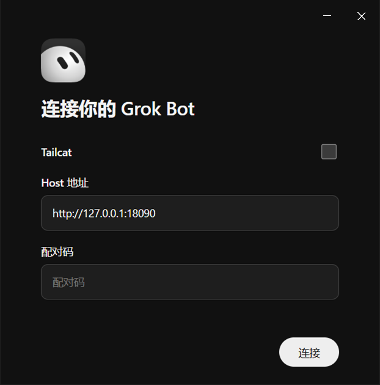

# ProkBot Plus Windows Patch

[简体中文](README.md)

Connect Grok Bot 1.3.0 for Windows x64 to your Host. Requires Windows 10/11 x64, Node.js 22.12+ and the full repository (the client code and patch tools in `mac/` are shared).

The complete deployment steps are in the [deployment guide](../docs/AI-INSTALL.en.md#client-packages), and how it works is in the [technical documentation](../docs/ARCHITECTURE.en.md#windows-client).

## Use

The recommended input is the unmodified [Windows x64 **1.3.0** installer](patchers/desktop/supported.json); if it does not work for you, [fall back to 1.2.3, 1.1.0 or 0.71.2](#falling-back-to-older-versions). Without `--source` the tool downloads 1.3.0 for you. Other versions and modified installers are rejected during input verification, before pairing. ProkBot Plus release numbers are unrelated to Grok Bot versions. The original installer is only an input: you don't run it, and your installed official app is not affected.

From the repository root:

```powershell
node windows/patchers/desktop/patch.mjs
```

The tool downloads and verifies the official `Grok_Bot_1.3.0_Setup.exe` and writes to `windows/output/`:

| Output | Purpose |
| --- | --- |
| `Grok Bot Local/` | Portable folder; run `Grok Bot.exe` inside it |
| `GrokBotLocal-1.3.0-x64-portable.zip` | Portable archive; extract and run |
| `GrokBotLocal-1.3.0-x64-Setup.exe` | Per-user installer into `%LOCALAPPDATA%\Programs\Grok Bot Local`, no administrator rights |

Open the client and enter your Host address and 6-character pairing code. Turn on the Tailcat switch on the connect screen only when pasting the connection link from Remote access in the Host console; leave it off for a LAN or HTTPS address. To use an existing original installer, `app-64.7z` or installed original folder, pass `--source`; the tool recognizes the version by its digest. `--no-installer` builds the portable outputs only.

<p align="center"></p>

<a id="falling-back-to-0712"></a>
### Falling back to older versions

If the 1.3.0 build does not work for you, quit it and first build the previous [1.2.3](patchers/desktop/1.2.3/supported.json); if that does not work either, build [1.1.0](patchers/desktop/1.1.0/supported.json) or [0.71.2](patchers/desktop/0.71.2/supported.json):

```powershell
node windows/patchers/desktop/patch.mjs --version 1.2.3 --output windows/output/1.2.3
```

The tool downloads and verifies the selected official installer, and the output filenames carry that version. A downloaded 1.2.3, 1.1.0 or 0.71.2 installer also works with `--source`. All versions share pairing and settings; do not run them at the same time.

The installer accepts `/S` (silent) and `/D=folder` (last). For a regular install, uninstall from Settings → Apps or run `Uninstall Grok Bot Local.exe` in its folder. The new uninstaller keeps pairing, settings and personal files.

Use an absolute path for a new or empty folder, or a ProkBot Plus installation with an ownership receipt. The uninstaller refuses official, portable and receipt-less clients.

### Upgrading a legacy install

Quit the old client from its tray menu. When the new setup recognizes an install without a receipt, choose the side-by-side option, or run this PowerShell command from the folder containing the **new** setup. For a custom install, replace `$old` with the old folder's absolute path:

```powershell
$old = Join-Path $env:LOCALAPPDATA 'Programs\Grok Bot Local'
.\GrokBotLocal-1.3.0-x64-Setup.exe --migrate-legacy "/D=$old"
```

The new files go to a sibling named `<old folder> (side-by-side)`. The setup does not copy or delete legacy files or replace its uninstall entry. Run `Grok Bot.exe` directly from the new folder. Both versions use `%APPDATA%\Grok Bot Local`; run only one at a time. To go back, quit the new client and open the old executable. To remove **only the new copy**, run the uninstaller in the **side-by-side** folder, not the old uninstaller or its Settings → Apps entry. Repeat the same setup command for later upgrades; add `/S` before `/D=` for silent use.

## Notes

- The original package is extracted with the `tar.exe` included in Windows 11; on Windows 10 install 7-Zip (or set `GROKBOT_7Z` to `7z.exe`).
- Before using the official installer as input, verify that its signature is valid and identifies the expected publisher. The patch updates the ASAR integrity value only in the output copy of `Grok Bot.exe` and removes the invalidated signature. That copy and the locally generated `GrokBotLocal-1.3.0-x64-Setup.exe` are unsigned. If SmartScreen warns, or if Smart App Control or your organization's policy blocks the file, stop. Do not bypass the warning or disable protection.
- Supported: conversations, message search, notifications (notification-area icon, Start menu shortcut), attachments, Bot libraries, Tailcat, local command execution and Codex delegation. The original graphical computer-use helper exists only for macOS, so the Windows client does not offer local mouse and keyboard control yet.
- Voice input and real-time voice calls are provided by the Host. Configure speech recognition and voice chat under Voice on the admin page. Without a recognition service, the Host refuses voice input transcription requests.
- The library dialog gains an Upload files button (the original only accepts dropped files). Features that need an official cloud account, such as linking Microsoft Teams, are unavailable.
- Local commands use the original executor. When the client is started normally it runs Windows PowerShell with the original UTF-8 output option turned on, so non-ASCII output is not garbled. Start the client from the Start menu or the desktop shortcut: when it is started from Git Bash, the original executor switches to Git Bash, which rewrites arguments such as `cmd /c`.
- Codex delegation uses the local `codex.exe` (including npm installs) with this computer's Codex sign-in and model.

## Maintenance

- `patchers/desktop/original.mjs`: carves `app-64.7z` out of the official installer and extracts it; the Android patcher uses it too.
- `tools/desktop-recipes/`: `build.mjs` regenerates the 1.3.0 recipes for Windows, macOS ARM64, macOS Intel, Linux x64 and Linux ARM64 (`--target windows|mac-arm64|mac-x64|linux-x64|linux-arm64`) from the official 1.3.0 originals and the anchored edits in `spec.mjs`. Each anchor must be unique in its original file. `extensions/` holds the project code appended to original modules. With `--check` it only verifies that the committed recipes are reproduced byte for byte.
- `patchers/desktop/1.2.3/`, `patchers/desktop/1.1.0/` and `patchers/desktop/0.71.2/`: the pinned inputs and recipes of the fallback releases. The 1.2.3 recipes were generated by `spec.mjs` at commit `41c836b`; 1.1.0 and 0.71.2 are also shared by the Android and web client interfaces. The patcher recognizes a `--source` by the size and SHA-256 in `supported.json`.
- `installer/`: installer source (Go standard library only), `go build -trimpath -ldflags="-H=windowsgui -s -w" -o ../dist/installer/grokbot-setup-stub.exe .`
- `dist/network/grokbot-tailcat.exe`: `python host/network/build-tailcat.py --target windows-amd64 --output windows/dist/network`
- Tests: `node --test "windows/tests/*.test.mjs"`; how the recipes and installer work is in the [technical documentation](../docs/ARCHITECTURE.en.md#windows-client).

## License and support

Noncommercial use only. See [LICENSE](../LICENSE). Most of this project's code was written with AI assistance.
