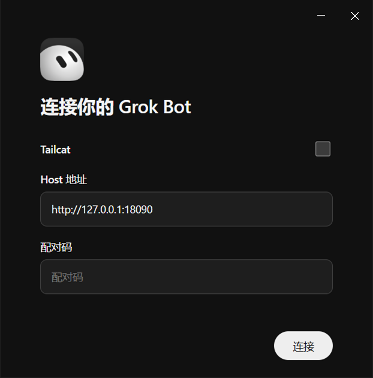

# ProkBot Plus Windows 补丁

[English](README.en.md)

为 Grok Bot 1.3.0 Windows x64 客户端连接自己的 Host。需要 Windows 10/11 x64、Node.js 22.12+，以及完整的仓库（共用 `mac/` 中的客户端代码和补丁工具）。

完整的部署步骤见[部署手册](../docs/AI-INSTALL.md#client-packages)，实现原理见[技术文档](../docs/ARCHITECTURE.md#windows-client)。

## 使用

推荐使用未经修改的 [Windows x64 **1.3.0** 原版](patchers/desktop/supported.json)，用不了再[回退到 1.2.3、1.1.0 或 0.71.2](#回退到旧版本)。省略 `--source` 时工具会自动下载 1.3.0。其他版本或改动过的安装包会在输入校验时被拒绝，不会进入配对。ProkBot Plus 的发布版本号与 Grok Bot 版本无关。原版安装包只作为输入，无需运行，也不影响已安装的官方客户端。

在仓库根目录执行：

```powershell
node windows/patchers/desktop/patch.mjs
```

工具自动下载并校验官方 `Grok_Bot_1.3.0_Setup.exe`，在 `windows/output/` 生成：

| 输出 | 用途 |
| --- | --- |
| `Grok Bot Local/` | 便携目录，直接运行其中的 `Grok Bot.exe` |
| `GrokBotLocal-1.3.0-x64-portable.zip` | 便携压缩包，解压后运行 |
| `GrokBotLocal-1.3.0-x64-Setup.exe` | 按用户安装到 `%LOCALAPPDATA%\Programs\Grok Bot Local`，无需管理员权限 |

打开客户端，填写 Host 地址和 6 位配对码。连接页的 Tailcat 开关只在粘贴 Host 管理页「远程访问」里的连接链接时打开，填局域网或 HTTPS 地址时保持关闭。已有原版安装包、`app-64.7z` 或已安装的原版目录时，用 `--source` 指定，工具按摘要识别版本；`--no-installer` 只生成便携版本。

<p align="center"></p>

<a id="回退到-0712"></a>
### 回退到旧版本

1.3.0 版用不了时，退出它，先生成上一版 [1.2.3](patchers/desktop/1.2.3/supported.json)，仍不行再生成 [1.1.0 版](patchers/desktop/1.1.0/supported.json) 或 [0.71.2 版](patchers/desktop/0.71.2/supported.json)：

```powershell
node windows/patchers/desktop/patch.mjs --version 1.2.3 --output windows/output/1.2.3
```

工具改为下载并校验对应版本的官方安装包，输出文件名中的版本号同步变化。已下载的 1.2.3、1.1.0 或 0.71.2 安装包也可以用 `--source` 指定。各版本共用配对和设置，不要同时运行。

安装包支持 `/S`（静默）和 `/D=目录`（放在最后）。常规安装可在「设置 → 应用」中卸载，也可运行安装目录中的 `Uninstall Grok Bot Local.exe`。新卸载器会保留配对、设置及个人文件。

自定义目录请使用绝对路径，选择新目录、空目录或带文件归属记录的 ProkBot Plus 安装目录。卸载器不会卸载官方客户端、便携版或没有归属记录的旧安装。

### 从旧安装升级

先从托盘菜单退出旧客户端。新安装包识别到没有归属记录的旧版时，可以在提示中选择并行安装，也可以在**新安装包**所在目录用 PowerShell 执行以下命令。若旧版装在自定义目录，把 `$old` 换成旧目录的绝对路径：

```powershell
$old = Join-Path $env:LOCALAPPDATA 'Programs\Grok Bot Local'
.\GrokBotLocal-1.3.0-x64-Setup.exe --migrate-legacy "/D=$old"
```

新版装在同级的 `<旧目录名> (side-by-side)` 目录。安装包不复制或删除旧文件，也不替换旧版卸载项。请直接打开新目录中的 `Grok Bot.exe`。两版共用 `%APPDATA%\Grok Bot Local` 中的配对和设置，不要同时运行。要切回旧版，退出新版再打开旧目录中的程序。要**只卸载新版**，请运行**并行安装目录**里的卸载器，不要使用旧卸载器或「设置 → 应用」中的旧版卸载项。后续升级可重复执行同一命令；静默安装时在 `/D=` 前加 `/S`。

## 说明

- 解压原版程序包使用 Windows 11 自带的 `tar.exe`；Windows 10 请安装 7-Zip（或设置 `GROKBOT_7Z` 指向 `7z.exe`）。
- 使用官方原版安装包前，请确认其签名有效且发布者与官方一致。补丁只在输出副本 `Grok Bot.exe` 中更新 ASAR 完整性值，并移除因此失效的签名；该副本和本地生成的 `GrokBotLocal-1.3.0-x64-Setup.exe` 均未签名。若 SmartScreen 发出警告，或智能应用控制、组织策略阻止运行，请停止，不要绕过提示或关闭防护。
- 支持对话、消息搜索、通知（托盘常驻、开始菜单快捷方式）、附件、Bot 资料库、Tailcat、本机命令执行与 Codex 委派。原版的图形界面电脑操作组件仅有 macOS 版本，Windows 客户端暂不提供本机鼠标键盘控制。
- 语音输入和实时语音通话由 Host 提供，需在管理页「语音」中配置识别服务和语音通话；未配置识别服务时，Host 会拒绝语音输入的转写请求。
- 资料库对话框增加了「上传文件」按钮（原版只能拖入文件）。依赖官方云端账户的功能，例如 Microsoft Teams 关联，不可用。
- 本机命令沿用原版执行程序，正常启动时使用 Windows PowerShell，并打开原版的 UTF-8 输出选项，中文输出不会乱码。请从开始菜单或桌面快捷方式启动客户端。在 Git Bash 里启动时，原版会改用 Git Bash，`cmd /c` 这类参数会被改写。
- Codex 委派使用本机 `codex.exe`（含 npm 安装的 Codex），使用本机的 Codex 登录和模型。

## 维护

- `patchers/desktop/original.mjs`：从官方安装包中切出 `app-64.7z` 并解压，Android 补丁也用它。
- `tools/desktop-recipes/`：`build.mjs` 按 `spec.mjs` 中的锚点修改，从官方 1.3.0 原包生成 Windows、macOS ARM64、macOS Intel、Linux x64 和 Linux ARM64（`--target windows|mac-arm64|mac-x64|linux-x64|linux-arm64`）五套 recipe；锚点必须在原文件中唯一。`extensions/` 是追加到原版模块里的本项目代码。加 `--check` 时只校验已提交的 recipe 能逐字节重现。
- `patchers/desktop/1.2.3/`、`patchers/desktop/1.1.0/` 与 `patchers/desktop/0.71.2/`：回退版本的固定输入和 recipe；1.2.3 的 recipe 由提交 `41c836b` 的 `spec.mjs` 生成，1.1.0 与 0.71.2 同时供 Android 与网页版使用。补丁按 `supported.json` 中的大小和 SHA-256 识别 `--source` 的版本。
- `installer/`：安装器源码（仅 Go 标准库），`go build -trimpath -ldflags="-H=windowsgui -s -w" -o ../dist/installer/grokbot-setup-stub.exe .`
- `dist/network/grokbot-tailcat.exe`：`python host/network/build-tailcat.py --target windows-amd64 --output windows/dist/network`
- 测试：`node --test "windows/tests/*.test.mjs"`；recipe 和安装器的原理见[技术文档](../docs/ARCHITECTURE.md#windows-client)。

## 许可与支持

仅限非商业使用，见 [LICENSE](../LICENSE)。本项目多数代码由 AI 辅助编写。
